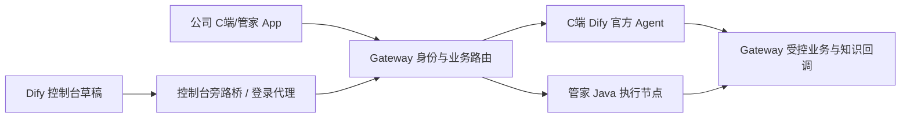

# AI-Ops

面向公司 C 端与管家端的只读业务助手：公司 App/H5 是用户入口，Gateway 负责身份、数据范围、发布绑定、异步作业与结果交付；C 端客服由 Dify 官方 Agent 执行，管家诊断由独立 Java 执行节点运行。业务全链路严格只读（禁止退款、补发、重算、修改订单或重启服务）。

> **状态约定**：源码已合并 ≠ 已部署 ≠ 业务已验收。任意组件的当前运行版本、启用范围与真实验收证据统一查 [当前交付索引](docs/agents/current-delivery-state.md)。

## 30 分钟新工程师必读路线

1. **系统架构与术语**：先读 [系统架构](docs/system-architecture.md) 与 [词汇表](GLOSSARY.md)（不要读已归档的旧架构稿 `docs/archive/architecture.md`）。重点区分 `environment` 四义（部署环境 / 执行环境 / 业务环境 / 接入候选）。
2. **交付现状与主机名册**：查 [当前交付索引](docs/agents/current-delivery-state.md) 与 [.dev-host.toml](.dev-host.toml)（`41` 网关、`36` Dify 与旁路、`95` 第二环境）；CD 仅覆盖 `deploy/deploy-41.sh`，其余组件手工交付见 [部署索引](deploy/README.md) 与 [手工部署台账](deploy/manual-deploys.md)。
3. **变更与验证规范**：读 [AGENTS.md](AGENTS.md)、[目录规范](docs/architecture/repository-layout.md#现行目录规则) 与 [验证分工](docs/agents/verification-workflow.md)。
4. **快速定位代码与配置**：环境接入全流程查 [流水线索引](docs/agents/environment-pipeline-map.md)，环境变量与进程归属查 [配置参考](docs/agents/config-reference.md)。

## 一、系统与入口



### 进程拓扑

| 进程 / 组件 | 入口或目录 | 职责 |
|---|---|---|
| Python Gateway | `aiops-gateway serve`（`src/aiops_diagnostics/gateway_server.py`） | 全部对外/内部 HTTP 路由、鉴权、发布绑定、作业调度与持久化 |
| 运维 CLI | `aiops-admin`（`src/aiops_diagnostics/admin_cli.py` + `admin/`） | 环境目录/草稿/计划/任务、Dify 同步、知识开户与数据库 schema 运维 |
| TDengine 只读代理 | `aiops-tdengine-proxy`（`src/aiops_diagnostics/tdengine_proxy.py`） | 仅监听回环的只读白名单 SQL 代理 |
| Java 执行节点 | `services/execution-node/` | 管家模型工具循环执行器，按执行清单回传证据 |
| 固定模型代理 | `services/model-proxy/` | 隔离栈固定模型出口 |
| Dify 控制台发布桥 | `services/dify-console-bridge/`（`python -m dify_console_bridge`） | 36 主机仅标准库独立旁路，处理 `__aiops/*` 同源浏览器回调 |
| Dify 公司登录代理 | `services/dify-login-proxy/`（`python -m dify_login_proxy`） | 36 主机独立旁路，基于公司身份签发 Dify 控制台会话并维护 `mappings.db` |

接口详情见 [功能测试接口文档](docs/testing-api-guide.md)；开发治理见 [AFK 工作流](docs/afk-workflow.md)。

## 二、安全与数据

- **严格只读与最小权限**：所有调用者范围经 `ScopeContext` 解析，不得由请求体字段放宽；模型仅接触受控只读接口，不持有数据库或登录凭据。
- **共享规则唯一权威**：订单可见性由 `identity/order_visibility.py` 与 `identity/query_scope.py` 共用，工具声明来自 [operator_tools.json](src/aiops_diagnostics/operator/operator_tools.json)（声明存在不等于所有环境已启用），计费金额判据见 [SOP](SOP.md#223-按订单历史计费模板检验金额产品测试补充)。
- **数据库版本治理**：Gateway SQLite 由 `gateway/gateway_schema.py` 统一管理（当前 schema v4，原 `standard_diagnoses` 已按 ADR-0340 原子迁移为 `async_jobs`）；历史数据库与证据目录在升级时保持完整不丢数据。

## 三、系统模块与依赖关系

`src/aiops_diagnostics/` 全包保持**严格无环分层**（`tests/test_readme_architecture.py` 同时覆盖绝对导入、相对导入、自导入与函数内延迟导入，强制全包零循环依赖，见 ADR-0339）。单文件可由源码树或 `node .sandcastle/repo-map.mjs --stdout` 按需枚举。

| 职责 | 源码入口 | 核心说明 |
|---|---|---|
| 网关装配、配置、存储与运行 | [gateway](src/aiops_diagnostics/gateway/) | `gateway_api.py` 装配 + `routers/` 分域路由 + 分组 `GatewayServerSettings` + `gateway_schema.py` / `gateway_store.py` |
| 环境接入、候选验证与正式发布 | [onboarding](src/aiops_diagnostics/onboarding/) | 目录登记、草稿计划、任务状态机、`*_ssh_runner.py`、候选试跑与发布协调（详见 [流水线索引](docs/agents/environment-pipeline-map.md)） |
| 运维命令行子命令分组 | [admin](src/aiops_diagnostics/admin/) | `aiops-admin` 按域拆分为 `onboarding`、`dify`、`knowledge`、`maintenance` 与共享 `common` |
| 身份、授权和数据范围 | [identity](src/aiops_diagnostics/identity/) | 公司主体解析、能力来源档、订单可见性与数据范围 |
| 客服编排与事实交付 | [consumer](src/aiops_diagnostics/consumer/) | C 端 v6 主路径（`presentation` / `billing` / `knowledge_access` / `agent_contract`）与 `legacy_callbacks.py` 历史 v1–5 隔离 |
| 节点合同、委派和运行账本 | [execution](src/aiops_diagnostics/execution/) | 路由绑定、节点委派、执行清单、数据授权与运行日志 |
| 管家编排与受控工具 | [operator](src/aiops_diagnostics/operator/) | `operator_cpms.py`（拆为 `cpms_task_store` / `cpms_proxy` / `cpms_evidence`）与 `ops_analysis_runner.py` |
| 发布、恢复与内容生命周期 | [publication](src/aiops_diagnostics/publication/) | Agent/快捷动作生命周期、`route_advancement.py` 指针推进与发布校验 |
| 知识与会话 | [knowledge](src/aiops_diagnostics/knowledge/)、[conversation](src/aiops_diagnostics/conversation/) | 知识检索、租户命名空间开户、签名媒体服务 `media_service.py`、多轮会话与 FAQ |
| 健康与只读取数 | [health](src/aiops_diagnostics/health/)、[data](src/aiops_diagnostics/data/) | 健康报告执行器 `health_job_runner.py` 与共享只读数据源 |
| 通用原语与 Dify 适配 | [common](src/aiops_diagnostics/common/)、[dify](src/aiops_diagnostics/dify/) | 标准库级 HTTP/鉴权/常量/配置原语与 Gateway 侧 Dify 协议/工作区/自助开通适配 |

## 四、仓库目录

新增或移动文件必须遵守 [现行目录规则](docs/architecture/repository-layout.md#现行目录规则)（由 `tests/test_repository_layout.py` 强制门禁）。

| 目录 | 用途 |
|---|---|
| `src/aiops_diagnostics/` | Python Gateway、共享能力、`onboarding/` 环境接入与 `admin/` 运维命令 |
| `services/` | 四个独立进程源码：`execution-node/`、`model-proxy/`、`dify-console-bridge/`、`dify-login-proxy/` |
| `integrations/cpms-java/` | 公司 Java 受控接口补丁（独立于执行节点） |
| `plugins/` | Dify 知识插件及其打包布局 |
| `deploy/`、`ops/` | 成套部署制品、主机脚本、Nginx 模板与旁路打包/部署脚本 |
| `tools/` | `content/` 内容工具、`verification/` 探针、`experiments/` 隔离实验、`inventory/` 索引 |
| `tests/` | 按职责分类的行为测试、结构/零环/退役/部署门禁 |
| `docs/` | 现役文档、`adr/` 架构决策、`agents/` 操作手册、`validation/` 与 `开发进度/` 按日回执、`archive/` 只读归档 |
| `.spec/`、`llmdoc/` | 行为规格树与 agent 文档索引 |
| `.github/`、`.sandcastle/` | CI/CD 与自动化交付治理 |

## 五、本地运行与验证

```bash
uv sync --locked --dev
uv run aiops-admin --help
uv run aiops-gateway serve --help
uv run ruff check .
uv run ruff format --check .
AIOPS_DATA_HOME="$(mktemp -d)" uv run pytest -rs
uv build
```

- Gateway 使用私有 `production.env` 与显式 `AIOPS_GATEWAY_ENVIRONMENT`（权威键表见 `.env.example`）；本地跑服务或测试必须使用一次性临时 `AIOPS_DATA_HOME`，**严禁触碰真实数据根**。
- Gateway 对外行为改动须用 [Gateway 验证技能](.claude/skills/verify-aiops-gateway/SKILL.md) 实启进程驱动验证；本地检查不替代远端 Dify/Java 联调、真实模型调用或业务准确率验收。

## 六、权威文档导航

- **总索引与上手**：[文档导航](docs/README.md)、[Gateway 运维](docs/gateway.md)、[快速上手](docs/快速上手.md)、[配置参考](docs/agents/config-reference.md)、[流水线索引](docs/agents/environment-pipeline-map.md)
- **业务端手册**：[C 端 WF01](docs/agents/consumer-wf01/README.md)、[管家 CPMS](docs/agents/operator-cpms/README.md)、[自助开通](docs/agents/operator-cpms/self-service.md)、[环境接入手册](docs/agents/environment-registry.md)
- **交付与运维**：[当前交付索引](docs/agents/current-delivery-state.md)、[Actions 交付手册](docs/agents/actions-delivery.md)、[部署索引](deploy/README.md)、[运维说明](ops/README.md)
- **决策、证据与归档**：[ADR 目录](docs/adr/)、[验收回执](docs/validation/)、[开发进度](docs/开发进度/)、[历史只读归档](docs/archive/README.md)
