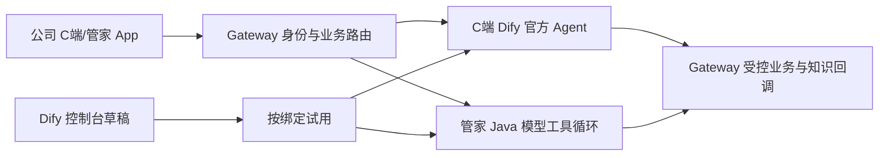

# AI-Ops

共享服务原HTTPS不可用时的受限备用接入与恢复见[操作手册](docs/agents/shared-dify-https-fallback.md)，实际可用性以验收回执为准。

面向公司 C端与管家端的只读业务助手。公司 App/H5 是用户入口，Gateway 负责身份、范围、
发布绑定、作业和交付；客服由 Dify 官方 Agent 执行，管家由 Java 节点执行；模型按SOP选择证据，系统负责授权与计算。

需求范围与依赖见[环境开通规划](docs/architecture/2026-11-16-manual-environment-onboarding.md)，
部分交付、启用与验收分别见[当前交付索引](docs/agents/current-delivery-state.md)。
现行方法见[文档导航](docs/README.md)，不从README中的旧版本推断运行状态。

## 一、系统与入口



架构见[系统架构](docs/system-architecture.md)，用户接口见[测试指南](docs/testing-api-guide.md)。
开发治理是独立的 `.sandcastle/` 与 GitHub 工作流，见 [AFK](docs/afk-workflow.md)。

## 二、安全与数据

业务只读；不执行退款、补发、重算、订单修改、消息重放或服务重启。业务范围来自已认证公司主体，
不能由请求体中的 tenant/user/site 字段放宽。模型只有受限的业务接口，不接收数据库和登录凭据。
订单通讯与充电事件的候选范围、源缺口及集成前置条件见[事件候选与通讯缺口](docs/agents/operator-cpms/communications.md)。
订单可见性由 `identity.order_visibility.py` 与 `identity.query_scope.py` 共用规则，数据读取保留超时、行数和时间窗上限。

历史数据库和证据目录不在退役时删除。新库不创建设备/注册码/run/event 表；
既有 `standard_diagnoses` 继续承载分析和 Dify/节点试用，改表名属于后续迁移。

## 三、系统模块与依赖关系

以下是迁移后的现有文件职责。导入检查覆盖子包、延迟导入与包级导入；既有节点装配四模块循环按具体边冻结，`test_readme_architecture.py`
核对职责入口与引用并拒绝新增循环；业务执行不得依赖已删除的 Python 运行器。

模块按职责查找，单个实现文件由源码树或 `node .sandcastle/repo-map.mjs --stdout` 按需枚举。
新增同职责模块无需重写README；新职责目录必须补入口与目录规则。

| 职责 | 源码入口 |
|---|---|
| 网关装配、配置、存储与运行 | [gateway](src/aiops_diagnostics/gateway/) |
| 身份、授权和数据范围 | [identity](src/aiops_diagnostics/identity/) |
| 客服编排与事实交付 | [consumer](src/aiops_diagnostics/consumer/) |
| 节点合同、委派和运行账本 | [execution](src/aiops_diagnostics/execution/) |
| 管家编排与受控工具 | [operator](src/aiops_diagnostics/operator/) |
| 发布、恢复与内容生命周期 | [publication](src/aiops_diagnostics/publication/) |
| 知识与会话 | [knowledge](src/aiops_diagnostics/knowledge/)、[conversation](src/aiops_diagnostics/conversation/) |
| 健康与只读取数 | [health](src/aiops_diagnostics/health/)、[data](src/aiops_diagnostics/data/) |
| 通用原语与Dify适配 | [common](src/aiops_diagnostics/common/)、[dify](src/aiops_diagnostics/dify/) |

金额判据见[SOP](SOP.md#223-按订单历史计费模板检验金额产品测试补充)；
工具列表来自[唯一声明](src/aiops_diagnostics/operator/operator_tools.json)，声明存在不等于所有环境已启用。

## 四、仓库目录

新增或移动文件遵循[现行目录规则](docs/architecture/repository-layout.md#现行目录规则)，CI对根层文件与一级目录进行检查。

| 目录 | 现在的用途 |
|---|---|
| `src/aiops_diagnostics/` | Python Gateway、共享能力与集成 |
| `src/aiops_diagnostics/consumer/`、`tests/consumer/` | C端工作流、知识与本人订单业务及对应测试 |
| `services/execution-node/` | 现役 Java 节点源码、资源与 Maven 构建入口 |
| `services/model-proxy/` | 现役固定目标模型代理 |
| `tools/verification/m2_live/` | 隔离栈探针与回环中继 |
| `src/aiops_diagnostics/knowledge/`、`tests/knowledge/` | 知识检索、开户、绑定、同步守卫与对应测试 |
| `src/aiops_diagnostics/identity/`、`tests/identity/` | 调用者身份、公司权限、能力来源档（`identity.capability`）、订单范围和共享安全规则 |
| `src/aiops_diagnostics/publication/`、`tests/publication/` | 发布内容、生命周期、快捷动作与校验 |
| `src/aiops_diagnostics/execution/`、`tests/execution/` | 路线、节点委派、执行清单与数据授权 |
| `src/aiops_diagnostics/dify/`、`tests/dify/` | Dify协议、工作空间、登录、发布和知识适配 |
| `src/aiops_diagnostics/{operator,health,data}/` | 管家分析、健康报告、共享只读数据 |
| `src/aiops_diagnostics/{common,conversation}/` | 通用原语、会话存储、澄清与固定FAQ资源 |
| `src/aiops_diagnostics/gateway/`、`tests/gateway/` | HTTP装配、网关配置、存储、调度与观测 |
| `tools/{content,verification,experiments,inventory}/` | 内容工具、业务验证、隔离实验与公司源码索引 |
| `integrations/cpms-java/` | 公司Java受控接口补丁，独立于执行节点 |
| `plugins/` | Dify 知识插件及其原生打包布局 |
| `deploy/`、`ops/` | 部署制品、环境声明、代理配置与操作手册 |
| `tests/` | 现役功能回归及退役检查 |
| `docs/` | 当前说明、ADR、操作手册和按日期留档的证据 |
| `.spec/` | 受维护行为与规格映射 |
| `.github/`、`.sandcastle/` | 开发交付治理 |

开通依赖从所选来源发布图与系统工具声明取得，每次重试核对实际状态；不再维护独立全局知识插件版本。
Dify自助开通：`dify.self_service`组织双端业务流程，`dify.self_service_api`提供固定管理端点，
`dify.self_service_bridge`校验同源会话，`dify.self_service_identity`读取公司管理权限，
`dify.self_service_config`解析平台连接，`dify.self_service_prepare`准备依赖与应用，
`dify.self_service_store`保存幂等任务与受管应用目录，`dify.dual_entry`定义端/场景与渠道口径，
`dify.service_keys`申请、对账并落盘每应用的 Service 凭据；`dify.knowledge_connection`管理各工作区的知识连接。

`dify.operator_run_logs`在原日志入口核对管家公司身份，`execution.operator_run_logs`只读既有运行账本。
受管管家日志显示本人当前权限内的 Java 运行：问题、订单号、终态原因码、执行节点、
版本核对、阶段耗时与逐事件拒绝码（ADR-0249 白名单）；业务结果过期与执行状态分开，
答案与证据 data 不投影。其他应用保留 Dify 原生日志。
入口、字段及验证方法见[运行日志说明](docs/agents/operator-cpms/run-logs.md)。

## 五、本地运行与验证

部署专用runner与过期任务回收见[队列治理](docs/agents/runner-queue.md)。
提交后的必需检查、自动同步、部署与发布排障统一见[Actions 交付手册](docs/agents/actions-delivery.md)。

开发与交付按[验证分工](docs/agents/verification-workflow.md)执行：实现者聚焦功能，
独立 Hacker 提供反例和用户入口证据；新增长期检查须有具体错误及独立判据。以下是交付检查，
迭代时只运行与当前改动和疑点相关的部分，完整结果不代替业务验收。
独立审查在容器私有 Git 副本运行，安装和隔离复验见[执行手册](docs/agents/reviewer-execution.md)。

```bash
uv sync --locked --dev
uv run aiops-admin --help
uv run aiops-gateway serve --help
uv run ruff check .
uv run ruff format --check .
uv run pytest -rs
uv build
```

Gateway 使用私有 `production.env` 和明确的 `AIOPS_GATEWAY_ENVIRONMENT`，配置键见 `.env.example`。
临时服务验证用[Gateway 技能](.claude/skills/verify-aiops-gateway/SKILL.md)，不对真实数据根运行测试。
镜像及随制品交付的构建记录用[本地构建手册](docs/agents/local-gateway-build.md)；
普通源码PR不改共享镜像输入锁，部署继续走既有合并制品流程。

站点工具的地点词在取证前以数组传递；本次协议升级须配套更新节点jar、工具声明和Gateway，
操作及原入口验收见[站点查询QA](docs/agents/operator-cpms/site-query-real-path-qa.md)。

## 六、操作与验收导航

- [文档导航](docs/README.md)、[Gateway](docs/gateway.md)、[快速上手](docs/快速上手.md)。
- [C端 WF01](docs/agents/consumer-wf01/README.md)、[管家 CPMS](docs/agents/operator-cpms/README.md)。
- [自由提问故障定位](docs/agents/consumer-wf01/free-question-failures.md)：区分固定FAQ、模型依赖失败和业务回答；额度故障需恢复服务，不要求用户改写问题。
- [Dify客户管家自助开通](docs/agents/operator-cpms/self-service.md)：平台开通默认绑定Dify/RAGFlow空间，按授权进入客户空间；租户预览与发布。
- [节点部署](deploy/node-runtime/README.md)、[Dify 部署](deploy/dify-36/README.md)、[运维说明](ops/README.md)。
- [验收记录](docs/validation/)、[历史进度](docs/开发进度/)、[ADR](docs/adr/)、[术语](GLOSSARY.md)。

历史 SOP 和早期架构图仅作资料，不再随 Python 运行时制品打包或作为模型工作区输入。
本地检查不证明远端 Dify/Java、真实故障准确率或正式页面交付。

管家原 H5 的制品构建、窄代理安装与恢复见[部署手册](docs/agents/operator-h5-deployment.md)。
**管家 H5 首页自 2026-11-03 起不再提供助手入口**：首页导航栏的「智能检测」按钮已撤回，
助手页仍注册在 `/aiPackage/pages/chat/chat`，只能由调用方按该路径导航进入；
线上制品为该日从干净合并修订构建的版本，详见[撤回回执](docs/validation/2026-11-03-operator-h5-entry-withdrawal.md)。

执行器兼容性由 `execution.node_capabilities` 记录实际节点协议心跳；
管家开通/发布/恢复前核对清单schema和工具声明摘要，过旧执行器不会被启用。
双端客户服务的开通、客户端工作流发布/预览和知识使用范围操作见
[业务管理手册](docs/agents/operator-cpms/self-service.md)；
当前实施与未验项见[双端进度](docs/acceptance/dual-entry/PROGRESS.md)。

站点清单通过权限与证据检查后独立交付；说明审核拒绝或不可用时隐藏说明，运营试用显示提示。审核复用网关配置的模型，无工具、无自动重试；历史回读不重审，权限撤回仍拒绝。见 [ADR-0195](docs/adr/0195-site-evidence-survives-note-refusal.md)。

管家统一循环改造使用业务SOP、会话及受控工具；模型理解意图与选择证据，系统独立授权和计算。
原H5、原Dify与第二租户已取得限定范围的验收证据；完整步骤见[验收计划](docs/acceptance/operator-agent-loop-qa-plan.md)，
线上状态以[交付索引](docs/agents/current-delivery-state.md)为准，不能由源码推断已迁移。

一键开通生成的应用凭据属于持久运行数据；目录迁移与沙箱内可写性验收见[开通手册](docs/agents/operator-cpms/self-service.md#运行凭据目录只读的恢复)。

客服编辑与发布故障的字段核对、原页面恢复见[知识选择与发布手册](docs/agents/consumer-wf01/knowledge-picker-deploy.md#参数面板打开后发布失败)。

设备离线分析以同一受控读面服务offline卡与管家Agent；新增业务时区配置和发布步骤见[离线手册](docs/agents/operator-cpms/device-offline.md)。

控制台发布与管理共用活动公司登录绑定，原生退出同步撤销；登录代理重启后需重新登录，见[登录代理手册](docs/agents/dify-login-proxy-36-runbook.md)。

业务环境与租户登记由 `gateway.environment_registry` 管理，草稿由 `gateway.environment_drafts` 持久化，运维入口为 `aiops-admin environment-registry`；配置 `AIOPS_GATEWAY_ENVIRONMENT_REGISTRY_FILE` 后按当前环境检查租户准入。登记与启停方法见[环境接入手册](docs/agents/environment-registry.md)。

共享知识服务的环境/租户命名空间由 `knowledge.tenant_scope` 统一计算；已启用环境登记的实例不与旧单环境租户头共用知识账号。

环境目录的获批行为、后续开通规划与运行证据分别从[试点导航](docs/README.md#环境目录试点与验收)读取。
目录页面保存草稿不改变现役连接；实际配置、启用与业务验收见对应领域的交付证据。
