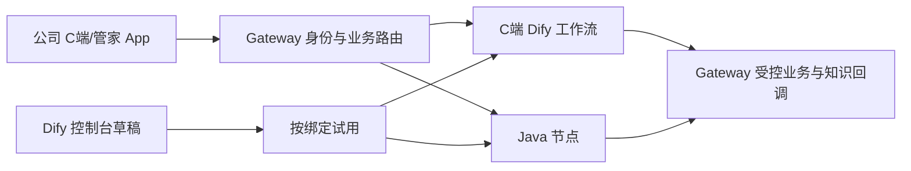

# AI-Ops

面向公司 C端与管家端的只读业务助手。公司 App/H5 是用户入口，Gateway 负责身份、范围、
发布绑定、作业和交付；C端工作流与 Java 节点各自负责已登记业务场景。

## 当前交付与退役范围

已完成 Python Thin Harness 的代码退役：删除诊断/交互式/设备 CLI、Codex 子进程、
工具循环、恢复工作区、旧诊断 HTTP 面和专属便携打包。运维入口保留为 `aiops-admin`。
退役版本`1.0.0+fbab0f739322`已部署，C端/管家原H5及Dify原生预览链路已验收；
详见[真实验收回执](docs/validation/2026-10-29-runtime-retirement-live.md)。历史故障准确率和长期稳定性仍未验收。

- C端聊天及订单检测快捷动作进入其 WF01 路线；订单检测使用本人订单状态分支，
  不再承诺旧 Python 的多源根因报告。独立状态查询和已有节点绑定保留。
- 管家单订单请求与原生 Dify 试用走公司身份和 Java 节点的两项 CPMS 工具。
- Dify 试用只接受已登记 `app_id`，按绑定运行 Dify/Java 草稿；不接受裸 prompt/旧工具白名单。
- 未配置业务路线时返回 `CHAT_ROUTE_UNAVAILABLE`，不回落 Python、通用问答或旧 FAQ 匹配。
- 固定 FAQ API、健康报告、确定性聚合、知识库与发布管理继续保留。

详细边界见[退役说明](docs/runtime-retirement.md)，阶段与线上最后证据见
[交付状态](docs/agents/current-delivery-state.md)和[测试交接](docs/testing-handoff.md)。
目录迁移已完成Java节点、模型代理、C端与知识Python包四片；两组Python新包均已部署并通过原H5回归。
最新见[知识迁移回执](docs/validation/2026-10-29-z04b-knowledge-layout-live.md)。
模型代理生产容器仍使用旧发布包，后续升级必须成对交付Compose和镜像；详见[迁移回执](docs/validation/2026-10-29-z03-directory-migration-live.md)。

## 一、系统与入口



架构见[系统架构](docs/system-architecture.md)，用户接口见[测试指南](docs/testing-api-guide.md)。
开发治理是独立的 `.sandcastle/` 与 GitHub 工作流，见 [AFK](docs/afk-workflow.md)。

## 二、安全与数据

业务只读；不执行退款、补发、重算、订单修改、消息重放或服务重启。业务范围来自已认证公司主体，
不能由请求体中的 tenant/user/site 字段放宽。模型只有受限的业务接口，不接收数据库和登录凭据。
订单可见性由 `identity.order_visibility.py` 与 `identity.query_scope.py` 共用规则，数据读取保留超时、行数和时间窗上限。

历史数据库和证据目录不在退役时删除。新库不创建设备/注册码/run/event 表；
既有 `standard_diagnoses` 继续承载分析和 Dify/节点试用，改表名属于后续迁移。

## 三、系统模块与依赖关系

以下是现有文件职责，不是已完成目录迁移的声明。导入检查覆盖子包、延迟导入与包级导入；既有节点装配四模块循环按具体边冻结，`test_readme_architecture.py`
核对模块索引与引用并拒绝新增循环；业务执行不得依赖已删除的 Python 运行器。

| 职责 | 当前模块 |
|---|---|
| 网关与服务 | `gateway_api.py`、`gateway_runtime.py`、`gateway_server.py`、`gateway_store.py`、`gateway_config.py`、`gateway_logging.py`、`public_openapi.py`、`request_observation.py`、`isolation_guard.py`、`deployment_environment.py` |
| 身份与范围 | `identity.caller_auth.py`、`identity.company_token_auth.py`、`identity.company_permissions.py`、`identity.third_session_auth.py`、`identity.scope_context.py`、`identity.query_scope.py`、`identity.order_visibility.py`、`http_auth.py` |
| C端业务 | `consumer.consumer_billing.py`、`consumer.consumer_chat_service.py`、`consumer.consumer_documents.py`、`consumer.consumer_flow_contract.py`、`consumer.consumer_intent.py`、`consumer.consumer_knowledge.py`、`consumer.consumer_knowledge_selection.py`、`consumer.consumer_language.py`、`consumer.consumer_order_chat.py`、`consumer.consumer_photo.py`、`consumer.consumer_publication.py`、`consumer.consumer_trial.py`、`charging_status.py` |
| 节点与试用 | `agent_runs.py`、`execution_manifest.py`、`chat_execution.py`、`chat_data_grant.py`、`chat_route_bindings.py`、`node_publication.py`、`operator_cpms.py`、`dify_trial.py`、`dify_workflow_trial.py` |
| 管理与发布 | `admin_cli.py`、`agent_content.py`、`agent_lifecycle.py`、`agent_manifest.py`、`agent_debug.py`、`shortcut_lifecycle.py`、`shortcut_migration.py`、`ops_provider.py` |
| 知识与会话 | `conversation_store.py`、`faq.py`、`qa_rag.py`、`clarification.py`、`knowledge.knowledge_retrieval.py`、`knowledge.knowledge_sources.py`、`knowledge.knowledge_triple.py`、`knowledge.knowledge_dataset_sync_guard.py`、`knowledge.kb_onboarding.py`、`knowledge.ragflow_console.py` |
| 健康与分析 | `health_curves.py`、`health_metrics.py`、`health_report.py`、`health_report_copy.py`、`ops_analysis.py`、`ops_analysis_narrative.py`、`order_status.py`、`rules.py`、`sources.py`、`tdengine_proxy.py` |
| 通用能力 | `config.py`、`model_request.py`、`bounded_http.py`、`private_files.py`、`redaction.py`、`i18n.py`、`answer_language.py`、`platform_paths.py`、`console_encoding.py`、`async_job_lifecycle.py`、`metrics_store.py` |
| Dify集成 | `dify_app_registry.py`、`dify_chat_workflow.py`、`dify_chatflow.py`、`dify_console_admin.py`、`dify_console_publish.py`、`dify_debug_identity.py`、`dify_dsl_pull.py`、`dify_ensure_workspace.py`、`dify_inner_api.py`、`dify_knowledge_api.py`、`dify_knowledge_datasets.py`、`dify_knowledge_migration.py`、`dify_login_company.py`、`dify_login_provision.py`、`dify_login_proxy.py`、`dify_login_server.py`、`dify_login_service.py`、`dify_run_store.py`、`dify_tenant_access.py`、`dify_tools_catalog.py`、`dify_workspace_directory.py`、`dify_workspace_ready.py`、`dify_workspaces.py` |

`agent_debug.py` 仅保留发布前的知识绑定校验；`qa_rag.py` 仅保留已发布客服元数据选择。
`model_request.py` 是一次性有界 HTTP 请求，供 C端语义分类和聚合说明使用，不含会话/工具循环。
`ops_provider.py` 只登记现役 `cpms-node`，旧 Python/共享租户 provider 已退出。

## 四、仓库目录

| 目录 | 现在的用途 |
|---|---|
| `src/aiops_diagnostics/` | Python Gateway、共享能力与集成 |
| `src/aiops_diagnostics/consumer/`、`tests/consumer/` | C端工作流、知识与本人订单业务及对应测试 |
| `services/execution-node/` | 现役 Java 节点源码、资源与 Maven 构建入口 |
| `services/model-proxy/` | 现役固定目标模型代理 |
| `tools/m2_live/` | 隔离栈探针与回环中继 |
| `src/aiops_diagnostics/knowledge/`、`tests/knowledge/` | 知识检索、开户、绑定、同步守卫与对应测试 |
| `src/aiops_diagnostics/identity/`、`tests/identity/` | 调用者身份、公司权限、订单范围和共享安全规则 |
| `tools/` | 内容生成、迁移和隔离验证 |
| `plugins/` | Dify 知识插件及其原生打包布局 |
| `deploy/`、`ops/` | 部署制品、环境声明、代理配置与操作手册 |
| `java/` | 公司侧 Java 集成补丁，不是执行节点源码 |
| `tests/` | 现役功能回归及退役检查 |
| `docs/` | 当前说明、ADR、操作手册和按日期留档的证据 |
| `.spec/` | 受维护行为与规格映射 |
| `.github/`、`.sandcastle/` | 开发交付治理 |

## 五、本地运行与验证

```bash
uv sync --locked --dev
uv run aiops-admin --help
uv run aiops-gateway serve --help
uv run ruff check .
uv run ruff format --check .
uv run pytest -rs
uv build
```

Gateway 使用私有 `production.env` 和明确的 `AIOPS_GATEWAY_ENVIRONMENT`，配置键见 `.env.example`。
临时服务验证用[Gateway 技能](.claude/skills/verify-aiops-gateway/SKILL.md)，不对真实数据根运行测试。
镜像与内容锁用[本地构建手册](docs/agents/local-gateway-build.md)，部署用既有合并制品流程。

## 六、操作与验收导航

- [文档导航](docs/README.md)、[Gateway](docs/gateway.md)、[快速上手](docs/快速上手.md)。
- [C端 WF01](docs/agents/consumer-wf01/README.md)、[管家 CPMS](docs/agents/operator-cpms/README.md)。
- [节点部署](deploy/node-runtime/README.md)、[Dify 部署](deploy/dify-36/README.md)、[运维说明](ops/README.md)。
- [验收记录](docs/validation/)、[进度记录](docs/开发进度/)、[ADR](docs/adr/)、[术语](GLOSSARY.md)。

历史 SOP 和早期架构图仅作资料，不再随 Python 运行时制品打包或作为模型工作区输入。
本地检查不证明远端 Dify/Java、真实故障准确率或正式页面交付。

管家原 H5 的制品构建、窄代理安装与恢复见[部署手册](docs/agents/operator-h5-deployment.md)。
