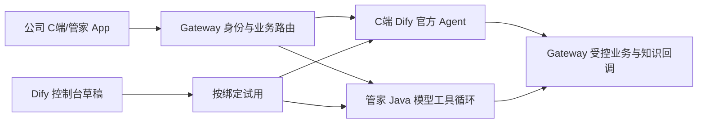

# AI-Ops

面向公司 C端与管家端的只读业务助手。公司 App/H5 是用户入口，Gateway 负责身份、范围、
发布绑定、作业和交付；客服由 Dify 官方 Agent 执行，管家由 Java 节点执行；模型按SOP选择证据，系统负责授权与计算。

## 当前交付与退役范围

2026-11-05阶段整理：[系统架构](docs/system-architecture.md)、[当前交付](docs/agents/current-delivery-state.md)、
[架构核对](docs/validation/2026-11-05-architecture-stage-closeout.md)、[任务台账](docs/reviews/2026-11-05-architecture-stage-closeout.md)。
客服生产版1.2.5的原Dify/安卓复验已完成；H5连续问答与发布恢复另有同轮证据，旧APK连续会话仍待发包。

已完成 Python Thin Harness 的代码退役：删除诊断/交互式/设备 CLI、Codex 子进程、
工具循环、恢复工作区、旧诊断 HTTP 面和专属便携打包。运维入口保留为 `aiops-admin`。
退役版本`1.0.0+fbab0f739322`已部署，C端/管家原H5及Dify原生预览链路已验收；
详见[真实验收回执](docs/validation/2026-10-29-runtime-retirement-live.md)。历史故障准确率和长期稳定性仍未验收。

- C端聊天及订单检测快捷动作进入其 WF01 路线；订单检测使用本人订单状态分支，
  不再承诺旧 Python 的多源根因报告。独立状态查询和已有节点绑定保留。
- 管家单订单请求与原生 Dify 试用走公司身份和 Java 节点；工具按已发布清单启用，覆盖订单、监测、历史模板、账务、核验与站点。
- 管家正式入口与Dify预览使用各自的会话ID，订单相关追问沿用成功确认的订单并重新授权；
  新会话、另一应用或另一主体不能继承，见[连续问答验收](docs/acceptance/operator-followup/qa-plan.md)。
- 管家没有指定订单时可咨询操作、解释状态或搜索当前账号可见站点；需要查具体订单时才请求单号。
  站点名称/地址来自CPMS，未定位时不按距离排序；见[无订单对话](docs/agents/operator-cpms/conversation-qa.md)。
  无订单能力已上线并经ulink真实页面核验；[最新回执](docs/validation/2026-10-29-z14-operator-conversation-verified.md)
  后续统一模型循环已删除最终JSON协议；事实复核与边界见当前交付索引，长期稳定性仍未验收。
- 节点站点工具通过 Gateway 代理取数，代理保留租户身份与分页字段，模型证据只留声明字段。
  管家与消费者按各自权限校验；节点、Gateway 和回调配置需配套交付，见[站点代理验证](docs/acceptance/site-tool-proxy/qa-plan.md)。
- Dify 试用只接受已登记 `app_id`，按绑定运行 Dify/Java 草稿；不接受裸 prompt/旧工具白名单。
- 未配置业务路线时返回 `CHAT_ROUTE_UNAVAILABLE`，不回落 Python、通用问答或旧 FAQ 匹配。
- 固定 FAQ API、健康报告、确定性聚合、知识库与发布管理继续保留。

详细边界见[退役说明](docs/runtime-retirement.md)，阶段与线上最后证据见
[交付状态](docs/agents/current-delivery-state.md)和[测试交接](docs/testing-handoff.md)。
目录迁移已完成Java节点、模型代理源码及consumer、knowledge、identity、publication、execution、dify、operator、health、data业务包。
#1153退役残留和#1159领域迁移已合并，#1161补齐供应商单层围栏JSON解析；双端历史回归见
[领域上线](docs/validation/2026-10-29-z15-domain-layout-live.md)与[围栏修复回归](docs/validation/2026-10-29-z16-operator-fenced-answer-live.md)。
独立Dify桥与登录代理已随#1147更新包和模块入口；模型代理生产仍为旧发布包中的等字节实现。
2026-10-30独立验收发现后续#1168两端未配套，补齐Java节点后原管家H5已独立复验通过；保留首次失败证据。
Gateway、通用/会话、工具与公司集成目录已分别通过#1181/#1182/#1184归位并上线；
最终范围与独立复验见[目录收尾](docs/validation/2026-10-30-z20-layout-final-acceptance.md)。

## 一、系统与入口



架构见[系统架构](docs/system-architecture.md)，用户接口见[测试指南](docs/testing-api-guide.md)。
开发治理是独立的 `.sandcastle/` 与 GitHub 工作流，见 [AFK](docs/afk-workflow.md)。

## 二、安全与数据

业务只读；不执行退款、补发、重算、订单修改、消息重放或服务重启。业务范围来自已认证公司主体，
不能由请求体中的 tenant/user/site 字段放宽。模型只有受限的业务接口，不接收数据库和登录凭据。
订单可见性由 `identity.order_visibility.py` 与 `identity.query_scope.py` 共用规则，数据读取保留超时、行数和时间窗上限。

历史数据库和证据目录不在退役时删除。新库不创建设备/注册码/run/event 表；
既有 `standard_diagnoses` 继续承载分析和 Dify/节点试用，改表名属于后续迁移。

## 三、系统模块与依赖关系

以下是迁移后的现有文件职责。导入检查覆盖子包、延迟导入与包级导入；既有节点装配四模块循环按具体边冻结，`test_readme_architecture.py`
核对模块索引与引用并拒绝新增循环；业务执行不得依赖已删除的 Python 运行器。

| 职责 | 当前模块 |
|---|---|
| 网关与服务 | `gateway.gateway_api.py`、`gateway.gateway_runtime.py`、`gateway_server.py`、`gateway.gateway_store.py`、`gateway.gateway_db.py`、`gateway.gateway_config.py`、`gateway.gateway_logging.py`、`gateway.public_openapi.py`、`gateway.request_observation.py`、`gateway.isolation_guard.py`、`gateway.deployment_environment.py` |
| 身份与范围 | `identity.caller_auth.py`、`identity.company_token_auth.py`、`identity.company_permissions.py`、`identity.data_scope_rule.py`、`identity.third_session_auth.py`、`identity.scope_context.py`、`identity.query_scope.py`、`identity.order_visibility.py`、`identity.order_identity.py`、`common.http_auth.py` |
| C端业务 | `consumer.consumer_agent.py`、`consumer.consumer_agent_flow.py`、`consumer.consumer_billing.py`、`consumer.consumer_facts.py`、`consumer.consumer_binding.py`、`consumer.consumer_chat_service.py`、`consumer.consumer_copy.py`、`consumer.consumer_documents.py`、`consumer.consumer_flow_contract.py`、`consumer.consumer_intent.py`、`consumer.consumer_knowledge.py`、`consumer.consumer_knowledge_selection.py`、`consumer.consumer_knowledge_grants.py`、`consumer.consumer_language.py`、`consumer.consumer_order_chat.py`、`consumer.consumer_photo.py`、`consumer.consumer_plain.py`、`consumer.consumer_reply.py`、`consumer.consumer_publication.py`、`consumer.consumer_sites.py`、`consumer.consumer_tool_grants.py`、`consumer.consumer_time.py`、`consumer.consumer_trial.py`、`consumer.business_environments.py`、`data.charging_status.py` |
| 节点与试用 | `execution.agent_runs.py`、`execution.run_deliverability.py`、`execution.execution_manifest.py`、`execution.chat_execution.py`、`execution.chat_data_grant.py`、`execution.chat_route_bindings.py`、`execution.node_publication.py`、`operator.operator_cpms.py`、`operator.order_analysis.py`、`operator.order_pricing.py`、`operator.order_billing.py`、`operator.station_pricing.py`、`operator.station_tariff.py`、`operator.operator_tools.py`、`operator.operator_conversation.py`、`operator.operator_answer_review.py`、`dify.dify_trial.py`、`dify.dify_workflow_trial.py` |
| 管理与发布 | `admin_cli.py`、`publication.agent_content.py`、`publication.agent_lifecycle.py`、`publication.agent_serviceability.py`、`publication.agent_manifest.py`、`publication.agent_debug.py`、`publication.shortcut_lifecycle.py`、`publication.shortcut_migration.py`、`operator.ops_provider.py`、`operator.operator_agent.py` |
| 知识与会话 | `conversation.conversation_store.py`、`conversation.faq.py`、`publication.qa_rag.py`、`conversation.clarification.py`、`knowledge.knowledge_retrieval.py`、`knowledge.knowledge_sources.py`、`knowledge.knowledge_triple.py`、`knowledge.knowledge_dataset_sync_guard.py`、`knowledge.kb_onboarding.py`、`knowledge.ragflow_console.py` |
| 健康与分析 | `health.health_curves.py`、`health.health_metrics.py`、`health.health_report.py`、`health.health_report_copy.py`、`operator.ops_analysis.py`、`operator.ops_analysis_narrative.py`、`data.offline_source.py`、`operator.device_offline.py`、`operator.offline_tool.py`、`data.order_status.py`、`health.rules.py`、`data.sources.py`、`tdengine_proxy.py` |
| 通用能力 | `common.config.py`、`common.model_request.py`、`common.bounded_http.py`、`common.private_files.py`、`common.redaction.py`、`common.endpoint_policy.py`、`common.i18n.py`、`common.answer_language.py`、`common.platform_paths.py`、`common.console_encoding.py`、`common.async_job_lifecycle.py`、`common.order_reference.py`、`common.scalar_rules.py`、`gateway.metrics_store.py` |
| Dify集成 | `dify.dify_app_registry.py`、`dify.dify_chat_workflow.py`、`dify.dify_chatflow.py`、`dify.dify_console_admin.py`、`dify.dify_console_publish.py`、`dify.dify_debug_identity.py`、`dify.dify_dsl_pull.py`、`dify.dify_ensure_workspace.py`、`dify.dify_inner_api.py`、`dify.dify_knowledge_api.py`、`dify.dify_knowledge_datasets.py`、`dify.dify_knowledge_migration.py`、`dify.dify_login_company.py`、`dify.dify_login_provision.py`、`dify.dify_login_proxy.py`、`dify.dify_login_server.py`、`dify.dify_login_service.py`、`dify.dify_run_store.py`、`dify.dify_tenant_access.py`、`dify.dify_tools_catalog.py`、`dify.dify_workspace_directory.py`、`dify.dify_workspace_ready.py`、`dify.dify_workspaces.py` |

`publication.agent_debug.py` 仅保留发布前的知识绑定校验；`publication.qa_rag.py` 仅保留已发布客服元数据选择。
`common.model_request.py` 是一次性有界 HTTP 请求，供旧客服合同语义分类、聚合说明和事实审核使用，不含会话/工具循环。
`operator.order_billing.py` 根据历史模板和订单优惠记录逐项核对折扣、充电费用、税费及实付款；
依照[SOP金额验证流程](SOP.md#223-按订单历史计费模板检验金额产品测试补充)，区分算术相符与证据不足。
`operator.ops_provider.py`、`operator.operator_agent.py` 只登记现役 `cpms-node`，旧 Python/共享租户 provider 已退出。

## 四、仓库目录

新增或移动文件遵循[现行目录规则](docs/architecture/repository-layout.md#现行目录规则)，CI对根层文件与一级目录进行检查。

| 目录 | 现在的用途 |
|---|---|
| `src/aiops_diagnostics/` | Python Gateway、共享能力与集成 |
| `src/aiops_diagnostics/consumer/`、`tests/consumer/` | C端工作流、知识与本人订单业务及对应测试 |
| `services/execution-node/` | 现役 Java 节点源码、资源与 Maven 构建入口 |
| `services/model-proxy/` | 现役固定目标模型代理 |
| `tools/verification/m2_live/` | 隔离栈探针与回环中继 |
| `src/aiops_diagnostics/knowledge/`、`tests/knowledge/` | 知识检索、开户、绑定、同步守卫与对应测试 |
| `src/aiops_diagnostics/identity/`、`tests/identity/` | 调用者身份、公司权限、能力来源档（`identity.capability`）、订单范围和共享安全规则 |
| `src/aiops_diagnostics/publication/`、`tests/publication/` | 发布内容、生命周期、快捷动作与校验 |
| `src/aiops_diagnostics/execution/`、`tests/execution/` | 路线、节点委派、执行清单与数据授权 |
| `src/aiops_diagnostics/dify/`、`tests/dify/` | Dify协议、工作空间、登录、发布和知识适配 |
| `src/aiops_diagnostics/{operator,health,data}/` | 管家分析、健康报告、共享只读数据 |
| `src/aiops_diagnostics/{common,conversation}/` | 通用原语、会话存储、澄清与固定FAQ资源 |
| `src/aiops_diagnostics/gateway/`、`tests/gateway/` | HTTP装配、网关配置、存储、调度与观测 |
| `tools/{content,verification,experiments,inventory}/` | 内容工具、业务验证、隔离实验与公司源码索引 |
| `integrations/cpms-java/` | 公司Java受控接口补丁，独立于执行节点 |
| `plugins/` | Dify 知识插件及其原生打包布局 |
| `deploy/`、`ops/` | 部署制品、环境声明、代理配置与操作手册 |
| `tests/` | 现役功能回归及退役检查 |
| `docs/` | 当前说明、ADR、操作手册和按日期留档的证据 |
| `.spec/` | 受维护行为与规格映射 |
| `.github/`、`.sandcastle/` | 开发交付治理 |

开通依赖从所选来源发布图与系统工具声明取得，每次重试核对实际状态；不再维护独立全局知识插件版本。
Dify自助开通：`dify.self_service`组织双端业务流程，`dify.self_service_api`提供固定管理端点，
`dify.self_service_bridge`校验同源会话，`dify.self_service_identity`读取公司管理权限，
`dify.self_service_config`解析平台连接，`dify.self_service_prepare`准备依赖与应用，
`dify.self_service_store`保存幂等任务与受管应用目录，`dify.dual_entry`定义端/场景与渠道口径，
`dify.service_keys`申请、对账并落盘每应用的 Service 凭据；`dify.knowledge_connection`管理各工作区的知识连接。

## 五、本地运行与验证

部署专用runner与过期任务回收见[队列治理](docs/agents/runner-queue.md)。
提交后的必需检查、自动同步、部署与发布排障统一见[Actions 交付手册](docs/agents/actions-delivery.md)。

开发与交付按[验证分工](docs/agents/verification-workflow.md)执行：实现者聚焦功能，
独立 Hacker 提供反例和用户入口证据；新增长期检查须有具体错误及独立判据。以下是交付检查，
迭代时只运行与当前改动和疑点相关的部分，完整结果不代替业务验收。
独立审查在容器私有 Git 副本运行，安装和隔离复验见[执行手册](docs/agents/reviewer-execution.md)。

```bash
uv sync --locked --dev
uv run aiops-admin --help
uv run aiops-gateway serve --help
uv run ruff check .
uv run ruff format --check .
uv run pytest -rs
uv build
```

Gateway 使用私有 `production.env` 和明确的 `AIOPS_GATEWAY_ENVIRONMENT`，配置键见 `.env.example`。
临时服务验证用[Gateway 技能](.claude/skills/verify-aiops-gateway/SKILL.md)，不对真实数据根运行测试。
镜像及随制品交付的构建记录用[本地构建手册](docs/agents/local-gateway-build.md)；
普通源码PR不改共享镜像输入锁，部署继续走既有合并制品流程。

站点工具的地点词在取证前以数组传递；本次协议升级须配套更新节点jar、工具声明和Gateway，
操作及原入口验收见[站点查询QA](docs/agents/operator-cpms/site-query-real-path-qa.md)。

## 六、操作与验收导航

- [文档导航](docs/README.md)、[Gateway](docs/gateway.md)、[快速上手](docs/快速上手.md)。
- [C端 WF01](docs/agents/consumer-wf01/README.md)、[管家 CPMS](docs/agents/operator-cpms/README.md)。
- [自由提问故障定位](docs/agents/consumer-wf01/free-question-failures.md)：区分固定FAQ、模型依赖失败和业务回答；额度故障需恢复服务，不要求用户改写问题。
- [Dify客户管家自助开通](docs/agents/operator-cpms/self-service.md)：平台开通默认绑定Dify/RAGFlow空间，按授权进入客户空间；租户预览与发布。
- [节点部署](deploy/node-runtime/README.md)、[Dify 部署](deploy/dify-36/README.md)、[运维说明](ops/README.md)。
- [验收记录](docs/validation/)、[进度记录](docs/开发进度/)、[ADR](docs/adr/)、[术语](GLOSSARY.md)。

历史 SOP 和早期架构图仅作资料，不再随 Python 运行时制品打包或作为模型工作区输入。
本地检查不证明远端 Dify/Java、真实故障准确率或正式页面交付。

管家原 H5 的制品构建、窄代理安装与恢复见[部署手册](docs/agents/operator-h5-deployment.md)。
**管家 H5 首页自 2026-11-03 起不再提供助手入口**：首页导航栏的「智能检测」按钮已撤回，
助手页仍注册在 `/aiPackage/pages/chat/chat`，只能由调用方按该路径导航进入；
线上制品为该日从干净合并修订构建的版本，详见[撤回回执](docs/validation/2026-11-03-operator-h5-entry-withdrawal.md)。

执行器兼容性由 `execution.node_capabilities` 记录实际节点协议心跳；
管家开通/发布/恢复前核对清单schema和工具声明摘要，过旧执行器不会被启用。
双端客户服务的开通、客户端工作流发布/预览和知识使用范围操作见
[业务管理手册](docs/agents/operator-cpms/self-service.md)；
当前实施与未验项见[双端进度](docs/acceptance/dual-entry/PROGRESS.md)。

站点清单通过权限与证据检查后独立交付；说明审核拒绝或不可用时隐藏说明，运营试用显示提示。审核复用网关配置的模型，无工具、无自动重试；历史回读不重审，权限撤回仍拒绝。见 [ADR-0195](docs/adr/0195-site-evidence-survives-note-refusal.md)。

管家统一循环改造使用业务SOP、会话及受控工具；模型理解意图与选择证据，系统独立授权和计算。
原H5、原Dify与第二租户已取得限定范围的验收证据；完整步骤见[验收计划](docs/acceptance/operator-agent-loop-qa-plan.md)，
线上状态以[交付索引](docs/agents/current-delivery-state.md)为准，不能由源码推断已迁移。

一键开通生成的应用凭据属于持久运行数据；目录迁移与沙箱内可写性验收见[开通手册](docs/agents/operator-cpms/self-service.md#运行凭据目录只读的恢复)。

客服编辑与发布故障的字段核对、原页面恢复见[知识选择与发布手册](docs/agents/consumer-wf01/knowledge-picker-deploy.md#参数面板打开后发布失败)。

设备离线分析以同一受控读面服务offline卡与管家Agent；新增业务时区配置和发布步骤见[离线手册](docs/agents/operator-cpms/device-offline.md)。
