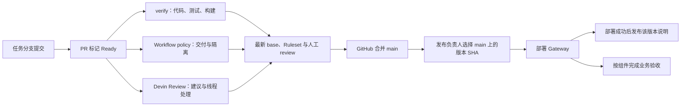

# Actions 交付手册

代码检查通过、代码合并、组件部署和业务验收是四个结果。当前发布节奏见[ADR0348](../adr/0348-release-on-main-sha-dispatch.md)，其余交付分工见[ADR0233](../adr/0233-actions-delivery-flow.md)。

## 阶段合入条件

大需求按可独立部署的增量拆分；数据库、接口、页面分别写完不自动构成三个可上线阶段。
需求A未完成时，需求B仍从最新main开发；B的PR差异不重复展示已合入的A，完整部署制品仍包含A。
复用原Issue、Feature/QA和PR模板记录以下判断，不另建阶段台账或通用开关平台。

| 本片实际影响 | 合入前需要的证据 |
|---|---|
| 未启用的新能力 | 按现役配置启动，相关旧入口仍可用；检查新增后台任务、资源占用、写入与权限，隐藏按钮不足以证明隔离 |
| 共享登录、配置、接口或持久化 | 按独立变化验证原调用方；列明受影响组件、支持的新旧版本组合、部署顺序与恢复条件 |
| 必须依赖未来阶段才保持旧行为 | 先重拆或补最小兼容过渡；证据不足的这一片暂不合入，不能靠父任务未完成或CI绿灯放行 |

作者在原任务写清目标行为、仍关闭的能力、已满足的依赖、观察判据和恢复方法；PR用链接交付结果。
依赖A公共组件的B，要依赖已可独立使用的合同，不隐含依赖A下一阶段。完成子任务不等于父需求验收；
状态继续用现有交付索引区分合并、部署、启用和验收，不能因代码入main展示“功能已开通”。
现有PRD调度器会在提交进入交付PR后关闭实现子单以推进下一片；该状态只代表调度进度。
交付负责人转Ready和合并前逐条核原验收，不用“所有子单closed”替代。自动生成的`Closes`须核实
其指向任务的全部完成条件；若任务含合并后才能完成的生产验收，使用`Refs #N`保留原任务及责任人，
到验收完成再关单；已有明确实现子单时可只关闭该实现片。缺发布前兼容证据的PR保持/转回草稿，
既有自动Ready不能放行。`Refs`也被调度器识别为占用；批量交付PR创建成功后移除实现授权标签
`ready-for-agent`，避免合并后待验任务重新派发。PR撤回且需要继续实现时，由负责人重新授权；
标签移除失败按交付失败处理并补齐，不靠关掉待验任务恢复。

生产发布与代码合入分开；任务分支可在同一需求内多次提交、推送，同一PR持续更新。
可独立部署的增量通过评审再合入main，不以每次对话、每个commit或固定天数强制拆PR、升版本。
合并后的worktree退休属于交付收尾，不触发业务发布，也不清理仍在开发或有人持有的工作树。
完整版本批次操作见下方[版本发布](#版本发布)；选择性延迟发布不会从制品中移除已合入代码。

本仓Gateway只在显式发布运行中部署；Web、登录代理、Java节点等仍分别交付。涉及它们时验证实际支持的
混合版本；不能假设同一Git提交会原子更新所有服务。优先追加兼容接口/格式，再迁移调用方，最后
在恢复窗口结束后删旧路径。SQL迁移、会话失效与后台行为不因开关关闭而自动撤销。
变更会要求用户重登或改变操作路径时，在原任务说明影响及恢复步骤，并覆盖该用户路径。

验证采用“候选版本＋现役配置＋A关闭”：运行B验收和本次触及的旧功能检查；选择共享依赖和实际
交互组合，不枚举无关开关笛卡尔积。缺环境或正常会话的用例标阻塞，列出它影响哪些发布/启用条件；
不阻断已证明独立的其他任务，也不把本地替身、匿名拒绝或部署成功当作真实用户正向验收。
若缺失的是本片共享路径的发布前兼容验收，阻塞的是本片合入；已部署历史缺口单独补验，保留原失败记录。
必要的生产确认沿既有受控部署步骤执行，发布前先满足
候选兼容验收。真实账号验证使用已有获准测试身份，不借验收开户、扩大权限或执行业务发布。

新增能力默认复用既有配置隔离。确需临时发布开关时，在原Issue标负责人、默认值、启用验收与
删除条件；启用/取消时复核，恢复窗口结束后清理旧分支与测试。永久产品配置和权限检查不随之删除。
开关启用仍需相应授权；暂缓发布只改变部署时间，不会从制品排除A。

分支仍是短任务分支→main。确实无法兼容拆分时，另行评审临时需求集成分支的负责人、期限、
PR/CI、同步和最终验收；当前工具基线和生产制品来源规则不因此改变。
这些判断由作者和评审对证据负责；现有CI验证其实际覆盖的行为，不新增模型判定或勾选即通过的闸门。

## 从提交到交付



普通本地 commit 不触发 Actions；push 已关联 PR 的分支触发 synchronize。
草稿 PR 跳过必需作业，转 Ready 后重新检查；冲突 PR 不派发 pull_request 工作流。
`verify` 和 `Workflow policy` 是既有必需检查名，不使用顶层 paths 跳过它们。
严格 base 要求、会话解决要求继续有效；Devin 状态不是必需检查，作者负责回复、复验和关闭线程。

| 工作流 | 触发与职责 | 如何解读 |
|---|---|---|
| CI / verify | Ready PR：Python 静态检查、测试、wheel/sdist、全量档的 Gateway 镜像构建/导入 | 必需；不证明真实模型与业务准确性 |
| AFK Policy / Workflow policy | Ready PR：AFK 隔离、自检、ADR | 必需；失败先看具体步骤，不按名称猜成模型审查 |
| Spec Tree | Ready PR、main、手动：规格 lint | 辅助；main 检查保留以暴露已合并规格漂移 |
| Sync Open PRs | main 更新、每日只报告；手动指定一个 PR | 只更新明确指定、同仓库所有者的 PR |
| CD / 版本发布 | 仅手动在main选择已合入完整SHA；先保留/核验不可移动的版本标签，再部署和生成Release | 同一提交含版本/依赖声明；main合并不部署；部署失败可重跑同一SHA |
| CD Watch | 每5分钟、手动（平台可能延迟） | 无待处理run表示未计划发布；真实取数失败及已启动run异常才报警 |
| Agent Implement / PRD / PR、Promote Queued | issue/PR 标签或手动授权 | 开发执行与依赖推进，不是普通提交必须等待的检查 |
| Agent Review、Update Branch、Architecture Review | 既有显式标签 | 按需 agent 工作；本轮不增加本地 reviewer 或必需模型检查 |
| Sandbox image | 沙箱输入变更或手动 | AFK 的运行镜像，不是 Gateway 生产镜像 |

GitLab mirror按push、delete及手动触发同步分支和标签；独立连接失败不代表Gateway部署失败。
镜像同步成功不能替代上述 CI、合并或部署结果。GITHUB_TOKEN新建标签不会触发push工作流；
发布标签镜像等待下次正常push，需即时同步时单独执行`gh workflow run gitlab-mirror.yml --ref main`。

## 版本发布

1. 日常功能PR只交付行为，不例行升版本。批次准备好后，版本准备PR同步`VERSION`、`pyproject.toml`、
   `src/aiops_diagnostics/__init__.py`和`uv.lock`的本项目版本；确定性CI通过并合入main。
2. 发布负责人获得该批次上线授权后，以`main`为workflow ref，给CD输入已合入的完整SHA：
   `gh workflow run cd.yml --ref main -f target_sha=<完整SHA>`。SHA属于main不等于已获业务发布授权。
3. CD在串行锁中核SHA、SemVer和注释标签，固定同SHA的`vMAJOR.MINOR.PATCH`后检出该提交执行部署。
   同版本异SHA、轻量标签与异SHA竞争在生产写入前拒绝；部署失败保留标签，可重跑同一SHA。
   标签存在只表示候选已固定，不证明部署成功；代码修复经PR后准备新版本。
4. 部署成功后发布同tag的GitHub Release，只取该版本CHANGELOG章节；分节仅使用已发布Release的SemVer标签
   和当前目标，尚未发布的失败候选标签不截断下一批内容。查询Release失败则停止，不用不完整历史生成说明。`CHANGELOG.md`仍gitignore，
   不提交、不回推main；人工升级/兼容说明仍放`RELEASE-NOTES.md`。旧Release和标签不移动。
5. `gh run rerun <RUN> --failed`只补失败作业。Gateway部署成功、Release失败时，只补说明，不回滚/重启服务；
   CD Watch保留workflow结果和部署job结果，仍监控连续失败、卡住和取数异常，空闲runner不产生告警。

一次只发起一个版本，等整个workflow结束再发下一个；Actions默认单pending不是FIFO队列。
Web、桥、登录代理、Java节点仍按各自入口配套交付。生产落后main时，紧急恢复沿服务器制品回滚/维护线规则，
不能借hotfix顺带上线所有待发布变更。依据见[ADR0348](../adr/0348-release-on-main-sha-dispatch.md)。

## 同步分支：自动报告，明确指定才更新

本仓当前 `allow_auto_merge=false`，不把不可用的 auto-merge 设置当作入口，也不为整理 CI 开启自动合并。
main 更新与每日任务只报告开放 PR 状态。交付负责人需要同步时，在 Actions 的 Sync Open PRs
手动运行中指定 `pr_number`；一次请求只处理这一条，不合并 PR、不批量改分支。

仅允许 OPEN、base=main、非草稿、同仓库且作者为所有者、无人 assignee、
无 `agent:in-progress` / `agent:update-branch` / `agent:blocked` 标签、状态 BEHIND 的 PR。
通过 GitHub update-branch API 合入 main，提交历史保留；`expected_head_sha` 拒绝读取后发生的新推送。
DIRTY 由原作者解决冲突，不自动加标签启动付费修复 agent。

普通开发 PR 不会因别人合并而反复更新；作者在交付前同步最新 main 并重跑必需 CI。
本地合并主线也受逐提交ADR检查：只同步既有设计时，在合并提交正文写明真实的`No-ADR:`理由；
已推送提交不能靠后续提交补写它的说明，也不能通过强推或改检查绕过。
平台 API 只提供 head 的原子检查；assignee/标签在读取之后变化仍有窄竞争窗。
明确授权同步后的命令为 `gh workflow run sync-open-prs.yml --ref main -f pr_number=<PR>`。
这会更新指定远端分支；只查状态时用下面的只读命令。

## 代码检查的范围与证据

- checkout 默认验证 PR 的测试合并提交；Workflow policy 读 head，以核对该分支提交的 ADR。
- 默认全量；仅所有改动均为 `docs/` 中的 Markdown 或根层 Markdown 才选文档档。
  两点 diff 保守纳入 base 前进造成的差异；文件集合为空或无 PR 身份时全量。
- 文档档复用现有按测试源码引用选择的集合，未宣称完整依赖分析；间接读取文档仍有漏选风险。
  新增此类读取时应更新既有选择规则和反例，不降低基线。
- pytest 退出码决定成败，JUnit XML 提供计数；保留全量 passed>=4000、文档 passed>=400、
  skipped<=10 的既有异常门槛。门槛只捕捉明显异常，不能证明测试完整。
- `ci-results-<attempt>` 保存合成测试日志、XML 和全量档的镜像身份记录 7 天。
  下载制品排查失败，不在证据中放真实设备令牌或生产数据。
- wheel/sdist 每次构建；全量档复用 `build-image.sh` 验证固定基础镜像、构建身份及镜像内导入，
  不上传镜像、不运行生产。Java 节点及多服务真实验收仍按各自手册执行。
- CI 与 Workflow policy 按 PR/ref 取消过期运行；CD 的整轮发布锁不取消运行中的发布。
  GitHub concurrency 默认只保留一个 pending，不能理解为每个合并提交都会顺序部署。

## 先定位失败阶段

从任务 checkout 执行；`<PR>` / `<RUN>` 替换成实际编号。以下均为只读：

```bash
gh pr view <PR> --json headRefOid,isDraft,mergeStateStatus,statusCheckRollup
gh pr checks <PR> --required
gh run view <RUN> --json jobs
gh run view <RUN> --log-failed
gh run list --workflow cd.yml --limit 10
gh api repos/{owner}/{repo}/actions/runners --jq '.runners[] | {name,status,busy}'
node .sandcastle/cd-watch.mjs --dry-run
```

| 现象 | 下一步 |
|---|---|
| 没有 CI | 先查草稿、冲突、head SHA；参见[冲突排障](pr-conflict-stops-ci-dispatch.md) |
| cancelled | 核对是否已被同一 PR 的更新提交替代，只等待最新 SHA |
| Workflow policy / ADR 红灯 | 检查缺失记录、No-ADR 说明或编号冲突；新记录取当前下一编号，不放宽检查 |
| verify 红灯 | 首个失败步骤 → XML/日志；基础镜像拉取失败与代码导入失败分别处理 |
| 没有CD run | 只有合并而未发起版本发布是正常状态；预期上线时核对手动run和所选SHA |
| CD queued/pending | 看 jobs、runner online/busy 与并发锁 |
| deploy-41 失败 | 看网络、身份、节点/依赖闸门；按[环境手册](env-41-runbook.md)核对并恢复 |
| deploy-41 成功、版本说明失败 | 服务已部署；只修复并重跑说明作业，不因此回滚服务 |

经本轮交付授权后，发布失败可用 `gh run rerun <RUN> --failed` 只重跑失败作业。
Gateway 部署重试必须先确认原因为何已消除；访问链路故障不能通过取消部署锁解决。
部署与回滚使用既有[环境手册](env-41-runbook.md)，镜像验证使用[构建手册](local-gateway-build.md)。

## 本地复验

```bash
uv sync --locked --dev
uv run ruff check .
uv run ruff format --check .
actionlint .github/workflows/{ci,afk-policy,spec-tree,sync-open-prs,cd,cd-watch}.yml
uv run pytest tests/tooling/test_actions_delivery.py tests/test_ci_test_tier.py tests/test_release_version.py
uv run pytest -rs --junitxml=dist/verification/actions/pytest.xml
uv run python tools/verification/ci_results.py dist/verification/actions/pytest.xml --floor 4000 --tier full
uv build
```

本轮没有改变业务入口、权限模型、生产配置或数据；未完成业务验收。

## CD 的 SSH 超时定位与恢复验证

先用 `dev-host exec 41 --allow-service-exec --timeout 20 -- true` 验证同一访问链。
本轮故障是已退役中转节点仍被 SSH 别名引用；不能靠延长超时或改用人工密钥解决。
地址、指纹、密钥位置、受限中转配置和备份保存在私有运维记录，不进入公开仓库。

获准更换路径时，先按主机清单逐跳校验公钥，再用独立中转密钥限制来源及唯一目标，
禁止 shell、PTY、agent/X11 与任意端口转发；生产密钥继续只保留在开发/部署端。
切换本机别名前保留旧配置，验证人工/CD身份都可用，再从dev-host读取health与服务状态。
回滚仅撤回本轮新增中转公钥和别名，不覆盖其他人的authorized_keys更新。
旧主机已退役时，恢复旧配置不代表恢复服务；必须单独记录这个限制。
恢复后按标准CD部署，并核对目标SHA、现役health版本及原备份路径，不手工同步生产源码。
