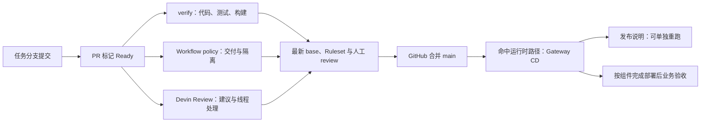

# Actions 交付手册

代码检查通过、代码合并、组件部署和业务验收是四个结果。本手册描述本次调整后的行为；
生效条件是对应 PR 经评审合并。设计依据见 [ADR](../adr/0233-actions-delivery-flow.md)。

## 从提交到交付



普通本地 commit 不触发 Actions；push 已关联 PR 的分支触发 synchronize。
草稿 PR 跳过必需作业，转 Ready 后重新检查；冲突 PR 不派发 pull_request 工作流。
`verify` 和 `Workflow policy` 是既有必需检查名，不使用顶层 paths 跳过它们。
严格 base 要求、会话解决要求继续有效；Devin 状态不是必需检查，作者负责回复、复验和关闭线程。

| 工作流 | 触发与职责 | 如何解读 |
|---|---|---|
| CI / verify | Ready PR：Python 静态检查、测试、wheel/sdist、全量档的 Gateway 镜像构建/导入 | 必需；不证明真实模型与业务准确性 |
| AFK Policy / Workflow policy | Ready PR：AFK 隔离、自检、ADR | 必需；失败先看具体步骤，不按名称猜成模型审查 |
| Spec Tree | Ready PR、main、手动：规格 lint | 辅助；main 检查保留以暴露已合并规格漂移 |
| Sync Open PRs | main 更新、每日只报告；手动指定一个 PR | 只更新明确指定、同仓库所有者的 PR |
| CD | main 命中 src、部署入口、依赖声明等路径；手动只允许 main | 仅 Gateway；deploy-41 与 release-notes 分别报告 |
| CD Watch | 每5分钟、手动（平台可能延迟） | 依据部署 job 结果报警；发布说明红灯不冒充部署失败 |
| Agent Implement / PRD / PR、Promote Queued | issue/PR 标签或手动授权 | 开发执行与依赖推进，不是普通提交必须等待的检查 |
| Agent Review、Update Branch、Architecture Review | 既有显式标签 | 按需 agent 工作；本轮不增加本地 reviewer 或必需模型检查 |
| Sandbox image | 沙箱输入变更或手动 | AFK 的运行镜像，不是 Gateway 生产镜像 |

GitLab mirror按push、delete及手动触发同步分支和标签；独立连接失败不代表Gateway部署失败。
镜像同步成功不能替代上述 CI、合并或部署结果。

## 同步分支：自动报告，明确指定才更新

本仓当前 `allow_auto_merge=false`，不把不可用的 auto-merge 设置当作入口，也不为整理 CI 开启自动合并。
main 更新与每日任务只报告开放 PR 状态。交付负责人需要同步时，在 Actions 的 Sync Open PRs
手动运行中指定 `pr_number`；一次请求只处理这一条，不合并 PR、不批量改分支。

仅允许 OPEN、base=main、非草稿、同仓库且作者为所有者、无人 assignee、
无 `agent:in-progress` / `agent:update-branch` / `agent:blocked` 标签、状态 BEHIND 的 PR。
通过 GitHub update-branch API 合入 main，提交历史保留；`expected_head_sha` 拒绝读取后发生的新推送。
DIRTY 由原作者解决冲突，不自动加标签启动付费修复 agent。

普通开发 PR 不会因别人合并而反复更新；作者在交付前同步最新 main 并重跑必需 CI。
本地合并主线也受逐提交ADR检查：只同步既有设计时，在合并提交正文写明真实的`No-ADR:`理由；
已推送提交不能靠后续提交补写它的说明，也不能通过强推或改检查绕过。
平台 API 只提供 head 的原子检查；assignee/标签在读取之后变化仍有窄竞争窗。
明确授权同步后的命令为 `gh workflow run sync-open-prs.yml --ref main -f pr_number=<PR>`。
这会更新指定远端分支；只查状态时用下面的只读命令。

## 代码检查的范围与证据

- checkout 默认验证 PR 的测试合并提交；Workflow policy 读 head，以核对该分支提交的 ADR。
- 默认全量；仅所有改动均为 `docs/` 中的 Markdown 或根层 Markdown 才选文档档。
  两点 diff 保守纳入 base 前进造成的差异；文件集合为空或无 PR 身份时全量。
- 文档档复用现有按测试源码引用选择的集合，未宣称完整依赖分析；间接读取文档仍有漏选风险。
  新增此类读取时应更新既有选择规则和反例，不降低基线。
- pytest 退出码决定成败，JUnit XML 提供计数；保留全量 passed>=4000、文档 passed>=400、
  skipped<=10 的既有异常门槛。门槛只捕捉明显异常，不能证明测试完整。
- `ci-results-<attempt>` 保存合成测试日志、XML 和全量档的镜像身份记录 7 天。
  下载制品排查失败，不在证据中放真实设备令牌或生产数据。
- wheel/sdist 每次构建；全量档复用 `build-image.sh` 验证固定基础镜像、构建身份及镜像内导入，
  不上传镜像、不运行生产。Java 节点及多服务真实验收仍按各自手册执行。
- CI 与 Workflow policy 按 PR/ref 取消过期运行；CD 的部署锁不取消运行中的部署。
  GitHub concurrency 默认只保留一个 pending，不能理解为每个合并提交都会顺序部署。

## 先定位失败阶段

从任务 checkout 执行；`<PR>` / `<RUN>` 替换成实际编号。以下均为只读：

```bash
gh pr view <PR> --json headRefOid,isDraft,mergeStateStatus,statusCheckRollup
gh pr checks <PR> --required
gh run view <RUN> --json jobs
gh run view <RUN> --log-failed
gh run list --workflow cd.yml --limit 10
gh api repos/{owner}/{repo}/actions/runners --jq '.runners[] | {name,status,busy}'
node .sandcastle/cd-watch.mjs --dry-run
```

| 现象 | 下一步 |
|---|---|
| 没有 CI | 先查草稿、冲突、head SHA；参见[冲突排障](pr-conflict-stops-ci-dispatch.md) |
| cancelled | 核对是否已被同一 PR 的更新提交替代，只等待最新 SHA |
| Workflow policy / ADR 红灯 | 检查缺失记录、No-ADR 说明或编号冲突；新记录取当前下一编号，不放宽检查 |
| verify 红灯 | 首个失败步骤 → XML/日志；基础镜像拉取失败与代码导入失败分别处理 |
| CD queued/pending | 看 jobs、runner online/busy 与并发锁，不能推断为“待人工批准” |
| deploy-41 失败 | 看网络、身份、节点/依赖闸门；按[环境手册](env-41-runbook.md)核对并恢复 |
| deploy-41 成功、release-notes 失败 | 服务部署已完成，只补发布说明，不因此回滚服务 |

经本轮交付授权后，发布失败可用 `gh run rerun <RUN> --failed` 只重跑失败作业。
Gateway 部署重试必须先确认原因为何已消除；访问链路故障不能通过取消部署锁解决。
部署与回滚使用既有[环境手册](env-41-runbook.md)，镜像验证使用[构建手册](local-gateway-build.md)。

## 本地复验

```bash
uv sync --locked --dev
uv run ruff check .
uv run ruff format --check .
actionlint .github/workflows/{ci,afk-policy,spec-tree,sync-open-prs,cd,cd-watch}.yml
uv run pytest tests/tooling/test_actions_delivery.py tests/test_ci_test_tier.py tests/test_release_version.py
uv run pytest -rs --junitxml=dist/verification/actions/pytest.xml
uv run python tools/verification/ci_results.py dist/verification/actions/pytest.xml --floor 4000 --tier full
uv build
```

本轮没有改变业务入口、权限模型、生产配置或数据；未完成业务验收。

## CD 的 SSH 超时定位与恢复验证

先用 `dev-host exec 41 --allow-service-exec --timeout 20 -- true` 验证同一访问链。
本轮故障是已退役中转节点仍被 SSH 别名引用；不能靠延长超时或改用人工密钥解决。
地址、指纹、密钥位置、受限中转配置和备份保存在私有运维记录，不进入公开仓库。

获准更换路径时，先按主机清单逐跳校验公钥，再用独立中转密钥限制来源及唯一目标，
禁止 shell、PTY、agent/X11 与任意端口转发；生产密钥继续只保留在开发/部署端。
切换本机别名前保留旧配置，验证人工/CD身份都可用，再从dev-host读取health与服务状态。
回滚仅撤回本轮新增中转公钥和别名，不覆盖其他人的authorized_keys更新。
旧主机已退役时，恢复旧配置不代表恢复服务；必须单独记录这个限制。
恢复后按标准CD部署，并核对目标SHA、现役health版本及原备份路径，不手工同步生产源码。
