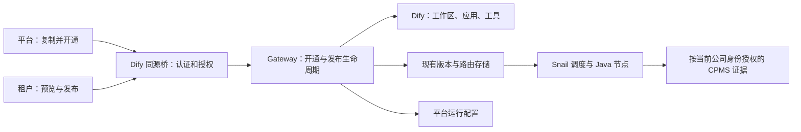

# Dify 自助开通与 Java 远端发布：业务磨合方案

日期：2026-10-29。状态：研究与实施建议，**尚未实现或部署**。
用户已确认的产品流程：**平台运营在 Dify 选择客户并开通；客户在自己的工作区自主管理。**
本轮研究不改变现役租户、路由、公司授权或模型；优链充真实正例仍等待有权限的新账号。
Snail AI 一手源码核查见[参考研究](snail-ai-publication-research.md)。

Snail AI的关键启发是统一配置、自动分发和节点在线目录；它的普通配置更新是原地保存，
没有核实到等同于我们不可变版本/正式指针的发布机制。我们已经接入其远端执行，
应继续借鉴管理体验并补齐自助生命周期，不让客户再到Snail后台维护一份相同SOP。

## 1. 结论：把“开通一个可用管家”作为完整产品操作

当前远端执行已经存在；缺的是从 Dify 应用到可用业务入口的完整管理流程。
把运维手册写完整只解决工程接手，不满足业务自助。目标是平台选客户、点“复制并开通”，
系统完成准备并显示结果；租户登录后直接进入自己的工作区，在同一页面试用和发布。
新增租户不再触发SSH、JSON/TOML编辑、人工初始版本、逐租户PR或节点重启。

平台最初接入环境、模型渠道和Java节点仍是工程部署；之后业务配置通过已部署的管理API执行。
这是把交付单位从“改服务器文件”改为“创建受管业务资源”，并不绕过代码制品的PR/CI流程。

## 2. 现场问题与源码对应

AI-Ops研究基线`9cc3fd58`；Dify现役1.17.1源码基线`8387590ace4a094de812b7847fc6a4c3a27cd52b`。
现役案例见[优链充部署回执](../validation/2026-10-29-youlian-operator-live.md)。

| 用户遇到的事情 | 根因 | 对产品的要求 |
|---|---|---|
| 每来一个租户要执行开户命令 | 登录代理只查已有workspace；缺行直接拒绝；创建函数只被管理CLI调用 | 平台页面可创建、查看进度、重试；租户不接收命令行错误 |
| 复制应用后模型/工具还要单配 | Dify复制在当前workspace内，跨workspace导入不是完整资源迁移 | 后端安装依赖、配模型、重建provider并转换UUID，不能只复制DSL |
| `ready`后还不能用 | `ensure_ready`只做插件、凭据、模板，且默认deepseek模板与当前管家不符 | 准备、发布、运行健康和账号权限分别回读，不能共用一个ready结论 |
| 先建空V1再发真正V2 | `node_publication.publish`拒绝不存在或draft agent | 首次发布直接冻结合法node-sop，消除人工占位版；不放松校验 |
| 每个租户追加环境清单和node-targets | 业务应用身份与固定平台连接被放在同一类部署配置里 | 连接作为平台配置；应用/租户关联作为数据库资源，通过API管理 |
| 试用内容与正式内容可能不同 | 原生预览带未保存配置，发布按钮只发app_id再读保存版 | 发布同一份明确草稿；显示草稿有改动、当前正式版本 |
| Dify模型选v4.1，Java执行v4 | 页面model_config与Snail模型/执行模板有两个控制面 | 展示唯一有效模型和预算，发布前验证映射；不出现可操作但无效的选择器 |
| 页面只显示`operator request unavailable` | 配置状态和账号站点权限混成通用失败文案 | 当前账号无站点时提前说明原因与处理人；不以放宽权限掩盖问题 |
| 多个“发布/试用”按钮、弹窗填订单 | 现有注入脚本叠加在Dify原生发布旁边 | 一个业务主发布入口、一个预览区；高级诊断信息折叠 |

定位依据（方法名用于后续目录调整后检索）：

- [LoginService.login](../../src/aiops_diagnostics/dify/dify_login_service.py)：resolve失败进入_refuse_workspace。
- [ensure_workspace](../../src/aiops_diagnostics/dify/dify_ensure_workspace.py)：已有租约、先占位、超时对账，可复用。
- [ensure_ready](../../src/aiops_diagnostics/dify/dify_workspace_ready.py)：固定TEMPLATE_PROVIDER与按名称跳过模板。
- [node_publication](../../src/aiops_diagnostics/execution/node_publication.py)：targets、candidate、publish、advance。
- [应用登记](../../src/aiops_diagnostics/dify/dify_app_registry.py)：主键为tenant/entry；
  [manifest收敛](../../src/aiops_diagnostics/publication/agent_manifest.py)可覆写同键业务登记。
- [原生试用](../../src/aiops_diagnostics/gateway/gateway_api.py)：dify_trial先选正式binding，要求app_id匹配。
- [按钮脚本](../../ops/dify-console-bridge/dify-publish-button.js)：扫描按钮文案挂载，独立发送空body发布。
- [Java执行](../../services/execution-node/src/main/java/com/trendpower/aiops/node/ReportingChatSessionRuntime.java)：
  managedPublication每轮从Gateway读取冻结manifest，覆盖systemPrompt；无需为每个SOP重新部署JAR。

## 3. Dify自带能力的实际边界

核查1.17.1的[AppDslService.copy_app](https://github.com/langgenius/dify/blob/8387590ace4a094de812b7847fc6a4c3a27cd52b/api/services/app_dsl_service.py)：
它要求源app、当前账号和目标tenant同属一个workspace。原生复制可以保留，作为同工作区草稿副本；
跨公司租户开通必须走受控导出/导入，并重建工作区依赖。

现役chat/agent-chat编排的[发布实现](https://github.com/langgenius/dify/blob/8387590ace4a094de812b7847fc6a4c3a27cd52b/web/app/components/app/configuration/hooks/configuration-lifecycle/publish.ts)
提交`/apps/{appId}/model-config`；这不会替AI-Ops建立业务路由。
我们的业务发布要在保存返回成功后冻结**同一份**内容，并在路由确认后展示成功。

当前Dify文档已介绍1.18的`.ifpkg`，而我们运行1.17.1，不能直接把新版说明当现役API。
[官方导入说明](https://docs.dify.ai/en/cloud/use-dify/workspace/export-import-apps)也明确模型凭据、
知识库和工具等不随应用完整迁移。不能把升级Dify当成本问题的自动修复。

[Endpoint插件](https://docs.dify.ai/en/develop-plugin/dev-guides-and-walkthroughs/endpoint)
提供HTTP接口；该能力本身不提供公司租户开通页面或公司授权。继续使用已有同源桥做身份转达，
不让业务人员安装一个还需要手填管理key的新插件。

## 4. 业务页面怎么操作

### 平台运营：选择客户，一次开通

从平台可管理的模板或现有管家卡片点击 **“复制并开通”**：

| 用户填写 | 默认与来源 |
|---|---|
| 客户 | 从公司权威租户目录中选择；展示名称，ID仅辅助核对 |
| 智能体名称 | 默认“客户名称－订单管家”，可修改 |
| 来源版本 | 默认当前已确认的正式配方，显示版本；不暗中复制未发布编辑 |
| 业务入口 | 当前首片为管家订单诊断，默认固定；不让用户填scenario字符串 |

平台操作者只看到其获授权的客户；租户自己的界面固定当前租户，不提供跨租户选择。
环境由已配置的连接决定；41首片固定，不出现IP、文件路径、app/provider UUID或密钥字段。
模型渠道、工具能力和节点连接由平台模板提供默认值。

点击后在同一窗口显示“准备工作区→准备依赖→创建智能体→发布到管家→完成”。
刷新/断网后可恢复同一操作，失败能“重试本步”，不要求重新复制。
完成展示客户、智能体、正式版本和“进入工作区/打开使用入口”。
如果客户已有同场景正式管家，默认只创建新草稿；切换正式入口是明确的后续发布，不能偷偷替换。

### 租户运营：编辑、试用、发布

正常公司登录后进入本租户工作区，不再要求运维手工join或输入公司租户ID。
页面保留 **“预览”** 与 **“发布到管家”** 两个主动作，历史版本/撤回收进菜单。
预览与发布围绕同一草稿内容；正式版旁显示“有未发布修改”。
新建或复制的草稿可在尚未占用正式入口时试用，这是当前必须补齐的能力。

对Java受管应用，页面显示实际执行模型/预算。首片采用已支持的平台运行配置作为默认，
不允许Dify那个无效的独立选择器造成误解。需要换模型时从平台允许的模型列表选取，
后端同步Snail配置和冻结manifest并核一致性；不能直接采信浏览器endpoint/任意模型ID。
模型变更不能原地改共享Snail agent而同时影响其他租户；需要复用相同运行配置或建立独立配置绑定。

普通Dify应用维持原生操作；受管应用使用明确组件入口，推荐复用现有web-patches构建流程进行小范围前端接入。
当前临时注入不适合继续扩成依赖中文按钮文本、setInterval和fetch拦截的开通页面；
后端仍复用同源桥和既有API，不重做整个Dify前端。

### 登录后能用的边界要可理解

“可配置智能体”和“能读取某订单”是不同权限。平台开通不授予公司站点权限。
进入预览或App时即时显示当前账号是否具有可用站点范围，缺少时给出
“当前账号未分配可诊断场站，请由公司管理员分配或切换账号”；不等模型调用后再给通用403。
不暴露别人订单是否存在，详细原因只面向当前账号自己的缺口。

Dify现有公司密码/图形验证码登录和管家App短信登录不同。若增加短信登录，仍由登录代理
直接调用公司认证并拿到公司令牌；不把浏览器提交的任意公司JWT兑换成Dify会话。
本轮已确认的平台开通方案不依赖先改登录方式；正常登录后join和进入自己的工作区必须可靠。

## 5. 后台怎样收口

新增一个完整开通入口，内部调用现有函数；CLI和UI使用同一实现，不在HTTP请求里执行shell。
保留现有Gateway作为业务身份、版本与路由的管理者，Snail负责模型/工具运行配置、调度及节点通信。
这样Dify中修改的业务SOP不会有第二份由人手同步的Snail提示词。

| 现有资源 | 改进方式 |
|---|---|
| dify_workspaces | 复用唯一键和租约；其ready只代表workspace，不伪装业务开通成功 |
| provider/插件/模型 | 从受管模板确定依赖，按目标workspace配置；API回读能力、预算与UUID |
| 应用登记与node targets | 受管应用登记存数据库，引用平台运行配置ID；固定地址/凭据仅留平台配置 |
| agent_versions与chat_route_bindings | 复用不可变版本、revision条件更新和撤回/恢复；首次直接发布真实V1 |
| 开通记录 | 最小持久操作记录，关联来源版本、目标、步骤及已创建资源ID；复用既有数据库与任务设施 |

`ops/environments`变成初始导入/恢复材料，不能继续作为已由业务页面管理的租户配置权威。
需要显式标明管理权归属：旧文件管理、新页面管理同一资源时拒绝冲突；原reconcile不得静默覆盖页面选择。
现役两个租户迁移只登记已有资源身份，比较后保留app/provider/正式版本与route revision，不重建、不重发。

同一个租户可以有多个草稿；每个“入口＋场景”仍只有一个正式版本。
不能把每次点击复制都写入当前`(tenant,entry)`注册表而替换正式源；需把应用身份与正式指针分开处理。
命名不作为幂等主键，用户改名不会导致下一次开通再建一份。

### 一键背后的失败处理

工作区、Dify和Gateway之间没有跨库事务。使用持久步骤记录与回读对账：
请求超时只能记“结果待确认”，先查询已产生的资源，再决定重试，避免重复workspace/app。
保存/导入完成但发布失败，旧正式路线保留；用户点击重试继续当前操作，不重新造资源。
重复点击返回同一个操作结果；不同操作者同时替换同一入口时由revision冲突拦住，界面刷新当前版本。
本次实际创建的资源ID、请求主体、目标租户、来源版本和结果进入审计，凭据不进入操作记录。

建议采用HTTP202表示“已接收”，返回可查询的操作地址；只有回读确认才显示完成。
这是[RFC 9110 §15.3.3](https://www.rfc-editor.org/rfc/rfc9110.html#name-202-accepted)语义，
不是把202当成功；具体路径/字段在实现契约中定稿。无需引入新的通用工作流平台。

## 6. 安全与产品决策必须同批完成

平台跨租户开通是新增管理能力；现有发布桥会把平台身份固定到platform workspace，
不能简单绕过工作区比较。新增动作需核公司平台管理身份、来源模板权限和目标租户授权。
首次开通目标尚无workspace，因此“已有workspace成员”不能独自解决授权；应从公司目录授权范围获取目标列表。
公司现有前端可见`/upms/tenant/page`、`/upms/tenant/list/my`和`/upms/organ/sysTenant`等候选，
但接口名称不证明其返回的就是可管理租户。目录接口和平台授权判据要在实施前以真实平台账号
验证，不猜`ROLE_ADMIN`或放任任意tenant_id。

已有ADR-0139允许租户自己的workspace成员进入并发布；它没有提供租户内部管理员/普通员工细分。
首片沿用这条边界需明确告知，不把新增平台开通权限继承给全部租户成员。
如果业务要求只有指定运营能编辑/发布，必须用真实公司角色能力映射到Dify成员角色，不能只隐藏按钮。

知识库也不能默认跨租户克隆。当前订单管家模板无KB，可先完整交付；带KB的模板展示依赖，
只允许已授权公共资料或目标自己的库，通过现有RAGFlow接入转换引用。不能为了“一键”复制客户私有文档。

## 7. 实施切片与完成判据

按依赖推进，每片可验证；不把“改后台”和“以后再补页面”拆成两次业务交付。

| 切片 | 具体交付 | 验收标准 |
|---|---|---|
| A 平台一键开通 | Dify源卡片入口、客户选择、开通操作、依赖配置、首次真V1、状态页 | 第二/第三租户全程浏览器完成，SSH次数0、每租户PR0、手填技术ID0、重启0 |
| B 租户发布闭环 | 同一草稿预览/保存/正式发布，实际模型可见，新草稿不依赖正式路由试用 | 草稿文本/工具变更在预览与新正式版本一致，失败保留旧版，撤回/恢复可见 |
| C 使用前检查与故障反馈 | 当前账号范围检查、公司登录状态、可诊断订单选择、运行状态 | 正常账号得到报告；空范围给明确处理建议；跨租户请求无业务内容 |

A必须携带可用的B最小发布路径，不能再次交付“建好应用但还要后台登记”；C的空范围解释也应随A显示。
复杂模型自助切换、跨环境复制、客户私有知识迁移不作为首片隐含能力；界面明确限制并沿用现有配置。
跨环境的95接入是额外工程准备，不能从客户输入域名自动连接任意服务器。

必须覆盖：双击/重试、导入成功但响应丢失、依赖失败后刷新续跑、来源被修改、目标已有正式版、
无权限跨租户开通、另一个租户不受影响、原生UI改动后内容一致、节点离线、空站点、两租户并发运行及撤回隔离。
“配置已完成”和“真实账号已成功运行”分别记录；没有有权订单时允许配置交付，但不能标成业务验收通过。

## 8. 本轮验证与剩余问题

本轮对已有能力运行94项测试：workspace准备/失败恢复、缺workspace拒绝、发布登记、不可变node-sop、
节点清单隔离、登录工作区；全部通过。这些证明现役限制与机制，**不证明尚未实现的一键入口**。
另在临时库直接执行发布器：不存在agent和draft agent均报“requires an existing published agent”；
默认ready配置中没有当前管家所用的openai_api_compatible插件，确认人工绕行的原因。

首要业务模式已由用户确认。落地前只需收口两个范围：平台授权租户目录的实际接口，
租户内部哪些角色可编辑/发布；模型自助切换按平台受管配置推进，不能将无效控件作为交付。
本轮没有执行生产开通/登录/模型请求；不改前次优链充路由。具体业务正例仍等待有权限账号。
