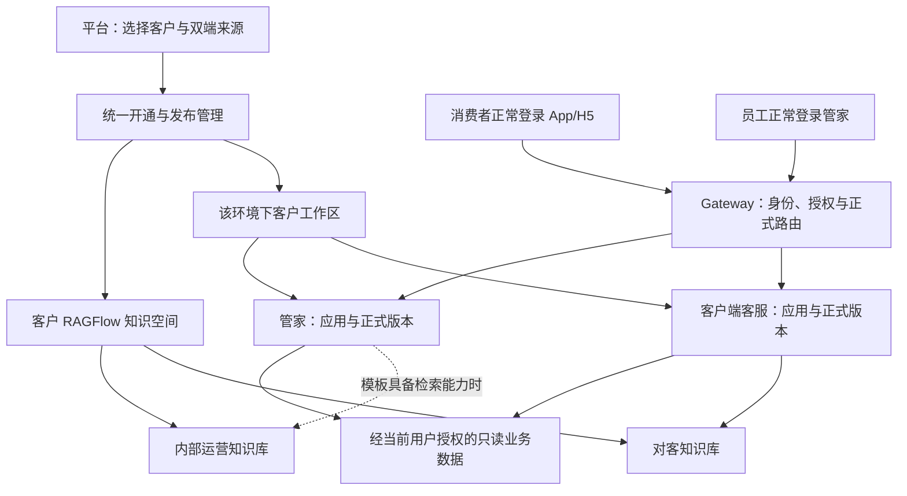

# 客户双端智能体开通与自主管理规划

日期：2026-10-30。状态：用户已同意按本规划派遣Claude实施；Codex负责任务指示与独立验收。
执行授权与回执要求见[Claude任务书](dual-entry-claude-task.md)。本规划不是新能力已上线的声明。
核查基线：`02d11c3f944a0285934506645e3e019b5883f77e`。本文件补全
[首片自助开通研究](dify-self-service-onboarding-research.md)，不把规划写成已上线能力。

## 1. 业务目标与角色

平台交付的是“一个客户可管理、可使用的 AI 服务”，默认包含客户端客服和管家。
客户企业的运营人员正常登录 Dify 管理这两个应用；消费者在原客户端 App/H5/小程序里
使用客服，企业员工在管家端使用管家。最终使用者不需要登录 Dify，也不接触密钥。

| 角色 | 管理位置 | 能做什么 |
| --- | --- | --- |
| 平台运营 | Dify 客户开通/管理入口 | 在公司授权目录内选客户、来源版本，开通两端、检查接入结果 |
| 客户企业运营 | 自己的 Dify 工作区 | 编辑、预览、选库、发布、撤回和恢复两端应用 |
| 消费者 | 原客户端 | 咨询对客资料，查询本人订单、状态和账务 |
| 管家使用者 | 原管家端 | 咨询运营知识，查看公司给本人授权的站点与订单 |
| 工程运维 | 平台部署流程 | 一次性接入环境、业务系统、模型、执行节点和使用渠道 |

沿用已有公司身份与授权；本规划不把开通应用变成授予站点权限，也不新增业务写动作。

## 2. 对现有解释的纠正

1. **客户端没有进入自助开通，是首片实现范围限制。** 当前 catalogue 过滤 `operator`，
   开通/发布也只生成管家清单；并非客户端不能复制或无人管理。
2. **自动保存服务凭据不违反“业务开通不用服务器命令”。** 后台本来就要写工作区、应用、
   映射和版本。禁止的是每客户人工 SSH、编辑配置及重启；受控后端管理运行数据是应有职责。
3. **每开客户都改 H5 并非已证明的必然要求。** Gateway 已按环境、已认证租户、端、场景选路，
   现役 H5 代理转发固定 `/v1/*`，没有 Dify app_id。已接入渠道换应用应只变后台正式指针。
   但当前有租户专属 H5 构建与域名代理：新域名、独立安装包尚未接入时，仍需一次渠道接入。
4. **共享运行基础设施不等于共享业务身份。** 单个共享应用理论上也能靠正确的每次授权隔离数据；
   选择每租户独立应用，是为满足独立编排、内容、发布和回退，不应以“必然串号”论证。
5. **“两次 CPMS 都成功”不是两端统一的验收条件。** 客户端知识问题应走知识检索，账务/状态
   按各自能力取证；管家订单诊断按模板声明的工具取证。验收应证明问题走对能力且不越权。

## 3. 产品操作：一次选择客户，默认交付两端

入口命名改为“客户 AI 服务”，在首页提供明显入口，并在工作室保留“复制并开通”。
按钮不再只叫“开通客户管家”；来源标签使用客户名、Dify 应用名、用途、正式版本。

```text
客户 AI 服务 → 复制并开通

客户                 [选择公司授权目录内客户]
开通范围             [✓ 客户端客服] [✓ 管家]
客户端来源           [已发布的客户端客服 · 版本]
管家来源             [已发布的管家 · 版本]
应用名称             自动生成“客户名－客服 / 客户名－管家”，可修改
知识空间             自动创建或复用该客户空间
使用入口             显示该客户已接入的客户端/管家入口及状态

                     [复制并开通]
```

单个源智能体不能推导出另一个端的业务配置。两端各选其兼容来源，默认使用平台推荐的两份模板；
选择现有客户作为来源时只带出该客户已发布且获授权的对应应用。缺一端时提示补选该端来源，
不把管家应用改个标签就当客服。暂不为这两个选择器另建模板市场或复杂组合版本系统。

只开一端时隐藏另一端配置；后续补开另一端，复用原工作区和知识空间。
若目标已有该端正式应用，默认仅建新草稿，明确显示“原正式应用继续服务”；后续主动发布才替换。
没有既有正式应用时，检查通过的所选端可首次发布。双端失败一端时逐端报告，整体显示“部分完成”，
重试复用已完成端，不删除它或让它重复发布。默认不把两端升级绑成一个不可分割事务。

## 4. 同一客户的资产关系



| 资产 | 归属与规则 |
| --- | --- |
| 客户空间 | `(环境, 公司租户)` 复用一个 Dify 工作区与对应 RAGFlow 空间 |
| 应用草稿 | 每端可有多个，全部属于目标客户；不因创建草稿就占正式入口 |
| 正式发布 | `(环境, 租户, 端, 场景)` 各有独立指针；保存不发布，撤回不回落到其他客户应用 |
| 运行方式 | 客户端先接现役 Chatflow 客服，管家先接现役 Java；用户不必先选执行引擎 |
| 来源版本 | 从明确发布快照复制，不暗中读取源应用的未发布修改；记录来源便于追溯 |
| 平台模板更新 | 形成可选新版本，不自动覆盖客户已改的提示词、选库和正式版本 |
| 连接与服务凭据 | 环境级连接由平台预置，客户应用引用；每应用密钥由后端申请和保存 |

现役 `consumer_own_order_status` Java 路线是客户端的另一个技术场景，不是第三个“客户产品”。
首个闭环复制现役客服主应用及其实际依赖；旧状态路线有使用者就保留，确有需要才作为模板依赖登记。
不借开通需求强制改写全部执行引擎或复制无使用者的历史应用。

## 5. 共用知识空间，分别决定可检索范围

同一客户在一个 RAGFlow 空间维护资料，最小落地按“对客知识库”和“内部运营知识库”分库。
新建普通库默认仅内部，明确发布给客户端后才可被客服选择与检索；已有库迁移需保持现役明确绑定，
不能把“租户自己的库”全部自动暴露给消费者。

客户端运行授权应同时满足：库属于目标租户、允许对客、在该应用的发布选择内、当前仍可用。
此检查放在发布和实际检索两处，隐藏下拉项不构成隔离。管家可按授权使用内部库和对客库。
当前管家发布仍拒绝带 KB 的草稿，所以“默认有知识空间”不代表“管家已经会检索”；
需要该能力时，以兼容的管家模板和受控检索工具交付，并单独验证。

复制只复制流程、提示词和允许的配置；目标应用里的知识引用重新绑定，绝不沿用源客户 UUID。
源客户文档、聊天记录、订单、登录会话和 API key 不随应用复制。平台公共资料必须有明确分发授权；
目标没有资料时可先生成空的对客库，客服明确“暂无资料”，不拿别的客户资料补齐。
建库/模型初始化成功与内容已解析可检索分别展示；需要必备资料的模板不能以空库通过内容就绪检查。

## 6. 后台缺口与最小实现方案

复用现有 Gateway 开通模块、版本库、路由库、Dify API 与两端执行模块。
对外保留目录、开通、查进度/重试、预览、发布和版本操作；内部按客户端/管家分派准备与校验，
不再堆一套独立客户端管理后台，也不新造通用工作流框架。

| 缺口 | 当前依据 | 建议补法 |
| --- | --- | --- |
| 目录和开通只认管家 | `self_service_api.catalogue`、`SelfService.route/create/run` | 受管应用登记显式区分端/场景，来源按兼容能力筛选；应用类型不等于业务端 |
| 客户端发布目标仍逐客户文件登记 | `consumer_publication.target_for` | 页管客户端登记引用受管运行配置；现役文件一次迁移，冲突显式拒绝 |
| 应用 Service key 人工预置 | `app_service_key`已能调用官方API；`_key_ref_for`只检查文件 | 开通中自动申请、回读验证并保存；发布只引用已确认的凭据 |
| 业务数据地址只登记旧租户 | `charging_endpoint`、`ConsumerToolGrants._cpms_base` | 选择已批准环境连接后持久登记目标租户；不把缺项改为任意租户全局兜底 |
| 客服插件、模型与目录凭据要手配 | 现役知识插件安装/选库手册 | 后端安装依赖、派生目标workspace目录凭据、重绑模型/provider/知识节点 |
| 新客服草稿依赖旧正式路由 | `ConsumerTrial.require_current/execute` | 试用绑定当前受管草稿和实际授权，不要求先有正式版本，不先发布再试用 |
| 多草稿与正式源混用 | `dify_app_registry`目前每租户每端一个主绑定 | 受管应用目录保存候选；正式发布才推进主绑定及场景指针 |
| 渠道状态缺失 | 现役H5有固定API代理和租户构建参数 | 登记已接入的渠道与能力版本；开通页可见使用地址和缺口，不暴露技术配置 |
| 配置/发布/可用合并为completed | 当前任务资源标记 | 每端回读工作区、知识、应用依赖、凭据、发布指针和渠道，分别显示结果 |

**凭据建议先用受控运行数据文件，复用现有读路径。** 平台部署一次服务身份专属目录，后端在
该目录内按应用ID原子保存0600文件，引用放进受管登记，业务人员不填路径或明文；不写代码目录、
不要求root、不在请求里执行shell。若既有目录不可写，首次平台部署迁移到服务数据目录并保留旧读引用。
这已满足一键开通，不必把改成加密数据库作为业务前置；未来多Gateway实例需要统一凭据服务时再迁移存储。
生产恢复、备份、轮换与权限必须覆盖这个目录；库外加密资产库存访问方法/位置，不混入业务日志。

API key申请也是外部副作用。Dify固定源码支持应用key列表与创建且有数量上限，
网络超时后先对账，不能每次点击重试就新增一枚key。新应用专属操作可记录创建前后的key ID，
只有归属可确认时复用；已有应用的其他集成key不得猜用或删除。凭据缺失或归属不明时不切正式指针。

双端操作复用“公共准备＋两端资源状态”的持久步骤记录，实际租户资源按唯一键及租约串行保护。
重试重新检查操作者授权；外部结果不明时先查已有资源；阶段成功不等于整个操作成功。
HTTP 202只表示接收，页面通过同一操作ID查结果。两端旧正式版、已有资料和新产生的业务记录均不被回滚覆盖。

## 7. 使用渠道与发布闭环

平台一次性接入：公司登录、环境连接、业务API、模型渠道、Java节点、Dify/RAGFlow及客户端协议。
业务重复开通：选客户/来源、准备该客户资源、绑定本端正式版本、回读可用性；每客户SSH/PR/重启均为0。

已接入的App/H5保持稳定业务API，Gateway从登录主体解析租户再选路。
前端只能声明使用场景，不能凭提交的租户ID、Dify app_id或入口头取得另一端权限。
新域名、小程序或安装包还没接入时，显示“AI已准备，渠道待接入”，指向渠道负责人；
不要自动开放公网地址、构建未知公司包或把“有一个Dify副本”写成“客户可用了”。

客户运营在编排页改提示词、工具能力和可选知识库，试用后点“发布到客户端/管家”。
C端措辞遵循现有模型正文与证据契约，不再把写JSON文案包的CLI当作业务主入口。
事实、金额和权限校验不因“更拟人”而放松；页面应说明哪些配置会实际生效，不能保存无效选择器。
平台新模板只提示可升级，由客户明确采用；采用之前不改客户正式版。

管理试用可用合成示例或明确授权数据，但不能代签消费者身份；最终客户端验收必须有真实消费者会话，
证明查的是本人数据。Dify原生预览、普通试运行和正式入口应回指同一个明确草稿/发布版本，
正常失败时显示可操作原因，不留下空白回复。

## 8. 分步交付与验收

| 阶段 | 一次交付的可见结果 | 核心验收 |
| --- | --- | --- |
| A 双端客户入口 | 首页/工作室可发现；默认两端、各选来源；统一进度/资源状态 | 双端/单端/后补一端行为明确，不自动切已有正式版 |
| B 客户端开通闭环 | 自动应用/依赖/key/数据连接/知识绑定、草稿试用与首次发布 | 第二客户在已接入渠道真实运行，不再手工登记或落key |
| C 双端租户自主管理 | 改提示词、选库、预览、发布/撤回/恢复、模板升级提示 | 改一端或一个客户不改变另一端/客户；草稿与正式行为可对照 |
| D 原有客户迁移与业务提测 | 现役资源无损纳管、入口直达和双端复验 | 原版本/凭据引用/路由不被重建；正常账号、异常与越权有证据 |

A/B属于首个可用交付，不先把“只显示客户端名字”当作完成。C的最小编辑/发布/回退随B交付；
模板批量升级、跨环境搬迁、通用市场和复杂多实例凭据系统不混进第一批。

必要用例：

- 新客户双端开通，各一应用、同一客户空间；两端首次可用。只开客户端不能附带开放管家。
- 已有管家补客服，原管家版本/路由/资料不变；已有客服反向补管家同理。
- 双击、刷新、导入响应丢失、key响应丢失、某端失败后重试，不重复资源或泄露明文。
- 客服咨询命中目标客户对客资料；内部库、源客户库、其他客户库均不可读取。
- 消费者状态/账务逐字段对本轮业务快照；同租户另一消费者及跨租户订单/历史回读拒绝。
- 管家空站点解释清楚、有权限订单完成；开通不赋予新的公司数据权限。
- 新草稿预览不依赖正式路由，保存不发布；发布竞争拒绝覆盖，撤回后无旧引擎兜底。
- 缺客户端渠道显示部分就绪；已接入渠道切智能体版本无需重建H5或修改代理。
- 来源后续更新不改已复制应用；客户修改不回写平台模板或其他客户。
- 重启和恢复后资源/凭据可回读；Dify/Gateway/Java版本不兼容时阻止启用。

完成标准分开：**资源准备完成、该端已发布、渠道已接入、真实用户已验证**。
显示双端“开通完成”至少要求所选两端发布与渠道检查均通过；没有真实账号测试则标“待业务验证”，
不能用fixture、200或平台身份的试用冒充真实消费者验收。

## 9. 证据、规范和当前验证边界

本轮按现有代码核查，不对生产作新增开通、改配置或发布：

- [开通目录/API](../../src/aiops_diagnostics/dify/self_service_api.py)、
  [开通生命周期](../../src/aiops_diagnostics/dify/self_service.py)、
  [资源与操作存储](../../src/aiops_diagnostics/dify/self_service_store.py)。
- [按租户选路与key引用](../../src/aiops_diagnostics/execution/chat_execution.py)、
  [正式路由库](../../src/aiops_diagnostics/execution/chat_route_bindings.py)、
  [发布目标](../../src/aiops_diagnostics/consumer/consumer_publication.py)、
  [草稿试用](../../src/aiops_diagnostics/consumer/consumer_trial.py)。
- [应用key申请](../../src/aiops_diagnostics/dify/dify_console_admin.py)、
  [文件权限/原子写入](../../src/aiops_diagnostics/common/private_files.py)、
  [业务连接解析](../../src/aiops_diagnostics/gateway/gateway_config.py)、
  [知识归属检查](../../src/aiops_diagnostics/consumer/consumer_knowledge_selection.py)。
- [H5固定入口代理](../../ops/nginx/ulink-h5-assistant-proxy.inc)、[客户端现役接线](consumer-wf01/app-handoff.md)、
  [首次H5发布手册](consumer-wf01/live-release.md)。这些只证明已有渠道形态，不证明所有客户渠道已就绪。
- [Dify官方导入边界](https://docs.dify.ai/en/cloud/use-dify/workspace/export-import-apps)：模型/工具凭据、
  Service API key、关联知识库等不自动带入。当前文档描述新版ifpkg，现役1.17.1的实现继续按固定源码核对。
- [Dify官方API说明](https://docs.dify.ai/en/api-reference/guides/get-started)：每应用key用于服务端调用，
  与最终用户身份分开；已有1.17.1官方源码`controllers/console/apikey.py`核实应用key GET/POST及10枚限制。
- [RFC 9110 §15.3.3](https://www.rfc-editor.org/rfc/rfc9110.html#name-202-accepted)：202不等于处理完成；
  发布冲突仍使用现有revision条件更新。不引入新的授权协议。
- [Snail参考研究](snail-ai-publication-research.md)：复用远端配置/执行能力，Dify作为业务编辑入口，
  Gateway负责客户资源和正式路由；不要求运营同时维护Snail第二份提示词。

现有路由/发布/登记套件本轮复跑53项通过；它们证明已有基础契约，不证明以上新增规划已实现。
客户端提示词正文契约同日刚在#1216/#1218推进，复制必须读取明确线上发布快照，不能把仓库旧DSL
当成客户现用版本。公司各客户的渠道清单、API key丢回执对账及新建空库的真实行为仍需实施验证。

## 10. 已确认范围与执行分工

已确认：平台开通＋租户自主管理；客户端必须包含；默认双端、可按需只开一端。
用户已接受按上述规划推进：双来源选择、逐端状态/发布、对客与内部知识分库、受控自动落key、
环境/渠道一次接入、现役资源一次纳管。技术存储和接口字段由执行者在实施规格中细化，
不要求业务人员决定文件或数据库细节；若影响业务范围或授权边界，明确记录差异，不自行扩权。
Claude负责规格/子任务、开发、自验、PR/CI和配套交付，并返回证据；Codex收到回执后独立复核。
本文件作者本轮只交接任务，不与Claude并行改业务代码。
