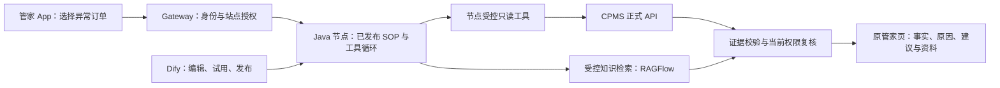

# B 端执行路线：Java 节点与 Dify 的适用边界

研究日期：2026-10-25。仓库基线：`e529a3ce`。核对官方资料、本仓代码、既有验收记录，并只读核对生产发布登记；没有新增业务问题、模型调用或部署。B 端本轮**未完成业务验收**。这是研究建议，未实施新的 B 端能力。

## 结论

B 端可以推进，先交付一个管家能用的只读诊断场景。用户已确认该业务方向，并明确新工具应来自规范的 CPMS API、能被 Java 节点实际调用；旧 AI-Ops 七工具可以淘汰。**修订前稿：不再以复用旧 Python 取数工具作为实现路线，也不把九项工具声明计为已贯通能力。**

具体推荐：B 端首个增量场景采用 Java 节点承载受控工具循环，通过 CPMS 正式只读 API 读取业务事实；Gateway 保留身份、任务授权和交付控制，RAGFlow 提供已审运维知识，Dify 复用 SOP 编辑发布入口；模型继续沿用已决定的 baoyun 渠道。先核对 CPMS 接口契约、权限和数据覆盖；缺少接口或数据就登记业务缺口，不用 SQL/TDengine/Redis 直连重新包出旧七工具冒充完成。

“B 端更复杂，所以只能用 Java”没有依据：Dify 的 Agent 节点也能按中间结果选择工具、多轮推理。Java 路线在本项目的具体价值，是已经具备按一次运行冻结配置、限制工具面、由 Gateway 决定取数对象的机制。它目前还不是完整的 B 端诊断引擎。

## C 端继续运行，剩余项单独排期

用户已明确附图误发、对外 C 端正常运行；本研究不以截图推断故障，也不以 C 端补齐全部能力作为 B 端启动条件。

按[最新真实发布验收](../validation/2026-10-25-consumer-wf01-live-release.md)，原 H5 已正式发布，真实链最终 29/29 检查通过，覆盖知识指导、连续追问、图文展示、本人状态与账务、越权拒绝和安全提示。这个结论限于已验场景。

| 尚未完成 | 对当前安排的影响 |
| --- | --- |
| 官方人工电话、邮箱、主页未配置 | 人工导航能打开，但尚不能真正接通；作为 C 端服务闭环的优先补齐项 |
| 完整 21 项教程、多设备与从新登录开始的全流程 | 已验内容可继续用，按体验反馈补齐；原生 APK/IPA 仍未验 |
| 照片输入的上游保留与清理 | 功能保持关闭，不能写成已开放 |
| 支付渠道到账、退款审批进度 | 已交付的是业务账务记录，不代表银行到账或执行退款 |
| 故障诊断准确率、长期稳定性、首屏性能、按人限流、证据自动清理 | 需要各自证据；其中真实诊断数据与方法可由 B 端建设反哺 C 端，但两端输出与权限必须分别验收 |

先前验收中的“A/B 两个用户”是越权对照身份，不能据此推断已经验过“客户端/管家端”两个入口。退款、停止充电、修改设备等写操作仍是另行设计的范围。

## B 端已经有什么

2026-10-25 本轮只读核对：生产 operator 登记的智能体是已发布 `operations` V21，允许工具名共九项；新运行路由表中只有 consumer 的 node 和 dify 场景，没有 operator 行。**九项是历史声明数，不是可供新 B 端复用的九项工具交付数。** 用户补充后重新核对旧目录、DSL 映射、执行器和两工具记录，结论如下。

| 现有资产 | 可以复用 | 还不能据此声称 |
| --- | --- | --- |
| 公司管家身份及店铺到站点范围解析 [12] | 同租户内按该员工可管理站点限制订单；无站点不扩权 | 整租户服务 key 等于员工权限；公司管家 App 新全链已验 |
| 已发布运维 SOP 选版 [13] | operator 精确选择发布版本，把方法论和工具白名单注入执行器 | 当前 B 端已由 Java 执行 |
| 七类 Python 诊断工具 [14][17] | 仅作为旧逻辑及证据经验的参考；列入退役范围 | Dify 目录会取数、Java 可调用、满足 CPMS API 规范 |
| 两个 Dify 租户服务工具 [10][18] | 保留局部联调记录供参考；不作为新链前置依赖 | 九个名字已贯通；租户服务身份等于管家权限；整套均由 CPMS API 提供 |
| 运维分析聚合 [15] | 统计定义可参考；业务事实须改由 CPMS API 提供并验证 | 旧数据库读路径可直接成为新节点工具；银行渠道失败率、真实故障根因已证明 |
| 知识检索与证据校验 [16] | 限定知识库、来源、引用、失败数据源和证据文件校验 | C 端 53 条 FAQ 已足以作为工程维修依据 |

当前单订单诊断实际由 Gateway 的 `run_agent_diagnosis` / Python 协调器执行，并注入已发布运维方法论。[13] Java 新路线不应通过包装整个旧执行器来交付；权限校验和证据校验的原则可复用，旧取数实现不作为新工具底座。

三个需区分的事实：

- 旧七工具的 Dify 目录接口返回固定说明，源码明确不读数据、不启动 run；这一点与用户补充一致。[17]
- 代码确有“发布后读取 allowed_tools → 旧 Python 执行器拦截”的路径，不能概括为任何开关都从未生效。但旧非 ops 模式下全关/不声明会沿用默认权限，移除旧 provider 也可能保留旧权限；这不是新链所要求的完整发布控制。静态路径存在不证明生产各入口均贯通。[13][14][17]
- 两个后加工具的历史记录包含先失败、修复后 Dify 模型段局部通过；本次未重验原件，保留历史范围，不将它改写为“从未成功”。其实现仍是租户服务身份，order_list 直接读 MySQL，charging_info 在 SQL 归属核对后调用 CPMS，且不是 Java 节点工具；不满足本轮目标。[18]

## 第一阶段要交付的业务效果

**管家站点内异常订单诊断助手**：优先聚焦异常结束或充电中断的一张订单。管家从订单详情进入，或输入订单号；系统先确定其管理范围，再读订单时间线、设备状态及可用的通信/遥测证据，按已发布 SOP 给出结果。首片支持一轮完整诊断；连续追问属于后续明确交付，不假称现节点已有记忆。

页面结果至少呈现五件事：发生了什么、依据是什么、可能原因及不确定性、下一步检查建议、转交工程师所需材料。证据缺失必须明确写出来，不以“模型回答成功”判业务成功。报告整理不等于自动创建工单，建议也不执行重启、退款或配置修改。

知识建设与接线同步：先盘点实际设备手册、协议/故障码解释、处置 SOP 和工程师确认案例；沿用 RAGFlow 与已有发布能力，标明适用设备、协议/版本、来源和审核状态。标准手册解释含义，实时工具证明本次发生了什么，历史案例只作参考。材料覆盖不足时，首版交付事实和待核查项。

这是目标结构，箭头不代表本轮已经接线。调用取数与检索时必须验证本次任务授权；CPMS 侧也不能把节点身份直接视为某位管家的数据权限。具体公司鉴权/委托方式先核对正式接口再确定，不默认复制 C 端会话或下发整租户密钥。现有状态节点仍通过 Gateway 取数，只作为已有模式的事实，不冒充已完成该目标结构。

推进顺序：先交付上述一张订单的完整闭环，再复用跨订单聚合做“我的站点今天哪些异常值得处理”，随后扩展持续追问和更多异常类型。处置写操作最后单独设计；不把全引擎迁移、无人值守巡检或全量旧系统退役塞入首片。

## 实施时需要触达的现有位置

1. 管家前端的真实登录凭据、订单入口与结果展示：先核对公司当前源码和发布链；本轮只读看过共享聊天源文件，不能推定管家生产构建与其相同。
2. `gateway_api.py`、`query_scope.py`：复用当前身份与订单授权，发布前、取数时、回读时核验；历史/会话正文也适用。
3. `chat_execution.py`、`node_publication.py`、`chat_route_bindings.py`：增加明确 operator 场景及发布语义；目前 consumer 限制不能仅改字符串后宣称完成。
4. Java 受控工具与配置清单：只加入首场景必要的业务工具；范围由运行上下文决定，不能让模型随意传 SQL、URL 或扩大站点。
5. CPMS API 工具适配与 `agent_validator.py`、`knowledge_retrieval.py`：依据真实接口建立工具，复用合适的交付校验；`diagnostic_tools.py` 与 `dify_tools_catalog.py` 是待退役的旧实现，不是新工具规范。
6. 契约测试、真实节点隔离整链、发布试用撤回恢复、真实管家页面及工程师对照案例：随业务片交付，不用配置登记数或模型可调用替代验收。

首片完成须证明：正常/异常/证据不足三种结果可区分；同租户站点外及跨租户访问拒绝；撤权后的工具读取、结果与会话历史回读不泄露；失败可见且不会暗中切引擎；草稿不改线上、发布切版、撤回停止交付；真实管家从登录到读报告完整通过；实际工具/模型请求量可复核，至少有工程师可独立确认的真实案例。无已确认真实案例时只能报告链路验收，不能宣称诊断准确率。

## 修订后的下一片：CPMS 工具先贯通

1. 核对公司当前分支与部署版本的正式接口，按首个异常场景列出能力：订单详情/状态、相关设备/枪状态、故障或事件记录。每项标明 CPMS 操作、请求/响应、权限、分页/时间窗、错误语义及实际可用性；数量由 API 与场景决定，不要求凑齐旧七项。采用公司接口规范及兼容的 OpenAPI 描述；HTTP GET 名称本身不证明无副作用。
2. 先实现首片真正需要的少量 Java 可调用工具，逐个证明节点发出 CPMS 请求并消费同次响应；缺 API 则列出公司接口缺口，不绕回旧运行时或数据库直读。工具清单只列可执行实现，展示条目、固定提示和配置登记都不计完成。
3. 打通 Dify 发布控制到节点实际执行：草稿开关不影响正式版；关闭并发布后新 run 拿不到该工具，绕过模型直接调用也被拒且不产生 CPMS 请求；全部关闭不能恢复默认工具。工具身份、schema、版本及实现对应关系可核对，未知/未实现工具发布失败。撤回时取消在飞并在后续读取与交付阶段拒绝；无法追回已经发出的上游读取，必须如实记录。
4. 用该工具集完成真实管家一张异常订单的报告，依据同次业务证据核验权限、失败和结果，再扩展场景。Dify 预览或试用若仍是目录说明或旧 Python 执行器，不计新节点试用通过。
5. 退役旧七工具及不再使用的两工具尝试：先核对运行引用、已发布应用及实际流量，再移除误导性目录、旧发布映射、路由、凭据和实现；分步切换保留恢复材料。未查明是否仍供 C 端或其他旧入口使用的代码不立即整包删除，历史证据与发布审计保留。新 B 端不以修好旧链为前置任务。

## 官方能力与本项目实现分开看

| B 端需求 | 官方能力 | 本项目现状与选型含义 |
| --- | --- | --- |
| 根据证据选择下一步工具 | Spring AI 将模型产生的工具调用交给应用执行；Dify Agent 同样支持工具循环、Function Calling / ReAct 策略。[1][3] | 两者都能承载动态诊断，不能仅据此选 Java。现有 Java 实际只注册一个状态工具。[7] |
| 身份、站点权限不交由模型决定 | Spring AI `ToolContext` 可以把用户、租户、请求范围等数据直接交给工具，不发给模型。[1] | 本仓用它传 `run_id`，再由 Gateway 的授权记录决定订单。可复用此模式扩展 B 端；`ToolContext` 本身不验证公司权限。[7] |
| 固定 SOP、分支、知识检索 | Dify Workflow 提供可视化节点编排；Chatflow 在同类编排上增加会话层，每条消息触发流程。[2] | 适合已有确定步骤的业务流程；不应为了使用 Java 而重写已经可复用的流程。当前节点发布只读取源应用 `pre_prompt`，不是把任意 Dify 工作流图转成 Java 执行。[8] |
| 追问、连续调查 | Dify Agent 文档描述记忆能力，Chatflow 提供会话交互。[2][3] | 现有 Java 受控模式明确拒绝历史消息、媒体和记忆上下文。多轮管家助手需要另外接入和验收，不能以框架支持代替已交付。[7] |
| 等待人工决定后继续 | Dify Human Input 可暂停流程、收集表单、按选择或超时分支继续；1.17.1 源码也有该节点模块。[4][5] | 这不等于本项目已有公司审批：还缺操作人权限、单据状态、确认与审计的业务接线。首片仍只读，无须先实现业务写审批。 |
| 失败、重试和成本控制 | Spring AI OpenAI 客户端有独立重试配置；当前官方文档列出 `spring.ai.retry.max-attempts` 默认值 10。[6] | 不能把该文档值当本节点的有效值或总请求上限。模型客户端、插件与流式路径需按实际依赖核验；节点 Gateway HTTP 客户端自身没有重试循环，并不代表模型侧没有重试。[9] |

官方文档会更新。Dify 的 Agent 文档同时描述经典节点和新的 beta 节点，本记录只以经典节点的工具循环能力作比较；没有声称新节点已在本项目安装或接入。Spring AI 是节点的传递依赖，本次未执行依赖解析，不把官网当前默认值等同于运行制品配置。

## Java 节点真正可以复用什么

从本仓代码可直接确认：[7][9]

- 运行标识从调度请求进入 `ToolContext`；模型不能通过工具参数自行指定租户、订单、用户或 URL。
- `GovernedToolRuntime` 只提供 `charging_status_snapshot`；默认 shell、通用 HTTP、RAG、技能和动态 MCP 解析均被替换。
- 执行配置守卫核对模型、适配器、端点和工具清单；运行前从 Gateway 获取该次发布配置。
- 完成回报要求 Gateway 确认同一个 `run_id` 已经 `succeeded`；模型流末轮截断不能按成功交付。

这些机制可作为 B 端底座，但新增诊断工具、站点范围内多对象读取、诊断证据组合、知识检索和追问都需要实际实现。应扩展明确的只读业务工具，避免重新放开通用 SQL、任意 HTTP 或 shell 来填补业务缺口。

## 第一片如何避免把选型做成平台工程

先围绕“一位管家调查其有权管理站点内的一张异常订单”确定输入和交付：定位订单、读取相关业务证据、列出已确认事实与仍待核实的原因、给出操作指导和人工处理所需材料。具体首个异常类型由现有工具覆盖和可复核案例决定。

一次任务只保留一个推理编排者。Java 节点负责本轮诊断工具循环，Dify 继续承担已有 SOP 编辑、试用和发布入口；不叠加第二层 Dify Agent 规划。新工具直接对应 CPMS 业务契约，不包装整个旧 Python 智能体；已运行的 C 端流程独立保留。

最关键的新增边界是**当前管家对站点和订单的权限**。已有 Dify 运维工具只认租户服务 key，不能直接当作某个管家的个人权限。[10] OWASP 要求每个接收对象标识并访问对象的接口校验当前用户对该对象的权限；只认证租户或只比较用户 ID 都不足以覆盖对象级授权。[11] 新调用和历史结果回读应统一经过现有公司权限来源，而不是接受模型、自报站点或共享服务 key 的范围声明。

首片验收至少需要证明：真实管家在授权站点内拿到带来源与时间的证据；同租户不同站点与跨租户访问被拒；权限撤回后不能回读正文；业务读取失败或证据不足时不编造结论；一次诊断的实际工具和模型请求数可核对；工程师能用真实案例复核结论。框架跑通和合成工具成功都不能替代这些业务判据。

## 来源

1. Spring AI 官方：[Tool Calling / Tool Context](https://docs.spring.io/spring-ai/reference/api/tools.html)。工具上下文不发送给模型；工具输出仍可能进入模型上下文。
2. Dify 官方：[Workflow & Chatflow](https://docs.dify.ai/en/cloud/use-dify/build/workflow-chatflow)。
3. Dify 官方：[Agent 节点](https://docs.dify.ai/en/guides/workflow/node/agent)；版本核对：[1.17.1 Agent 源码](https://github.com/langgenius/dify/blob/1.17.1/api/core/workflow/nodes/agent/agent_node.py)。源码可确认策略解析与调用，不能由此推定本项目已配置相关插件。
4. Dify 官方：[Human Input](https://docs.dify.ai/en/cloud/use-dify/nodes/human-input)。官方说明邮件模式持链接者即可应答，因此不能将其天然视为公司审批身份。
5. Dify 官方源码：[1.17.1 Human Input 模块](https://github.com/langgenius/dify/tree/1.17.1/api/core/workflow/nodes/human_input)。模块存在不等于本项目已完成接线。
6. Spring AI 官方：[OpenAI Chat / Retry Properties](https://docs.spring.io/spring-ai/reference/api/chat/openai-chat.html)。这是客户端配置说明，不是本项目的实测总调用上限。
7. 本仓：[GovernedToolRuntime.java](../../services/execution-node/src/main/java/com/trendpower/aiops/node/GovernedToolRuntime.java)、[ControlledChargingStatusTool.java](../../services/execution-node/src/main/java/com/trendpower/aiops/node/ControlledChargingStatusTool.java)。
8. 本仓：[M3-02 节点 SOP 发布与执行](../agents/m3-node-publication.md)。
9. 本仓：[ReportingChatSessionRuntime.java](../../services/execution-node/src/main/java/com/trendpower/aiops/node/ReportingChatSessionRuntime.java)、[GatewayClient.java](../../services/execution-node/src/main/java/com/trendpower/aiops/node/GatewayClient.java)、[节点 pom.xml](../../services/execution-node/pom.xml)。
10. 本仓：[Dify 租户运维首批工具](../agents/dify-ops-first-slice/README.md)。
11. OWASP 官方：[API1:2023 Broken Object Level Authorization](https://owasp.org/API-Security/editions/2023/en/0xa1-broken-object-level-authorization/)。
12. 本仓：[query_scope.py](../../src/aiops_diagnostics/identity/query_scope.py)、[scope_context.py](../../src/aiops_diagnostics/identity/scope_context.py)。
13. 本仓：`ops_agents.py`（已随旧诊断引擎退役删除）、[gateway_runtime.py](../../src/aiops_diagnostics/gateway/gateway_runtime.py)。
14. 本仓：`agent_contracts.py`、`diagnostic_tools.py`（均已随旧诊断引擎退役删除）。
15. 本仓：[ops_analysis.py](../../src/aiops_diagnostics/operator/ops_analysis.py)。
16. 本仓：[knowledge_retrieval.py](../../src/aiops_diagnostics/knowledge/knowledge_retrieval.py)、`agent_validator.py`（已退役删除）。
17. 本仓：[旧 Dify 目录](../../src/aiops_diagnostics/dify/dify_tools_catalog.py)、[DSL 工具映射](../../src/aiops_diagnostics/dify/dify_dsl_pull.py)、[ADR-0019 历史白名单语义](../adr/0019-tool-allowlist-enforced-in-executor.md)。
18. 本仓：[两工具实现](../../src/aiops_diagnostics/operator/operator_tools.py)、[历史局部模型验收](../agents/dify-ops-first-slice/model-acceptance.md)。
