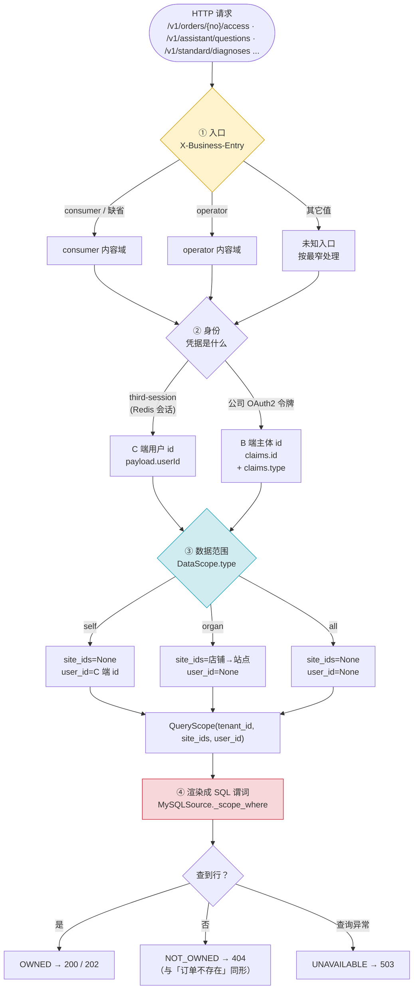
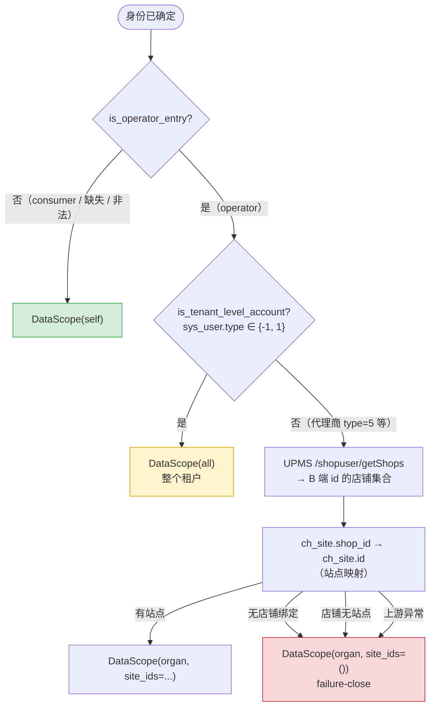
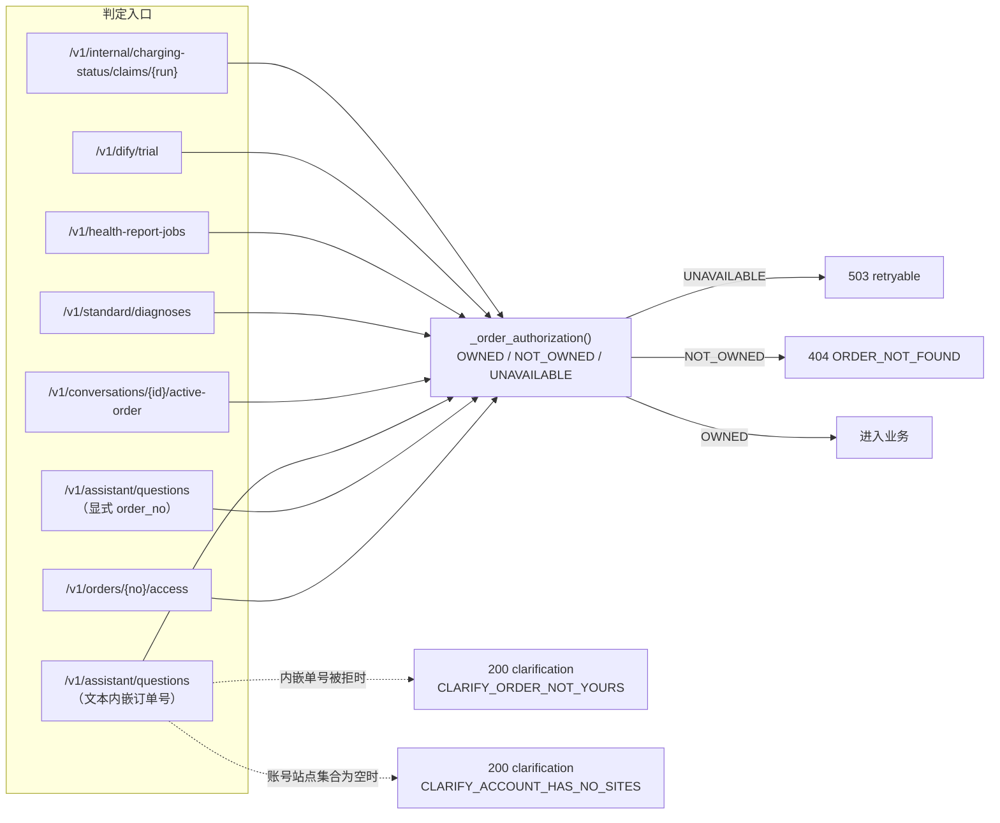
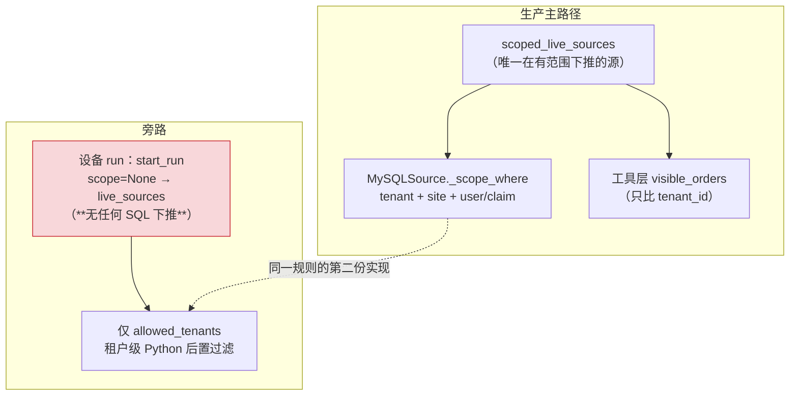
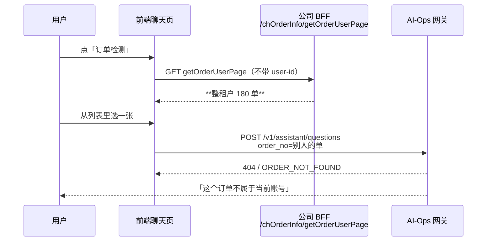

# 订单权限：从入口到 SQL 的完整判据图

> **用途**：与服务端同事评审「订单归属判定是否成立」。每一节都可以单独拿出来质疑。
>
> **依据**：`main@9cba70d` 源码 + 41 生产库只读实测（2026-10-21）。
> 文中所有数字都是 41 上跑出来的，不是估算；**未验证的推断都标了「未验证」**。
>
> **怎么读**：§1 是全貌；§3 是本次事故的核心；§9 是留给评审的五个问题。
> 相关文档：`frontend-api-brief.md` §11（选择器）、ADR-0065（工单订单归属）、
> `operator-frontend-chain.md`（管家端前端接入）。

---

## 0. 一句话结论

系统里**没有「订单归属」这个独立步骤**。有的是一条链：入口 → 身份 → 数据范围 → SQL 谓词。
所谓「这张单归不归你」，最终等价于 **`SELECT ... WHERE <谓词>` 是否返回了行**。

```python
# caller_auth.py:348-351 —— 整个授权判定的全部代码
def can_access(self, context: ScopeContext, order_no: str) -> bool:
    query_scope = resolve_query_scope(context)
    with scoped_live_sources(self.settings, scope=query_scope) as sources:
        return bool(sources.get_orders(order_no))
```

**因此：谓词少一列 = 主人被误拒；谓词多一列 = 他人被放行。** 讨论「逻辑对不对」，
实质上就是讨论这条 SQL 的构造对不对。

---

## 1. 全链路总图



---

## 2. ③ 数据范围：三种口径怎么来的



**三个出口的实际覆盖面**（41 生产）：

| 口径 | 谁能拿到 | 可见范围 |
|---|---|---|
| `self` | consumer 入口；或 C→B 映射失败 | 本人下的单 + 本人是 `consumer_id` 的工单单 |
| `organ` | operator 入口的代理商账号 | 该代理商店铺映射出的站点上的**所有**单（含他人下的） |
| `all` | operator 入口的 `type ∈ {-1,1}` 账号 | 整个租户的**所有**单 |

> ⚠️ **`organ` 与 `all` 的设计意图就是「能看别人的单」**（运营商要看本站点的所有订单）。
> 这不是越权，是 #423 的产品裁定。评审时请把「他人被放行」限定在 `self` 口径里讨论。

---

## 3. ④ SQL 谓词：全部分支

`sources.py:235 _scope_where(...)` 拼出这一段（参数全部绑定）：

```sql
WHERE tenant_id = :tenant
  [AND site_id IN (:s1, :s2, ...)]                                  -- site_ids 非 None 且未禁用
  [AND (CASE WHEN user_id='-1' THEN consumer_id ELSE user_id END) = :c_user]
                                                                     -- 或（无 claim_column 的表）
  [AND user_id = :c_user]                                            -- user_id 非空且未禁用
```

### 3.1 逐表开关矩阵

| 调用点 | `site_column` | `user_column` | `claim_column` | 说明 |
|---|---|---|---|---|
| `get_orders` | `site_id` | `user_id` | **`consumer_id`** | 唯一认工单订单的地方 |
| `get_fee_template_record` | `site_id` | `user_id` | **`consumer_id`** | 用于订单存在性检查，必须与上一条一致 |
| `get_occupy_orders` | `site_id` | `occupy.userId` | 无 | 占位单表**没有** `consumer_id` |
| `get_device` | `site_id` | 无 | 无 | 设备表没有用户维度 |
| `aggregate_*` / `count_devices` | 无（外部交集） | 无 | 无 | 站点交集在 `_bounded_sites` 内算 |

### 3.2 `self` 口径下「谁能打开哪张单」← **本次事故的核心**


**41 实测分布**（`ch_order_info` 共 **31,344** 行，2026-10-21 复核）：

| 形态 | 行数 | self 口径下 |
|---|---|---|
| `user_id` = 正常 C 端 id | 30,147 | 主人可查 |
| `user_id='-1'` 且 `consumer_id` 非空 | **347** | 修前**主人也查不到**（已修，`f1c8a454`） |
| `user_id='-1'` 且 `consumer_id` 为空 | 424 | 无人认领，谁都查不到 |
| `user_id` 空白 / NULL | 399 | 无人认领 |
| `user_id` 是渠道码（`ocpi` / `5DF62243` 等） | 27 | 无人认领 |

> 另有 **272 单** `enterprise_user_id <> user_id`（车队钱包口径），当前**不**纳入 self 判定。

---

## 4. 全部调用点（谁在判、判完做什么）



**两种拒绝形态不同，是为了不泄露存在性**：显式传 `order_no` → 404；文本里嵌单号 → 200 +
澄清文案。两者都不告诉你「这张单存在但你没权」。

---

## 5. 已知的「主人被误拒」分支（假阴性）

| # | 分支 | 机制 | 41 实测 | 状态 |
|---|---|---|---|---|
| **A1** | 工单单只认 `user_id` | 真人在 `consumer_id` | **347 单** | ✅ 已修（#891） |
| **A2** | 订单的 `site_id` 在 `ch_site` 中不存在 | operator 走店铺→站点映射，映射不到的站点永远不在集合 | **210 单**（3 个租户：77/69/62） | ⚠️ **未处理** |
| **A3** | `tenant_id` 脏值 | `'2005573840461369344_'`（尾随下划线） | **1 单** | ⚠️ **未处理** |
| **A4** | 站点有 `partner_b_id` 但无 `sys_user_shop` 行 | operator 拿不到该站点 | **146 个站点** | ⚠️ 数据缺口，不影响 self |
| **A5** | C→B 映射为空 / 歧义 / 跨租户 | operator 入口**静默回落 `self`** | 代码路径存在 | ⚠️ 设计如此但无信号 |
| **A6** | 会话过期但客户端仍带旧 `third-session` | 401（非 404，用户易误判为权限问题） | 当日复现 | 契约行为 |
| **A7** | 判定期间数据源不可用 | `SourceError` → 503 | 41 上 `/diag` 源未配置，走直连 | 已隔离 |

> **A2/A3 是数据不一致，不是代码 bug**，但后果与 A1 完全相同：主人自己查不到自己的单。
> A2 只在 operator 口径生效（站点映射不到 → 站点不在集合）；A3 在两种口径都会生效
> （租户谓词永远下推）。建议列为与公司侧核对的数据修复项。

---

## 6. 已知的「他人被放行」分支（假阳性）

| # | 分支 | 机制 | 41 实测 | 性质 |
|---|---|---|---|---|
| **B1** | `type ∈ {-1,1}` → `all` | 整个租户可见 | 设计如此 | **产品裁定**，非缺陷 |
| **B2** | operator 站点集合覆盖他人订单 | 站点内所有单 | 设计如此 | **产品裁定**（#423） |
| **B3** | C 端 id 与 B 端 id 撞号 | 同一串在两表都合法 | **1 例**，且该用户不是站点 owner | 未触发 |
| **B4** | 订单 `user_id` = 某人 B 端 id | consumer 查单时命中 | **0 例** | 未触发 |

**结论：`self` 口径下，现网没有发现他人放行的实据。**

---

## 7. 结构性风险（不是当前 bug，会随改动放大）



| # | 风险 | 说明 | 触发条件 |
|---|---|---|---|
| **C1** | 同一规则两份渲染 | SQL 渲染（`_scope_where`）比 tenant+site+user；行级渲染（`visible_orders`）**只比 tenant** | 两者目前结果兼容；一旦行级要承担真正的 self 判定就会分叉 |
| **C2** | `visible_orders` 不校验 `consumer_id` | 它只比租户 | 若将来 SQL 下推被绕过，工单单的归属会失效 |
| **C3** | **设备 run 无站点/self 维度** | `start_run` 只有 `allowed_tenants` | 41 上 `devices` 表 **0 行**，现网未暴露；一旦有人 enroll 设备即可查该租户任意订单 |
| **C4** | `/diag/*` HTTP 源在 41 未配置 | `AIOPS_HTTP_BASE_URL` 等缺失 ⇒ `HttpSources` 构造即抛 | 现网走直连，`/diag` 那套 Java 侧校验是死代码 |

---

## 8. 订单选择器：判据不同源（本次线上事故的直接原因）



**实测**：同一端点用两个不同账号的真实会话各打一次，`total` 都是 **180**（该租户全部订单）。
公司那条 mapper 只按 `ch_order_info.user_id` 过滤，**也不会认 `consumer_id`**——所以本轮修的
347 单在那个列表里依然查不到。

**唯一判据**（已写入 `frontend-api-brief.md` §11）：
> 选择器里出现的订单号，提交后必须能被服务端接受。

---

## 9. 评审时需要确认的问题

1. **`organ` 口径包含「他人下的单」是否是期望行为？**（#423 定案为是；本次事故中产品认为
   「这单是我的」，指的是站点口径。）
2. **A2/A3 那 211 单**（孤儿站点 + 脏租户号）—— 公司侧能否确认这些站点是被删除还是数据错误？
3. **C3 设备 run 路径**是否还在路线图上？若在，需要补站点/self 维度；若不在，建议删除该路径
   或显式标注为「仅租户级」。
4. **选择器**是否按 §11 修法 C（BFF 侧提供与 AI-Ops 同源的列表端点）推进？
5. `enterprise_user_id`（车队钱包，**272 单** `<>user_id`）是否需要纳入消费者口径？
   当前**未纳入**，需产品裁定。

---

## 附：关键代码位置

| 环节 | 文件:行 |
|---|---|
| 授权判定（全部代码 3 行） | `src/aiops_diagnostics/caller_auth.py:348` |
| 范围解析 | `src/aiops_diagnostics/query_scope.py:256` |
| SQL 谓词渲染 | `src/aiops_diagnostics/sources.py:235` |
| 工单哨兵常量 | `src/aiops_diagnostics/sources.py:172` |
| 入口判据 | `src/aiops_diagnostics/scope_context.py:600` |
| 顶层账号判据 | `src/aiops_diagnostics/scope_context.py:75` |
| 会话身份 | `src/aiops_diagnostics/third_session_auth.py:217` |
| 令牌身份 | `src/aiops_diagnostics/company_token_auth.py:281` |
| 行级渲染（只比租户） | `src/aiops_diagnostics/order_visibility.py:208` |
| 拒绝文案与码 | `src/aiops_diagnostics/clarification.py` |
