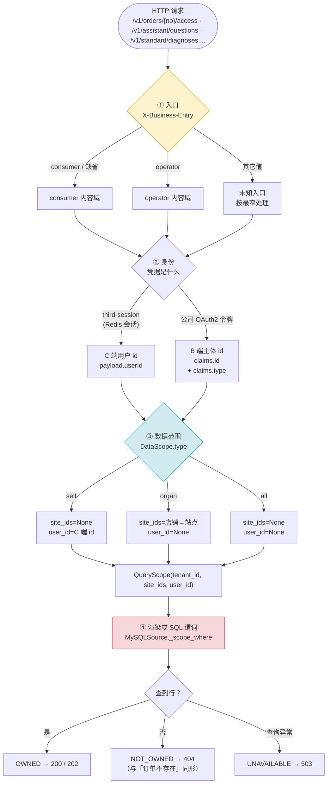
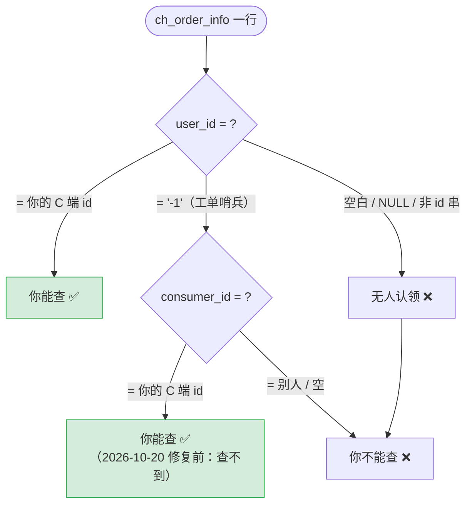
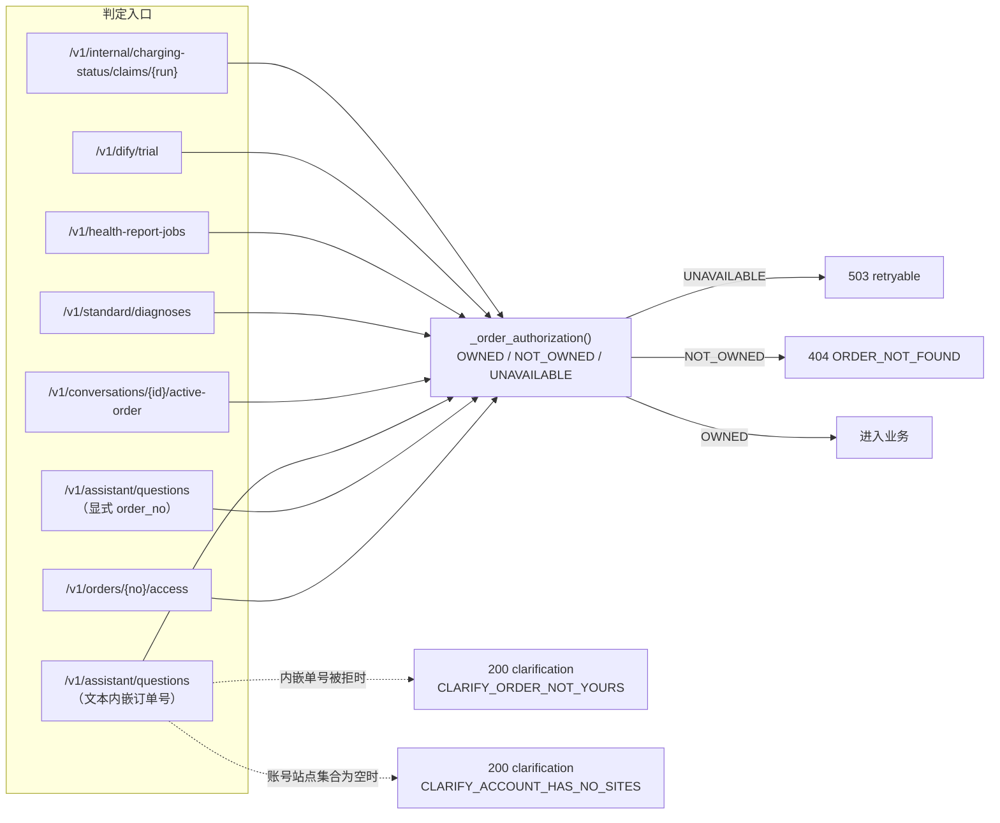
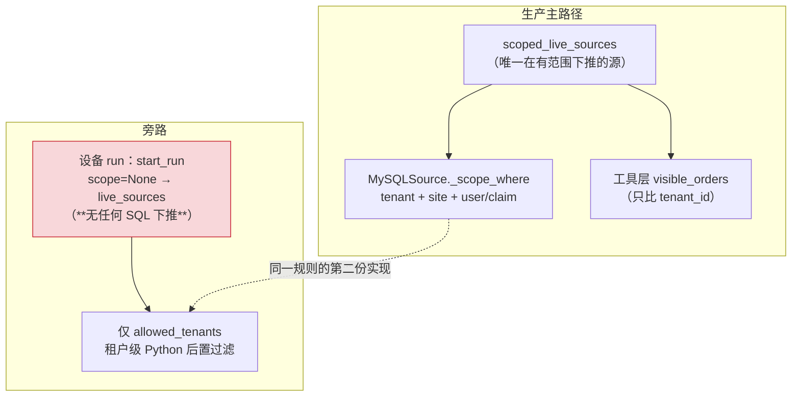
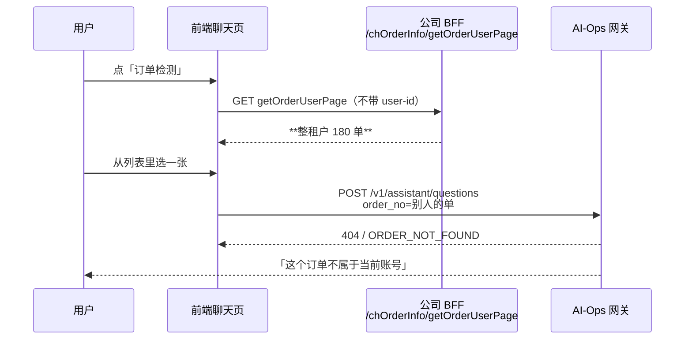

# 订单权限：从入口到 SQL 的完整判据图

> **用途**：与服务端同事评审「订单归属判定是否成立」。每一节都可以单独拿出来质疑。
>
> **依据**：`main@9cba70d` 源码 + 41 生产库只读实测（2026-10-21）。
> 文中所有数字都是 41 上跑出来的，不是估算；**未验证的推断都标了「未验证」**。
>
> **怎么读**：§1 是全貌；§3 是本次事故的核心；§9 是留给评审的五个问题。
> 相关文档：`frontend-api-brief.md` §11（选择器）、ADR-0065（工单订单归属）、
> `operator-frontend-chain.md`（管家端前端接入）。

---

## 0a. 一次「订单检测」到底发生了什么（按时间顺序讲一遍）

这一节是给**没读过这份代码的人**的。下面每一段都对应后面某一节，讲完你就能复述。

### 第 1 步：用户点了「订单检测」，前端弹出一个订单列表

前端 `aiPackage-pages-chat-chat` 里调的是公司 BFF 的
`/charging-pile/chOrderInfo/getOrderUserPage`。**这个列表不是 AI-Ops 给的**，
而且它不带 `user-id` 时返回**整个租户**的订单（41 实测：两个不同账号都拿到 `total=180`）。
→ 这就是为什么用户能选到别人的单（详见 §8）。

### 第 2 步：前端把订单号和问题发给 AI-Ops

请求里有两个关键东西：**凭据**和**入口头**。

- 凭据：客户端聊天页只发 `third-session`（Redis 里的一条会话），管家端页面发公司 OAuth2 令牌。
- 入口头：`X-Business-Entry: consumer | operator`。**41 的 nginx 缺省补 `consumer`。**

这一步决定了后面所有判定按哪套口径走。客户端聊天页把 `consumer` **写死在代码里**，
所以从聊天页进来的请求永远是「本人」口径——哪怕这个用户同时是某个站点的运营商。

### 第 3 步：网关确认「你是谁」

两条互斥的链路（§2）：

- `third-session` → Redis 拿到 `{userId, tenantId}` → 这是**C 端用户 id**（我们用 `c_user_id` 表示）。
- 公司令牌 → 解出 `{id, tenant_id, type}` → `id` 是**B 端主体 id**（`sys_user.id`），`type` 决定是不是顶层账号。

**这两套 id 是不同的东西，数字看起来一样但含义不同。**

### 第 4 步：网关算出「你能看多大」

`DataScope` 只有三种（§2），分派规则是两句话：

> **不是 `operator` 入口 → 一律 `self`（只看本人）。**
> **是 `operator` 入口 → 顶层账号（`type` 是 `-1` 或 `1`）看整个租户（`all`）；其他人按店铺 → 站点集合（`organ`）。**

`organ` 这一步需要调 UPMS 的 `/shopuser/getShops` 拿店铺，再用 `ch_site.shop_id → ch_site.id`
映射成站点。**映射出来的站点集合就是这个人能看到的全部站点**；映射失败或为空 → 空集合 →
**什么都看不到**（故意失败关闭，不回落成"整个租户"）。

### 第 5 步：把「你能看多大」翻译成一条 SQL WHERE

这是全篇最核心的一步（§3）。三种口径生成三种**完全不同**的 WHERE（下面是用生产代码跑出来的真实输出）：

**① consumer（`self`）—— 按人过滤**

```sql
WHERE tenant_id=%s
  AND (CASE WHEN user_id=%s THEN consumer_id ELSE user_id END=%s)
-- 参数: ['1942105476598861824', '-1', '1955624354196754434']
```

读法：**如果这单的 `user_id` 是 `'-1'`（工单订单），就比 `consumer_id`；否则比 `user_id`。**
这就是 2026-10-20 修的那一列——修之前它只比 `user_id`，于是 347 张工单订单连主人都查不到。

**② operator 代理商（`organ`）—— 按站点过滤，不看人**

```sql
WHERE tenant_id=%s AND site_id IN (%s, %s, %s)
-- 参数: ['1942105476598861824', '1950545576277942273', '1955812353387794433', '2037332104177541121']
```

读法：**只要这单在这个人的站点集合里，就能看，不管是谁下的。** 这是产品定的（运营商要看本站所有单）。

**③ operator 顶层账号（`all`）—— 只按租户过滤**

```sql
WHERE tenant_id=%s
-- 参数: ['1942105476598861824']
```

读法：这个租户里任何一单都能看。

> ⚠️ 你还可能看到第四种：`site_id IN ()`——那是"店铺绑定为空"时渲染出来的空集合。
> 它不会真的发给 MySQL：每个查询入口都有 `_scope_blocked()` 短路，范围为空直接返回空结果。

### 第 6 步：SQL 有没有返回行，就是答案

```python
def can_access(self, context, order_no):
    scope = resolve_query_scope(context)  # 第 4 步
    with scoped_live_sources(self.settings, scope=scope) as sources:
        return bool(sources.get_orders(order_no))  # 第 5 步的 SQL，返回非空 = 有权限
```

- 返回非空 → `OWNED` → 200 / 202，开始跑诊断。
- 返回空 → `NOT_OWNED` → **404 `ORDER_NOT_FOUND`**（和"订单不存在"同一个响应，故意不区分，防止探测）。
- SQL 抛异常 → `UNAVAILABLE` → **503**（可重试，与"没权限"分开，否则一次数据库故障会被误读成一批越权）。

### 第 7 步：进去之后，诊断工具再拿同一个范围查一遍

诊断不是只查一次订单：它还要查计费模板、设备、时序数据。这些**用的是同一个 `QueryScope`**
（`scoped_live_sources` 一次性建好），所以不会出现"订单查得到、设备查不到"的分叉。
唯一的例外是**设备 run 那条老路径**（§7 C3），它没有站点/本人维度，只有租户级过滤。

### 把七步压成一句话（你可以直接讲给后端同事听）

> **前端从「全租户订单列表」里让用户选单；用户选完，网关按「入口头 → 身份 → 三选一的数据范围」
> 生成一条 SQL；这条 SQL 只做一件事——把用户能看的范围翻译成 WHERE 条件；查到行就是有权限，
> 查不到就是 404。所以「订单归属」不是一个函数，是这条 SQL 构造得对不对。**

### 常见误解对照表

| 误解 | 实际 |
|---|---|
| 「系统判断这张单属于谁」 | 系统**不比对你和订单的 owner 字段**，它只是按你的范围去查，查得到就算你的 |
| 「管理员能看到所有单」 | 只有 `type ∈ {-1,1}` 的顶层账号是 `all`；代理商是 `organ`（站点集合） |
| 「不是我的单会返回 403」 | 返回 **404**，和"不存在"一样，防止用来探测 |
| 「订单权限和入口无关」 | **入口头直接决定 `self` / `organ` / `all`**，同一个账号换个头答案就相反（实测过） |
| 「`user_id` 就是下单人」 | 工单订单的 `user_id` 是 `'-1'`，真人在 `consumer_id` |

---

## 0b. 一句话结论

系统里**没有「订单归属」这个独立步骤**。有的是一条链：入口 → 身份 → 数据范围 → SQL 谓词。
所谓「这张单归不归你」，最终等价于 **`SELECT ... WHERE <谓词>` 是否返回了行**。

```python
# caller_auth.py:348-351 —— 整个授权判定的全部代码
def can_access(self, context: ScopeContext, order_no: str) -> bool:
    query_scope = resolve_query_scope(context)
    with scoped_live_sources(self.settings, scope=query_scope) as sources:
        return bool(sources.get_orders(order_no))
```

**因此：谓词少一列 = 主人被误拒；谓词多一列 = 他人被放行。** 讨论「逻辑对不对」，
实质上就是讨论这条 SQL 的构造对不对。

---

## 1. 全链路总图



---

## 2. ③ 数据范围：三种口径怎么来的


**三个出口的实际覆盖面**（41 生产）：

| 口径 | 谁能拿到 | 可见范围 |
|---|---|---|
| `self` | consumer 入口；或 C→B 映射失败 | 本人下的单 + 本人是 `consumer_id` 的工单单 |
| `organ` | operator 入口的代理商账号 | 该代理商店铺映射出的站点上的**所有**单（含他人下的） |
| `all` | operator 入口的 `type ∈ {-1,1}` 账号 | 整个租户的**所有**单 |

> ⚠️ **`organ` 与 `all` 的设计意图就是「能看别人的单」**（运营商要看本站点的所有订单）。
> 这不是越权，是 #423 的产品裁定。评审时请把「他人被放行」限定在 `self` 口径里讨论。

---

## 3. ④ SQL 谓词：全部分支

`sources.py:235 _scope_where(...)` 拼出这一段（参数全部绑定）：

```sql
WHERE tenant_id = :tenant
  [AND site_id IN (:s1, :s2, ...)]                                  -- site_ids 非 None 且未禁用
  [AND (CASE WHEN user_id='-1' THEN consumer_id ELSE user_id END) = :c_user]
                                                                     -- 或（无 claim_column 的表）
  [AND user_id = :c_user]                                            -- user_id 非空且未禁用
```

**为什么是「拼片段」而不是写一条完整 SQL？** 因为订单、计费模板、占位单、设备四张表都要
按同一个范围过滤，但它们的列名不一样（`ch_occupy_order_info` 的用户列叫 `userId`）。
函数返回 `(where片段, 参数列表)`，调用方自己拼在自己的 SQL 里——**范围规则只有一份，
表结构的差异通过参数表达。**

**为什么 `tenant_id` 永远在？** 即使调用方传了 `tenant_id=None`（"我想跨租户查"），
只要这次运行有 `QueryScope`，租户谓词就一定会下推。这是唯一一道无条件生效的边界。

**为什么用户条件要写成 `CASE WHEN` 而不是 `OR`？** 见 §3.2 下面的说明——写成
`user_id=:c OR consumer_id=:c` 会让「`user_id='-1'` 且 `consumer_id` 为空」的行
被误判成"属于查 `-1` 的人"。`CASE` 版本只在哨兵值出现时才去看第二列。

### 3.1 逐表开关矩阵

| 调用点 | `site_column` | `user_column` | `claim_column` | 说明 |
|---|---|---|---|---|
| `get_orders` | `site_id` | `user_id` | **`consumer_id`** | 唯一认工单订单的地方 |
| `get_fee_template_record` | `site_id` | `user_id` | **`consumer_id`** | 用于订单存在性检查，必须与上一条一致 |
| `get_occupy_orders` | `site_id` | `occupy.userId` | 无 | 占位单表**没有** `consumer_id` |
| `get_device` | `site_id` | 无 | 无 | 设备表没有用户维度 |
| `aggregate_*` / `count_devices` | 无（外部交集） | 无 | 无 | 站点交集在 `_bounded_sites` 内算 |

**为什么每张表要单独设这三列？** 因为「订单的认领者」这件事在不同表上落在不同列：
订单表有两列（`user_id` + 工单的 `consumer_id`），占位单只有一列且叫 `userId`，
设备表根本没有用户维度。**把开关做成参数，是为了让每张表只声明"我有哪几列"，
而不是让 `_scope_where` 知道所有表结构。**

**为什么 `get_fee_template_record` 也要打开 `claim_column`？** 它查的是
`ch_fee_template_record`（计费模板），这张表没有 `consumer_id`；但它会先拿同一个谓词
去 `ch_order_info` 做一次"这张单在不在你范围内"的存在性检查。**如果这里忘了打开，
就会出现"订单查得到、计费快照查不到"**——用户能看到诊断结果，但计费证据永远是空的。

**为什么聚合类方法不传 `site_column`？** 因为它们统计的是"某组站点"的整体数字，
本身没有"行属于哪个站点"的概念；站点交集在 `_bounded_sites` 里先算好，再作为
`site_id IN (...)` 显式拼进去。**这层交集不能交给调用方做**，否则任何一次调用方疏忽
都会如实统计出无权看到的站点。

### 3.2 `self` 口径下「谁能打开哪张单」← **本次事故的核心**



**41 实测分布**（`ch_order_info` 共 **31,344** 行，2026-10-21 复核）：

| 形态 | 行数 | self 口径下 |
|---|---|---|
| `user_id` = 正常 C 端 id | 30,147 | 主人可查 |
| `user_id='-1'` 且 `consumer_id` 非空 | **347** | 修前**主人也查不到**（已修，`f1c8a454`） |
| `user_id='-1'` 且 `consumer_id` 为空 | 424 | 无人认领，谁都查不到 |
| `user_id` 空白 / NULL | 399 | 无人认领 |
| `user_id` 是渠道码（`ocpi` / `5DF62243` 等） | 27 | 无人认领 |

> 另有 **272 单** `enterprise_user_id <> user_id`（车队钱包口径），当前**不**纳入 self 判定。

---

## 4. 全部调用点（谁在判、判完做什么）



**两种拒绝形态不同，是为了不泄露存在性**：显式传 `order_no` → 404；文本里嵌单号 → 200 +
澄清文案。两者都不告诉你「这张单存在但你没权」。

**为什么同一个判定要重复调用那么多次？** 因为每个入口在"进入业务之前"都要自己确认一次：
`/v1/assistant/questions` 在路由到诊断前判一次（`A2`），在文本里发现订单号时又判一次（`A3`，
这次的结果决定"回落成普通问答"还是"启动诊断"）。`/v1/internal/.../claims` 那两处在
**节点回呼**时再判一次——节点是外部进程，它自报的身份不可信，必须用服务端记录的范围重算。

**为什么判定失败（数据源挂了）要返回 503 而不是 404？** 因为 404 的含义是"这单不是你的"，
会让用户去翻自己的订单列表；而真相是"我们暂时查不了"。两者补救方式完全相反，
混在一起就变成一次数据库故障被当成一批越权。

---

## 5. 已知的「主人被误拒」分支（假阴性）

| # | 分支 | 机制 | 41 实测 | 状态 |
|---|---|---|---|---|
| **A1** | 工单单只认 `user_id` | 真人在 `consumer_id` | **347 单** | ✅ 已修（#891） |
| **A2** | 订单的 `site_id` 在 `ch_site` 中不存在 | operator 走店铺→站点映射，映射不到的站点永远不在集合 | **210 单**（3 个租户：77/69/62） | ⚠️ **未处理** |
| **A3** | `tenant_id` 脏值 | `'2005573840461369344_'`（尾随下划线） | **1 单** | ⚠️ **未处理** |
| **A4** | 站点有 `partner_b_id` 但无 `sys_user_shop` 行 | operator 拿不到该站点 | **146 个站点** | ⚠️ 数据缺口，不影响 self |
| **A5** | C→B 映射为空 / 歧义 / 跨租户 | operator 入口**静默回落 `self`** | 代码路径存在 | ⚠️ 设计如此但无信号 |
| **A6** | 会话过期但客户端仍带旧 `third-session` | 401（非 404，用户易误判为权限问题） | 当日复现 | 契约行为 |
| **A7** | 判定期间数据源不可用 | `SourceError` → 503 | 41 上 `/diag` 源未配置，走直连 | 已隔离 |

**每条分支用一个具体例子讲明白：**

- **A1（已修）**：订单 `2110199767941656577` 的 `user_id='-1'`、`consumer_id=1955624354196754434`。
  主人拿着自己的会话去查，旧 SQL 拼出 `user_id='1955624354196754434'` → 查不到 → 404。
  新 SQL 拼出 `CASE WHEN user_id='-1' THEN consumer_id ELSE user_id END = '1955624354196754434'`
  → `consumer_id` 命中 → 200。
- **A2（未处理）**：这 210 单的 `site_id` 在 `ch_site` 表里**找不到对应行**。operator 的
  站点集合来自 `ch_site`，所以这些站点永远不可能进入任何人的集合——**运营商也看不到**。
  这不是 SQL 写错，是订单引用了不存在的站点（可能是站点被删）。
- **A3（未处理）**：`tenant_id` 是 `'2005573840461369344_'`（末尾多一个下划线），而站点表里
  是 `'2005573840461369344'`。租户谓词是精确字符串比较，所以这单对**任何人**都不可见。
- **A5（设计如此但危险）**：`operator` 入口下，如果拿不到 C→B 映射（比如这个 C 端账号没绑
  B 端主体），代码会**静默退回 `self`**。用户以为自己在用运营商视角，实际拿到的是"只看本人"。
  日志里只有一行 `c_mapping_unresolved`，接口响应看不出区别。

> **A2/A3 是数据不一致，不是代码 bug**，但后果与 A1 完全相同：主人自己查不到自己的单。
> A2 只在 operator 口径生效（站点映射不到 → 站点不在集合）；A3 在两种口径都会生效
> （租户谓词永远下推）。建议列为与公司侧核对的数据修复项。

---

## 6. 已知的「他人被放行」分支（假阳性）

| # | 分支 | 机制 | 41 实测 | 性质 |
|---|---|---|---|---|
| **B1** | `type ∈ {-1,1}` → `all` | 整个租户可见 | 设计如此 | **产品裁定**，非缺陷 |
| **B2** | operator 站点集合覆盖他人订单 | 站点内所有单 | 设计如此 | **产品裁定**（#423） |
| **B3** | C 端 id 与 B 端 id 撞号 | 同一串在两表都合法 | **1 例**，且该用户不是站点 owner | 未触发 |
| **B4** | 订单 `user_id` = 某人 B 端 id | consumer 查单时命中 | **0 例** | 未触发 |

**结论：`self` 口径下，现网没有发现他人放行的实据。**

---

## 7. 结构性风险（不是当前 bug，会随改动放大）



| # | 风险 | 说明 | 触发条件 |
|---|---|---|---|
| **C1** | 同一规则两份渲染 | SQL 渲染（`_scope_where`）比 tenant+site+user；行级渲染（`visible_orders`）**只比 tenant** | 两者目前结果兼容；一旦行级要承担真正的 self 判定就会分叉 |
| **C2** | `visible_orders` 不校验 `consumer_id` | 它只比租户 | 若将来 SQL 下推被绕过，工单单的归属会失效 |
| **C3** | **设备 run 无站点/self 维度** | `start_run` 只有 `allowed_tenants` | 41 上 `devices` 表 **0 行**，现网未暴露；一旦有人 enroll 设备即可查该租户任意订单 |
| **C4** | `/diag/*` HTTP 源在 41 未配置 | `AIOPS_HTTP_BASE_URL` 等缺失 ⇒ `HttpSources` 构造即抛 | 现网走直连，`/diag` 那套 Java 侧校验是死代码 |

**这四条用大白话讲：**

- **C1** 是说：我们其实有**两套**"谁能看什么"的实现。一套在 SQL 里（生产用的就是它），
  一套在 Python 里（`visible_orders`），后者**只检查租户**、不检查站点和用户。现在没出事是
  因为数据经过 SQL 那套先筛过一遍，Python 那套只是"再确认一次租户"。**但代码里它们长得像
  同一件事，下一个人改的时候很可能只改一处。**
- **C2** 是 C1 的直接后果：如果哪天真要靠 `visible_orders` 来判工单订单的归属，它看不见
  `consumer_id`，会把这单判成"不属于任何人"。
- **C3** 最值得在会上提：设备注册那条路径（`/v1/runs`）**完全没有**站点和本人维度，
  只按租户过滤。41 上现在没有任何注册设备（`devices` 表 0 行），所以没人能利用；但这是一条
  **存在但被"数据为空"保护着**的越权路径。
- **C4** 是说：代码里还留着一条走 HTTP `/diag/*` 的取数路径（配合 Java 侧的鉴权），
  但 41 上那几个环境变量一个都没配，构造时就抛异常。也就是说**那段 Java 侧校验从来没生效过**，
  真正在保护数据的是我们自己的 SQL 谓词。

---

## 8. 订单选择器：判据不同源（本次线上事故的直接原因）



**实测**：同一端点用两个不同账号的真实会话各打一次，`total` 都是 **180**（该租户全部订单）。
公司那条 mapper 只按 `ch_order_info.user_id` 过滤，**也不会认 `consumer_id`**——所以本轮修的
347 单在那个列表里依然查不到。

**唯一判据**（已写入 `frontend-api-brief.md` §11）：
> 选择器里出现的订单号，提交后必须能被服务端接受。

---

## 9. 评审时需要确认的问题

1. **`organ` 口径包含「他人下的单」是否是期望行为？**（#423 定案为是；本次事故中产品认为
   「这单是我的」，指的是站点口径。）
2. **A2/A3 那 211 单**（孤儿站点 + 脏租户号）—— 公司侧能否确认这些站点是被删除还是数据错误？
3. **C3 设备 run 路径**是否还在路线图上？若在，需要补站点/self 维度；若不在，建议删除该路径
   或显式标注为「仅租户级」。
4. **选择器**是否按 §11 修法 C（BFF 侧提供与 AI-Ops 同源的列表端点）推进？
5. `enterprise_user_id`（车队钱包，**272 单** `<>user_id`）是否需要纳入消费者口径？
   当前**未纳入**，需产品裁定。

### 9.1 每个问题「怎么问、问到什么算有答案」

| # | 一句话抛给对方 | 期望拿回的答案 | 如果没有答案会怎样 |
|---|---|---|---|
| 1 | 「运营商在站点维度能看到本站点**别人**下的单，这是我们要的行为吗？」 | 是/否 + 如果否，改哪一侧（网关还是产品口径） | 继续维持现状；但每次有人报「别人能看到我的单」都会重复讨论一次 |
| 2 | 「这 3 个租户里 210 单的站点在 `ch_site` 里查不到，站点是被删了还是当时就没写？」 | 数据修复方案，或确认这些是测试数据可忽略 | 这些单的人只能从「订单列表」进，诊断永远 404 |
| 3 | 「`/v1/runs`（设备注册那条路）还在用吗？」 | 在用→补范围；不用→删掉或标注 | 一条被「devices 表为空」挡着的越权路径会一直留着 |
| 4 | 「订单列表能不能由 BFF 提供一份和 AI-Ops 同源的？」 | 排期，或明确的替代方案 | 选择器继续给全租户列表，用户继续选到别人的单 |
| 5 | 「车队钱包的单（`enterprise_user_id`）算谁的？」 | 算司机 / 算企业 / 两边都能看 | 现在算下单人；车队管理员看不到，但也不会误放行 |

### 9.2 可以在会上当场做的三个验证

这三条都是只读的，不需要改代码：

1. **同一个账号换个入口头，答案会变**：
   ```bash
   curl -H "Authorization: Bearer <公司令牌>" -H "X-AIOps-Source-Key: <key>" \
        -H "X-Business-Entry: operator" https://api.mall.qushiyun.com/v1/orders/<单号>/access
   # 再发一次，把 operator 换成 consumer
   ```
   实测结果：站点 owner 用 `operator` → 200，用 `consumer` → 404。**这直接证明"入口决定口径"。**

2. **同一个订单，主人口径和运营商口径答案相反**：用 13412341122 的会话查
   `2110180538479685633` → 200；用站点 owner（ulinkys）的令牌 + `operator` 查同一单 → 也是 200；
   但 ulinkys 用 `consumer` 查 → 404。

3. **订单列表与判定不同源**：用两个不同账号的会话各打一次
   `/charging-pile/chOrderInfo/getOrderUserPage?current=1&size=10`，两次 `total` 都是 180。

---

## 附：关键代码位置

| 环节 | 文件:行 |
|---|---|
| 授权判定（全部代码 3 行） | `src/aiops_diagnostics/identity/caller_auth.py:348` |
| 范围解析 | `src/aiops_diagnostics/identity/query_scope.py:256` |
| SQL 谓词渲染 | `src/aiops_diagnostics/data/sources.py:235` |
| 工单哨兵常量 | `src/aiops_diagnostics/data/sources.py:172` |
| 入口判据 | `src/aiops_diagnostics/identity/scope_context.py:600` |
| 顶层账号判据 | `src/aiops_diagnostics/identity/scope_context.py:75` |
| 会话身份 | `src/aiops_diagnostics/identity/third_session_auth.py:217` |
| 令牌身份 | `src/aiops_diagnostics/identity/company_token_auth.py:281` |
| 行级渲染（只比租户） | `src/aiops_diagnostics/identity/order_visibility.py:208` |
| 拒绝文案与码 | `src/aiops_diagnostics/clarification.py` |
