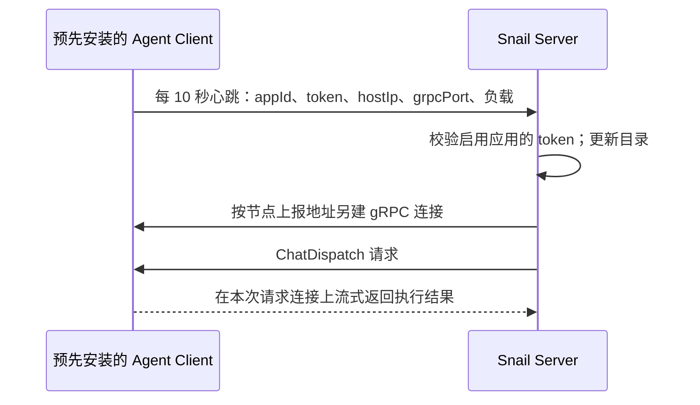

# Snail AI 的环境管理、节点接入与自动开通研究

日期：2026-11-16（北京时间）。性质：公开上游源码与官方文档研究，供 AI-Ops 下一阶段规划使用；
没有实施、部署或验收新功能。问题是：在不修改公司仓库的前提下，如何借鉴 Snail AI，
让管理员在 Dify 管理环境与租户，并完成 AI-Ops 自身模块的自动开通。

## 研究结论

值得借鉴的是**集中管理配置与连接资源，明确执行分组，展示节点状态，通过后台 API 完成操作**。
Snail 已有 App 管理、节点发现、模型/MCP 资源配置与请求分发；它没有直接提供本项目所需的
“公司环境—公司租户—公司账号权限—Dify 资源—部署任务”完整目录。

尤其要区分两件事：**节点启动后自动注册，不等于从管理页面远程安装节点**；
**客户端主动心跳，不等于服务器无需反向访问客户端**。固定源码实际使用两个方向的 gRPC
连接，默认明文。因此不能以“模仿 Snail”为理由，承诺只靠客户出网即可接入，或重新引入专属业务隧道。

## 证据范围与版本

| 来源 | 本轮实际核查 | 用途与限制 |
|---|---|---|
| [用户指定的 Gitee 仓库][gitee] | API 返回 master=`10c1d3e50b701be62da23a3403d79a41187ab8cd`；取得当前 README 与该固定提交的 LICENSE | 部分 raw/tree 请求 TLS 超时，未重新证明整个 Gitee 树与 GitHub 相同 |
| [官方 GitHub 仓库][github] | 下载并展开 `v1.1.1` 固定修订 `31c52e8277f012cfa5cfbafc53c2baaf654afa3d` 的完整源码；读取本文所引类、SQL 与内置管理端 JS | 下文具体代码结论以此修订为准，不能冒充不同提交的逐行结论 |
| [官方文档][quickstart] | 取得快速开始、App、节点、客户端配置、生产部署、分布式架构与管理 API 页面 | 文档与源码存在差异，涉及行为时以固定源码为准 |
| [官方独立管理端仓库][admin-repo] | API 取得 master=`3b2db48d7849554631f7b6f726c41b99af7c3462` 和 `src/views/app` 目录存在性 | 该修订 Vue 文件获取超时；页面行为改由后端仓库自带的固定 JS 制品交叉核对 |

此前对 AI-Ops 所用上游版本的早期核查已并入本文并归档于 Git 历史（`57c1d788:docs/agents/snail-ai-publication-research.md`）。
本轮没有运行 Snail 演示站、登录后台、启动上游服务或评估其企业版；没有用宣传文案推断企业版能力。

## 1. App 管理最值得借鉴，但 App 不是公司租户

官方页面有新增抽屉、应用列表、编辑、启停、删除及实例查看。新增输入 `appId`、名称、描述与
路由策略，后端生成 token；列表显示在线节点数，节点抽屉显示地址、在线状态、活跃会话/容量和踢出操作。
这组交互由[应用说明][app-guide]、[AppController][app-controller]和[内置页面制品][app-ui]共同支持。

其领域模型是：

| 上游对象 | 实际含义 | AI-Ops 的对应处理 |
|---|---|---|
| `sai_agent` | 提示词、模型、MCP/Skill 等智能体配置；`app_id` 选择执行分组 | 继续由现有内容发布与 Dify 应用承载；不把它当服务器 |
| `sai_app` | 执行应用身份、token、启停状态、路由策略 | 保留为执行层内部配置，不充当公司租户目录 |
| `sai_client_node` | 某执行分组内的活节点；唯一键 `(app_id, host_id)` | 展示运行状态，不能把一次启动的节点 ID 当稳定部署身份 |
| 公司业务环境与租户 | 所查 App/Agent 表没有对应维度或公司权限来源 | 在 AI-Ops 维护 `environment_id` 与 `(environment_id, tenant_id)`，再关联资源 |

依据：[Agent 表][agent-schema]、[App/节点表][app-schema]。
同一公司租户编号在两个独立业务环境重复时，单独 `tenant_id` 不足以定位和隔离；
Snail App token 证明接入应用身份，不证明最终用户有权查看某个公司订单。[OpenAPI 鉴权][openapi-auth]

**页面层面的借鉴**：管理员填环境与租户的业务信息，平台将其翻译为连接、Dify 资源和执行配置；
让普通业务运营选择已授权环境，避免让他们拼接 node ID、工作区 UUID 和内部地址。

## 2. 节点发现与实际网络方向

固定源码的通信过程如下：

- 客户端必须先装 SDK，并配置 `app-id`、`token`、Server 地址及自己的监听端口；示例配置直接说明
  “Server 通过此端口分发 Chat 请求”。[客户端配置示例][client-config]
- `ClientHeartbeatScheduler` 每 10 秒发送 unary 心跳；上报地址优先来自 `snail-ai.host`，未填时取
  `InetAddress.getLocalHost()`，并非由 Server 自动推导穿透 NAT 的可达地址。[客户端心跳][heartbeat]
- `BeatRequestHandler` 校验应用 token 后采纳上报的地址、端口和容量；`ClientInstanceManager`
  为该地址建立新的 channel。存活窗口为 40 秒，心跳队列每 5 秒刷入数据库。[心跳处理][beat]、[实例目录][instances]
- `LlmCallHandler` 使用目标节点 channel 发送 server-streaming 请求，客户端独立启动 gRPC
  listener 接收请求。[分发][dispatch]、[客户端监听][client-server]
- 心跳 channel 与 Server→Client channel 都调用 `usePlaintext()`；客户端 listener 也未在所查
  创建路径配置 TLS。[心跳建连][heartbeat-channel]、[反向建连][reverse-channel]

官方节点文档使用“gRPC 双向流”描述；源码协议和调用路径显示的是 unary 心跳加独立的
server-streaming 分发，不能据该描述宣称只有一条客户主动建立的双向长连接。
另外，官方 App 文档说未绑定 App 可本地执行，但 `ContextCollectorHandler` 对空 `appId`、
停用 App 或无节点直接返回错误。[节点说明][node-guide]、[路由选择][routing]

**对本项目的含义**：Snail 执行平台与节点可继续部署在受控共享服务网络内。
跨业务环境的数据调用应使用明确获准的普通 HTTPS 接口；网络可达、TLS、接口授权是开通前提。
若某环境只有本地数据库/Redis 证据，需要 AI-Ops 自有的受限只读适配器，不能把全功能 Snail 节点
直接暴露到客户公网，也不能把 SSH 业务隧道包装成正式接入方案。

## 3. 生命周期有边界，不能把管理按钮当完整开通事务

| 能力 | 固定源码的行为 | 本项目应怎样借鉴 |
|---|---|---|
| 创建/编辑 App | 创建生成 token 并默认启用；编辑只改名称、描述、路由策略 | 复用表单与目录模式，开通结果需另有验收状态 |
| token 展示 | `AppResponseVO` 每次仍带完整 token；UI 以圆点掩码并提供复制按钮 | 不照搬；凭据由后端保管，页面显示引用/状态，录入后只允许替换 |
| token 轮换 | 所查 AppController/AppService 没有轮换 API | 不宣称上游已有；本项目按实际凭据生命周期设计替换与失效 |
| 停用 App | 心跳校验与新任务路由检查启用状态 | 借鉴停止新任务；在飞任务、用户会话及凭据撤销要单独定义 |
| 踢出节点 | Server 内存记录被踢节点，清目录并通知客户端暂停心跳 | 不是永久设备撤销；客户端每次启动生成新的随机 `hostId` |
| 删除 App | 删除关联节点行和 App 行 | 不照搬无依赖保护删除；本项目应先停用、处理引用再退休 |
| 保存 Agent | 原地更新当前配置及 MCP/Skill 关联 | 保留本项目既有不可变版本、发布账本和受控路由；不降级为保存即发布 |
| 新机器安装 | 所查 App API 只有资源 CRUD、节点查询与踢出；快速开始要求预先部署服务/客户端 | 安装、升级、回滚、配置渲染属于 AI-Ops 需补的部署任务 |

依据：[AppService][app-service]、[AppController][app-controller]、[页面 JS][app-ui]、
[踢出实现][kickout]、[客户端身份生成][host-id]、[Agent 更新][agent-update]、[快速开始][quickstart]。
“没有找到”限定在所研究的公开版本和相关模块，不是对所有版本/企业版的否定。

因此，“一键开通”不能只是顺序发几个 HTTP 请求后弹成功。应有持久任务与逐步回执：
预检→固定配置修订与制品→安装 AI-Ops 自身组件→登记资源→验证→启用；
网络中断可重试原任务，半成品不进入正式路由，失败不删除上一次可用部署。
这部分是本项目的新增设计需求，不能计入“Snail 已经替我们实现”。

## 4. 配置集中分发可以复用，工具与凭据边界要保留

`ChatDispatchRequest` 每次带入 Agent 配置、模型、MCP、Skill、历史与 system prompt，
`LlmCallHandler.buildDispatchRequest` 逐次组装；因此提示词或连接资源更新不需要重新编译节点 JAR。
[请求组装][dispatch]

MCP 管理有测试连接入口，执行 initialize 并根据服务能力验证工具；删除被引用的 MCP 会拒绝。
这可以借鉴为“保存连接→测试连接→查看哪些资源引用它”的统一体验。
但连通性成功不证明当前公司账号的订单权限；其 MCP 配置允许通用 command、args、env、headers，
不能直接开放给普通租户运营。[MCP 管理][mcp]

两处不能直接复制：

1. `DispatchModelConfigAssembler` 解密模型 key 后放进 dispatch DTO；应保持本项目既有受控模型出口
   与凭据引用，不将共享供应商密钥分发到任意客户侧部署。[模型配置分发][model-dispatch]
2. 默认 `ToolRuntime` 装配 MCP、基础工具、RAG、Skill、自定义工具；`BaseToolResolver` 注册
   Shell 与 HTTP 工具。AI-Ops 必须继续使用受限业务工具和服务端权限校验，安装流程与模型工具分离。
   [工具装配][tool-runtime]、[基础工具][base-tools]

## 5. 对 AI-Ops 规划的直接建议

1. **Dify 一个管理 Tab，AI-Ops 一个权威目录。** 环境、租户、连接引用、能力、部署与任务状态都由
   AI-Ops API 管理；Dify 负责页面入口，不再维护另一份隐藏映射，也不要求进入 Snail 再填一遍。
2. **执行分组与公司环境分开。** 共享 Dify/模型/知识/执行服务；只有现有公司接口不足时，
   给对应业务环境安装 AI-Ops 的最小只读适配组件。新开租户通常是登记与开户，不是再复制一套平台。
3. **人工映射只解决去哪查，不替代谁能查。** 用户身份必须绑定到已经验证的环境与当前会话；
   查询继续检查公司租户和资源权限。不能相信用户任意提交的环境/租户 header，也不能遍历所有环境尝试 token。
4. **安装任务与业务执行分开。** 管理员可执行受控安装、升级与恢复；模型只能调用只读业务工具。
   表单不接受任意安装脚本、SQL、Shell 或用户任意指定的下载制品。
5. **借鉴状态可见性，补齐成功判据。** 页面分别说明目录已登记、依赖可达、组件健康、账号授权、
   三项业务已验证；“节点在线”不代表智能客服、异常订单、离线分析全部可用。

这些建议尚待本项目设计落地；本文只提供上游证据，不把建议写成当前已实现能力。

## 6. 授权描述与研究限制

GitHub 固定修订 LICENSE 为 Apache-2.0 正文；Gitee 固定提交 LICENSE 与它的 SHA-256 相同。
但本轮取得的 Gitee master README 写有附加商业使用条件，GitHub 固定 README 未含该段。
这说明不能只凭 GitHub API 的 `license=Apache-2.0` 字段作复制或再分发决定。
本规划借鉴结构与交互，不引入新复制代码；如后续复用源码或交付上游组件，应按实际修订另核
LICENSE、README 与相关附加条款。[Gitee 说明][gitee-readme]、[Gitee LICENSE][gitee-license]、[GitHub LICENSE][github-license]

未验证：真实 Snail 管理页面操作、不同部署条件下的网络行为、企业版功能；未对上游作完整安全审计。
本轮静态源码证据足以纠正“自动注册等于自动安装”“心跳等于单向出网”两项架构假设，
不足以证明 AI-Ops 的新接入方案已经通过真实业务验收。

[gitee]: https://gitee.com/aizuda/snail-ai
[github]: https://github.com/aizuda/snail-ai/tree/31c52e8277f012cfa5cfbafc53c2baaf654afa3d
[admin-repo]: https://gitee.com/opensnail/snail-ai-admin
[quickstart]: https://snailai.opensnail.com/guide/quick-start.html
[app-guide]: https://snailai.opensnail.com/guide/app/
[node-guide]: https://snailai.opensnail.com/guide/app/client-node.html
[app-controller]: https://github.com/aizuda/snail-ai/blob/31c52e8277f012cfa5cfbafc53c2baaf654afa3d/snail-ai-server/snail-ai-server-admin/src/main/java/com/aizuda/snail/ai/admin/controller/AppController.java#L28-L94
[app-service]: https://github.com/aizuda/snail-ai/blob/31c52e8277f012cfa5cfbafc53c2baaf654afa3d/snail-ai-server/snail-ai-server-admin/src/main/java/com/aizuda/snail/ai/admin/service/app/AppService.java#L53-L200
[app-ui]: https://github.com/aizuda/snail-ai/blob/31c52e8277f012cfa5cfbafc53c2baaf654afa3d/snail-ai-starter/src/main/resources/admin/assets/index-UA5ONi5x.js
[agent-schema]: https://github.com/aizuda/snail-ai/blob/31c52e8277f012cfa5cfbafc53c2baaf654afa3d/script/sql/snail_ai_schema.sql#L133-L179
[app-schema]: https://github.com/aizuda/snail-ai/blob/31c52e8277f012cfa5cfbafc53c2baaf654afa3d/script/sql/snail_ai_schema.sql#L464-L500
[client-config]: https://github.com/aizuda/snail-ai/blob/31c52e8277f012cfa5cfbafc53c2baaf654afa3d/snail-ai-agent-example/src/main/resources/application.yml#L30-L48
[heartbeat]: https://github.com/aizuda/snail-ai/blob/31c52e8277f012cfa5cfbafc53c2baaf654afa3d/snail-ai-agent/snail-ai-agent-common/src/main/java/com/aizuda/snail/ai/agent/common/handler/ClientHeartbeatScheduler.java#L35-L245
[heartbeat-channel]: https://github.com/aizuda/snail-ai/blob/31c52e8277f012cfa5cfbafc53c2baaf654afa3d/snail-ai-agent/snail-ai-agent-common/src/main/java/com/aizuda/snail/ai/agent/common/handler/ClientHeartbeatScheduler.java#L115-L122
[host-id]: https://github.com/aizuda/snail-ai/blob/31c52e8277f012cfa5cfbafc53c2baaf654afa3d/snail-ai-agent/snail-ai-agent-common/src/main/java/com/aizuda/snail/ai/agent/common/handler/ClientHeartbeatScheduler.java#L229-L245
[beat]: https://github.com/aizuda/snail-ai/blob/31c52e8277f012cfa5cfbafc53c2baaf654afa3d/snail-ai-server/snail-ai-server-features/snail-ai-feature-common/src/main/java/com/aizuda/snail/ai/rpc/handler/BeatRequestHandler.java#L40-L84
[instances]: https://github.com/aizuda/snail-ai/blob/31c52e8277f012cfa5cfbafc53c2baaf654afa3d/snail-ai-server/snail-ai-server-features/snail-ai-feature-common/src/main/java/com/aizuda/snail/ai/ClientInstanceManager.java#L60-L195
[reverse-channel]: https://github.com/aizuda/snail-ai/blob/31c52e8277f012cfa5cfbafc53c2baaf654afa3d/snail-ai-server/snail-ai-server-features/snail-ai-feature-common/src/main/java/com/aizuda/snail/ai/ClientInstanceManager.java#L564-L571
[kickout]: https://github.com/aizuda/snail-ai/blob/31c52e8277f012cfa5cfbafc53c2baaf654afa3d/snail-ai-server/snail-ai-server-features/snail-ai-feature-common/src/main/java/com/aizuda/snail/ai/ClientInstanceManager.java#L465-L549
[routing]: https://github.com/aizuda/snail-ai/blob/31c52e8277f012cfa5cfbafc53c2baaf654afa3d/snail-ai-server/snail-ai-server-features/snail-ai-feature-agent/src/main/java/com/aizuda/snail/ai/feature/agent/chain/ContextCollectorHandler.java#L50-L72
[dispatch]: https://github.com/aizuda/snail-ai/blob/31c52e8277f012cfa5cfbafc53c2baaf654afa3d/snail-ai-server/snail-ai-server-features/snail-ai-feature-agent/src/main/java/com/aizuda/snail/ai/feature/agent/chain/LlmCallHandler.java#L60-L118
[client-server]: https://github.com/aizuda/snail-ai/blob/31c52e8277f012cfa5cfbafc53c2baaf654afa3d/snail-ai-agent/snail-ai-agent-common/src/main/java/com/aizuda/snail/ai/agent/common/rpc/ClientGrpcServer.java#L37-L47
[agent-update]: https://github.com/aizuda/snail-ai/blob/31c52e8277f012cfa5cfbafc53c2baaf654afa3d/snail-ai-server/snail-ai-server-admin/src/main/java/com/aizuda/snail/ai/admin/service/agent/AgentService.java#L146-L171
[openapi-auth]: https://github.com/aizuda/snail-ai/blob/31c52e8277f012cfa5cfbafc53c2baaf654afa3d/snail-ai-server/snail-ai-server-openapi/src/main/java/com/aizuda/snail/ai/openapi/interceptor/OpenApiAuthInterceptor.java#L73-L107
[mcp]: https://github.com/aizuda/snail-ai/blob/31c52e8277f012cfa5cfbafc53c2baaf654afa3d/snail-ai-server/snail-ai-server-admin/src/main/java/com/aizuda/snail/ai/admin/service/mcp/McpServerService.java#L198-L243
[model-dispatch]: https://github.com/aizuda/snail-ai/blob/31c52e8277f012cfa5cfbafc53c2baaf654afa3d/snail-ai-server/snail-ai-server-features/snail-ai-feature-model/src/main/java/com/aizuda/snail/ai/model/adapter/server/DispatchModelConfigAssembler.java#L29-L52
[tool-runtime]: https://github.com/aizuda/snail-ai/blob/31c52e8277f012cfa5cfbafc53c2baaf654afa3d/snail-ai-agent/snail-ai-agent-executor/snail-ai-agent-executor-core/src/main/java/com/aizuda/snail/ai/agent/core/runtime/tool/ToolRuntime.java#L39-L59
[base-tools]: https://github.com/aizuda/snail-ai/blob/31c52e8277f012cfa5cfbafc53c2baaf654afa3d/snail-ai-agent/snail-ai-agent-executor/snail-ai-agent-executor-core/src/main/java/com/aizuda/snail/ai/agent/core/resolver/BaseToolResolver.java#L37-L49
[gitee-readme]: https://gitee.com/aizuda/snail-ai/blob/10c1d3e50b701be62da23a3403d79a41187ab8cd/README.md
[gitee-license]: https://gitee.com/aizuda/snail-ai/blob/10c1d3e50b701be62da23a3403d79a41187ab8cd/LICENSE
[github-license]: https://github.com/aizuda/snail-ai/blob/31c52e8277f012cfa5cfbafc53c2baaf654afa3d/LICENSE
