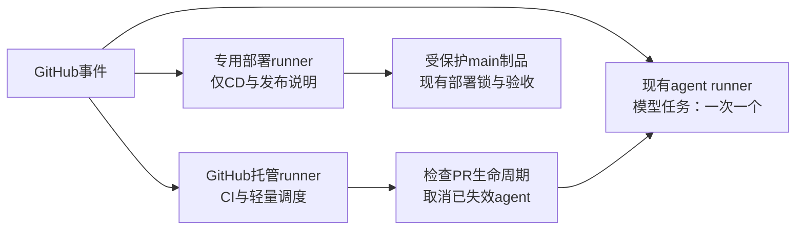

# Actions 队列治理方案

状态：用户已批准，实施中。依据基线 `6e8a05fe` 与2026-11-05 GitHub运行记录；不是已完成的容量验收。
目标是消除“agent长任务阻塞部署”和“已失效任务继续占槽”两类反复发生的问题；
不承诺GitHub故障、主机故障或部署本身超时下零等待。

## 1. 已确认的原因

当前只有一个可用自托管runner。真实API标签与仓库YAML匹配结果表明：
`deploy-41`、`release-notes`、`Agent Update Branch`、`Agent Promote Queued`都只能去同一个实例。

| 证据 | 实测结果 | 能支持的判断 |
|---|---|---|
| 分支更新运行42012040921 | 等待43.3分钟，再执行34.4分钟，最终取消 | 长任务占槽且没有及时随PR结束 |
| 分支更新运行42012047713 | 等待77.7分钟；开始时PR已合并 | 开始前缺少实时状态检查 |
| CD运行42021956567 | 等待7.7分钟，执行约1.7分钟 | 部署主要延迟来自等槽 |
| CD运行42024035523 | 空闲时约4秒开始，部署约1.6分钟，发布约15秒 | 部署本身不需要几十分钟 |

等待统计使用实际执行步骤与runner分配交叉确认。不能一律用job.started_at：
运行42012527885没有runner、没有步骤，却有started_at，实际未执行。

#1411已停止main变更后批量rebase/自动派发冲突修复，也分开了部署与发布结果；
但没有新增独立执行槽，没有实现PR关闭后的任务回收，因此不是队列问题的全部解法。

## 2. 推荐结构



### 独立部署槽

新增一个runner实例，沿用当前开发主机，不增购机器，不部署到生产主机。
使用独立工作目录和`claude`用户systemd单元，沿用已安装的治理发布单元；
不复制runner凭据或另一实例的`.runner`/`.credentials`，通过官方注册取得自己的身份。

注册参数包含 `--no-default-labels --labels aiops-deploy`，CD两作业改成：

```yaml
runs-on: aiops-deploy
```

现有agent runner继续接`self-hosted`任务。**新实例不能带`self-hosted`标签**：
否则现有裸`runs-on: self-hosted`仍可能抢占部署槽。静态回归检查与在线标签核验都必须保护这一点。

部署继续串行、不取消正在部署的作业；仅保留最新pending部署，不保存一长串过时版本。
release-notes沿用专用槽；若实测发布作业成为瓶颈，再拆它，当前15秒不值得再加实例。

这隔离的是调度，**不是主机资源或凭据安全边界**。两个实例仍在同一主机/账户，
共享CPU、内存、网络、Docker与既有生产访问条件。标签不是授权规则。
当前先保持agent并发为1；部署实例设置内存上限与较高CPU权重，具体数值由并发验收确定。
Docker容器的资源不自动归入runner的systemd限制，不能把限制runner服务当成限制全部agent负载。
若同机争用仍造成超标，再做独立主机决策，不无边界增加agent并发。

### 轻量调度移出自托管队列

`Agent Promote Queued`与`Architecture Review/check-backlog`只调用GitHub API，改用`ubuntu-latest`。
授权令牌、拒绝条件和幂等标签转换保留；不让这类几秒钟的元数据操作排在模型任务后面。
`architecture-review`模型作业、Implement、Review、Update Branch仍在现有agent槽。

### 过期任务自动退出

限定三个变更PR的工作流：`agent-implement-pr.yml`、`agent-review.yml`、`agent-update-branch.yml`。
不能按“排得久”取消所有Actions，不能触碰CD、发布、其他PR或仍开放的有效工作。

1. **开始前核对**：实时读取PR仍为OPEN、同仓库所有者、head等于事件记录。
   stale/closed时在checkout候选及调用模型前结束；不改成blocked，不输出“实现完成”。
2. **推送前核对**：复读同一PR状态及head；沿用trusted-pr-delivery的历史/head保护。
   PR在计算期间已关闭或head推进，就保留内部回执并停止交付，不能重建已删除远端分支。
3. **运行中回收**：新建仅调用GitHub API的hosted清理工作流，监听PR closed，
   加一个低频兜底扫描处理漏到的事件。权限仅contents:read、pull-requests:read、actions:write。
   不checkout候选，不加载PR代码，不调用模型，不推送分支。

为三个工作流增加明确的 `run-name: <workflow> / pr-<number>`，编号来自GitHub事件字段。
清理时以workflow路径白名单、事件类型、可信PR编号、当前关闭状态和关闭时刻共同匹配，
先枚举完整候选集合，再取消创建于该关闭时刻之前的queued/in-progress运行。
**不能依赖run.pull_requests字段**：本仓pull_request_target真实记录为空。
没有可靠PR关联的历史任务只报告，不猜测或批量取消。

PR重新打开时不取消；延迟的旧closed事件不得取消重新打开之后的新运行。
API异常或分页不完整时报告未知；不要把“查不到”当成“已经关闭”。
普通取消后回读终态与runner释放，验证SDK容器及子进程退出；不能把HTTP 202当成已经结束。
不自动force-cancel，也不按名称批量清理Docker容器。无响应时发出具体任务告警并由原任务负责人处理。

## 3. 状态可观测

扩展现有CD Watch，不引入新的常驻服务：

- 分开报告等待runner、等待部署锁、正在执行、已取消和部署失败。
- 显示匹配部署标签的runner数量、online/busy，以及部署run/job。
- 排队超过2分钟先输出诊断，超过5分钟告警；这是拟定内部目标，不是GitHub保证。
- PR关闭到任务终态的拟定目标为2分钟；失败时报告取消请求与回读结果。
- 普通agent允许排队，显示当前运行者和等待者；容量不足需要缩小/切分任务或经实测扩容。
- 同主机资源压力独立观察；没有数据时不将“runner online”写成“机器有空余容量”。

当前CD Watch的部分文案把排队过长限定为离线/锁未释放，应补上runner忙于其他作业的实际原因。
等待开始时间取平台可验证时间，不能用run创建时间覆盖审批等待、也不能误信未分配job的started_at。

## 4. 实施与回滚顺序

一个逻辑任务、一个短期分支/PR，分小提交完成；任何生产部署仍走原有受保护main和CD。

1. 先写生命周期匹配/取消的合成反例，完成轻量任务分流、三处入场/交付检查及清理工作流。
2. 准备可复现的部署runner安装/撤回方法，目录放受管`_runners/`，配置不包含凭据。
   政策工具不单文件投影，所需更新只走canonical installer。
3. 注册带唯一标签的新实例，确认online且通用agent标签无法匹配；用无生产副作用的合成任务验证。
   新实例就绪之前不切CD标签，原runner与当前部署持续可用。
4. CI与独立入口验收通过后合并，CD切专用槽；原agent槽保持，验证一次标准CD。
5. 观察至少20次合并的等待分布和误取消，记录原始样本，不能用单次成功声称所有排队消失。

回滚先用PR恢复CD路由，再撤销新runner注册和用户unit，不能先删runner让现役CD无处执行。
生命周期清理故障可单独回退清理工作流；必需检查、生产锁、受信任控制器边界始终保留。

## 5. 防“看起来完成”的验收

| 编号 | 实际操作 | 必须看到 |
|---|---|---|
| Q1 | 用无模型合成任务占满普通agent槽，同时派发部署探针 | 不同runner ID，部署探针目标2分钟内开始 |
| Q2 | 比对在线标签与所有jobs的runs-on | agent不能匹配专用槽；CD不能回退普通槽 |
| Q3 | 让合成PR任务排队，再关闭PR | 模型入口未调用；过期任务结束；其他PR不受影响 |
| Q4 | 任务运行中关闭PR | 普通取消生效，2分钟内释放runner及本任务子进程/容器；保留回执 |
| Q5 | closed事件延迟、重新打开、head竞争、API失败、分页截断 | 不取消新任务、不推送过期结果、不假报清理完成 |
| Q6 | 暂停专用runner后发合成探针 | 明确报告部署runner离线，agent槽仍可工作；恢复后继续 |
| Q7 | 同时制造旧/新部署请求 | 不取消正在部署者；旧pending可被取代；不会反向部署旧版本 |
| Q8 | 满负载时执行一次获准标准CD | 服务健康、版本SHA、制品摘要、回滚记录全部匹配 |

Q1–Q7不使用真实业务数据或故障注入生产；Q8是获准的标准部署，不用测试制造真实用户故障。
未执行这些验收前，状态只能是“方案已完成”，不能叫“队列问题已根治”。

## 6. 为什么不用其他办法

- 增加一台带默认标签的runner：提高平均吞吐，但两台都能被agent占满，部署仍无保证。
- 缩短所有超时：会切断正常模型任务；timeout-minutes不限制等runner的时间。
- 定时删除/取消所有旧run：误伤有效长任务与部署，且不修生命周期。
- 打开`concurrency.queue: max`：平台已支持最多100个pending，但这只是存更多任务，不提供执行槽。
- Kubernetes/ARC：当前没有相应基础设施；为两个执行槽引入控制面成本过高。

## 7. 官方依据（核验于2026-11-05）

- [runner单作业分发实现](https://github.com/actions/runner/blob/main/src/Runner.Listener/JobDispatcher.cs)。
- [标签按组合匹配与no-default-labels](https://docs.github.com/en/actions/how-tos/manage-runners/self-hosted-runners/use-in-a-workflow)。
- [并发与queue模式](https://docs.github.com/en/actions/how-tos/write-workflows/choose-when-workflows-run/control-workflow-concurrency)。
- [事件与pull_request_target安全边界](https://docs.github.com/en/actions/reference/workflows-and-actions/events-that-trigger-workflows#pull_request_target)。
- [取消运行API](https://docs.github.com/en/rest/actions/workflow-runs#cancel-a-workflow-run)与[取消信号过程](https://docs.github.com/en/actions/reference/workflows-and-actions/workflow-cancellation)。
- [作业运行超时](https://docs.github.com/en/actions/reference/workflows-and-actions/workflow-syntax#jobsjob_idtimeout-minutes)与[平台限制](https://docs.github.com/en/actions/reference/limits)。
- [ARC适用前提](https://docs.github.com/en/actions/concepts/runners/actions-runner-controller)。
