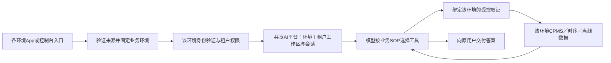

# 跨服务器业务环境与多租户：源码核对及改造方案

2026-11-13（北京时间），AI-Ops基线`29e4eed0`。状态：调查完成、方案建议；未实现跨环境路由。
用户目标是同一AI平台服务不同服务器上的租户，三个功能均适用：智能客服、异常订单分析、设备离线分析。
公司源码与生产数据只读，原文、内部端点及现场结果保存在私有证据目录，不复制入仓。

## 1. 结论及旧前提订正

白板可辨识的线索为JWT、tenantId和domain；不足以确认JWT直接包含域名。
本轮发现公司代码**已经有平台编码到SaaS地址的映射**，因此不能继续说公司侧没有环境映射机制。
但它还不是已经验证可接入的CPMS运行时目录。

| 事实 | 已核对结果 | 可推出的结论 |
|---|---|---|
| 当前JWT签发 | UPMS release/dev/refactor及登录修复分支均无domain、environment、platform_code、iss、aud；较旧调查多了agent_id | 不能直接解出服务器；agent_id不是环境 |
| system_id | 来自用户sysemId，菜单/系统配置消费 | 不能直接解释为服务器编号 |
| platformCode | 用户与租户实体都有，注释说明区分部署环境；创建租户/用户实际复制 | 是值得接入核对的环境线索，不能因某环境同值就全局否定 |
| 应用市场目录 | `PlatformService.getSaaSApp(platformCode, saasType)`返回`domain/context`，初始化流程实际调用该地址 | 映射有业务调用者，并非只有字段或注释 |
| SaaS种类 | 平台/商城/园区/美业；未找到独立CPMS类型 | 不能把domain/context直接当charging-pile、时序或数据库地址 |
| 当前环境只读核对 | 对应platform表存在但总行数为0；本环境租户/用户平台编码单值 | 这份库不能作为跨环境权威目录；不代表其他环境没有记录 |
| 第二环境 | 受管访问入口连接超时 | 本轮未验证它的JWT、目录、业务接口或部署版本 |

旧ADR0059的工作区隔离原则仍有效；“JWT没有domain，所以环境只能每实例写死”不是逻辑必然。
`platformCode`是否跨环境唯一、哪个中心目录实际维护它，尚未得到现场数据证明。

## 2. 一手证据索引

出处使用公司仓、分支、固定修订、文件与行；只记录语义，不搬运源码正文。

- `cloud-upms:dev@e7010feb`，`cloud-upms-admin/.../controller/TokenController.java:286`：逐项构造JWT；
  release@0e041e7b、refactor@a4d34a9f及fix/login_261112@e36b6215同路径也已核对。
  `agent_id`来自partnerId；开发分支新不等于已部署。
- 同仓`cloud-upms-common/.../entity/SysOrgan.java:133`、`SysTenant.java:239`、`SysUser.java:230`：platformCode；
  `SysTenantServiceImpl.java:73`及`SysUserServiceImpl.java:160`实际复制字段。
  `SysUserController.java:143`的`/user/info`读取当前用户；这仍要求事先知道正确UPMS。
- `cloud-gateway:dev@779cd2cb`，`.../filter/AuthGlobalFilter.java:88`：使用已选Route做身份与权限处理，未发现按该字段重选服务器。
- `paas/marketplace:master@0139c4eb`，`src/main/java/com/qushiyun/cloud/marketplace/`下：
  `domain/appauth/model/Platform.java:29`、`domain/appmall/service/PlatformService.java:13`按code/saasType选择；
  `domain/appauth/model/SaasAppVO.java:17`声明domain/context；
  `application/service/AppAuthAppService.java:199`实际用于平台和业务SaaS初始化。
- 同仓`api/PlatformController.java:26`提供平台入口；`:36`的saasApp/configs已标Deprecated，且返回的是远端配置，
  不能不经核对就把它当环境发现API；`PlatformQuery.java:22`支持code过滤，`PlatformPO.java:12`映射platform表。
  DDL只有id主键，不能假定code已有数据库唯一约束。
- `base/ddd4j:master@9eab70f5`，`base-web/.../api/CRUDController.java:49`起有继承式GET list/detail。
  只能据此列出**候选只读合同**；依赖是SNAPSHOT，实际部署的URL前缀、鉴权和响应仍需验证。
- `paas/qushisdk:master@4567b5e3`，`.../marketplace/service/MarketplaceFeignService.java:14`是可配置的市场服务地址，
  暴露许可/资源接口；未找到可直接复用的tenant→CPMS发现方法。
- `devops/saas-grady:main@1b83bbe6`的SyncOnClickAdd需输入租户与数据库地址，是同步任务，不是自动发现。
  Node遗留siteDomain是网站配置，也不能用于业务环境选择。

取数遵循[公司源码规程](../agents/company-code-recon-procedure.md)：先列分支、核Java数量，再固定ref读取。
GitLab API首次缺read_api权限，用户更新后恢复；全分页目录521项。未逐个审计521仓，不能声称全仓不存在其他目录。

## 3. 现有实现缺口

| 链路 | 现有实现 | 跨服务器时必须改变的点 |
|---|---|---|
| 请求身份 | `_caller_resolver`构造一套公司/会话解析器，依赖固定UPMS/Redis与来源密钥 | 在解析用户前绑定可信来源环境，调用该环境验证器；解析后复核环境/租户一致 |
| 身份与会话 | ScopeContext/QueryScope没有业务环境；会话按scope_fingerprint核权 | 相同用户/租户ID在不同环境必须产生不同作用域，会话与缓存不能跨环境复用 |
| 控制台登录 | 一个登录代理固定公司地址；MappingStore主键仅company_user_id | 验证码前确定环境；集中映射须环境＋用户，或保留各环境隔离映射库 |
| 工作区/正式路线 | 工作区及路线已带environment；调用方通常传settings.environment或execution_environment | 将业务来源环境贯穿解析，不能把AI服务的部署位置当客户环境 |
| 新客户开通 | consumer_endpoint按租户配置或清单默认项登记 | 默认环境不是租户归属证明；多环境须显式绑定，未知/冲突拒绝 |
| 实际工具 | CPMS可按租户配地址；离线等直接使用runtime.diagnostic_settings | UPMS、CPMS、商城、时序、MySQL、Redis及业务时区必须来自同一环境配置 |
| 运行记录 | 运行有environment，但其他账本仍假定单实例单环境 | 管理权限、幂等键、历史回读和恢复目标统一核环境，不能只改workspace一张表 |

临时合成探针确认：相同ID的ScopeContext指纹相同、登录映射主键无环境、清单默认项不包含租户归属判据。
这说明**直接把多环境并入一个当前实例不安全**，不证明现役隔离部署已发生串租户。
现有3项工作区检查通过，证明工作区映射已支持环境维度，不等于整链已支持。

## 4. 建议采用的链路

模型不选择域名或服务器。引入环境不会增加关键词路由或第二套模型循环。
业务环境是数据与认证的归属，不等同一台物理机器；同一环境可以有多个服务端点。

**先解决入口，再解析租户。** 仅拿tenant_id在各环境试登录，或把同一个JWT发给多个UPMS尝试，均不可采用。
同一tenant_id可能出现在两份数据库；从待验证JWT读domain后向它发送凭据也不可采用。

首轮建议使用已经存在的公司入口：每个环境由可信代理覆盖来源标识，以独立服务凭据绑定到已登记环境。
控制台可用环境专属链接/受管域名；集中登录页若需要选择环境，选择只决定受控候选，成功认证才确认身份。
验证码和密码必须发送到同一环境，不能登录过程中换地址；客户端自报Host/环境头不构成信任依据。

目录登记保存稳定environment_id与**完整依赖配置引用**、允许接入的租户绑定及启用状态。
第一版可以由平台运维一次登记环境，不能每来一个租户就修改生产环境文件；租户开通从已验证目录选取。
`platformCode/domain`来源核实后接到同一目录导入/对账流程，不同时维护两份竞争真值，不用空值默认QUSHIYUN。
现有单环境配置只能映射为已知旧环境兼容项，不能给未识别来源自动兜底。

若公司后续提供可验证JWT的iss或environment_id：先按本地可信列表选择验证规则，验签、签发者、受众与租户后绑定环境。
这是后继可替换的入口，当前不得臆造claim；字段齐备也不等于已被可信签发。
映射需明确0条拒绝、重复/歧义拒绝、撤销立即禁止新查询，已有会话不随目录变化静默迁入新环境。

标准依据：[RFC7519 §4.1.1/§4.1.3](https://www.rfc-editor.org/rfc/rfc7519.html#section-4.1.1)、
[RFC8725 §3.8～3.10](https://www.rfc-editor.org/rfc/rfc8725.html#section-3.8)。
它们要求校验签发者/受众并防止未经验证的claim驱动外部访问；不规定公司的platformCode一定对应服务器。
现有公司兼容模式不能自动扩展为跨环境信任边界。

## 5. 实施顺序与验收

1. **落实环境权威来源**：优先复用公司marketplace映射，先查到实际维护实例、唯一性与CPMS含义。
   若该目录尚未投用，先用平台受管环境登记与来源绑定启动，保留后续导入位置；不等待臆造JWT字段。
2. **完成环境隔离**：同一进程支持多个环境前，先贯穿身份、作用域、会话、用户映射、管理与发布。
   数据库迁移沿已存在gateway_schema流程；旧数据明确归入旧环境，不从tenant_id猜来源。
3. **贯穿三个业务功能**：按环境构建各自运行依赖和授权读面，禁止运行中改全局Settings/env变量。
   共享Dify、知识平台与模型循环；各业务环境可集中连接或保留隔离数据网关，部署位置不成为业务身份。
4. **双环境验收后启用**：每环境至少两租户；故意使用相同用户/租户/订单ID，验证回答、会话、知识库、
   离线统计与正式版本互不串用。再测未知来源、错误来源凭据、环境不一致、目录缺失/重复/撤销及恶意URL。
   一环境断连必须只影响其请求；另一环境正常。禁止拿mock或41双租户冒充两个真实环境。

本轮不更改公司签发器、不填生产platform表、不变更正式路线。需要补齐的事实是中心目录位置、数据有效性、
CPMS/时序/离线读面的真实映射及第二环境可达性；这几项决定生产启用，不能用设计文档代替。

## 6. 可独立交付的实施任务

| 顺序 | 任务 | 完成判据 | 依赖 |
|---|---|---|---|
| T1 | 可信业务环境入口与只读目录 | 环境来自已登记入口/凭据；未知、冲突和伪造来源被拒绝；旧环境明确绑定，不能默认接住其他环境 | 环境端点与验证合同经平台登记 |
| T2 | 身份、会话与管理对象环境隔离 | 两环境同用户/租户ID不共用会话、映射、发布与幂等账本；旧数据迁移后原入口正常 | T1 |
| T3 | 三项业务按绑定环境运行 | 客服、异常订单、离线分析各自从正确CPMS/商城/时序/只读库取数，单环境故障不波及其他请求 | T2 |
| T4 | 目录来源对账、双环境原入口验收与受控启用 | 已核中心目录记录及真实端点；每环境两租户完成用户问题、追问、越权及撤销；部署/回退证据齐全 | T3、第二环境可达 |

T1～T3的隔离合同可在两个一次性环境上先完成实现与系统验证；真实生产启用等T4，不把合成环境标成第二服务器已上线。
运行隔离可以继续使用每环境独立Gateway数据根/进程，再由统一入口分派；这将复用现有隔离能力，
比在同一实例中逐表改共享主键风险更小。共享的是AI平台与业务合同，不要求所有环境共用一个数据库或进程。
集中一个进程是替代方案：必须先改完T2，不能只给scope加字段就放行生产。
