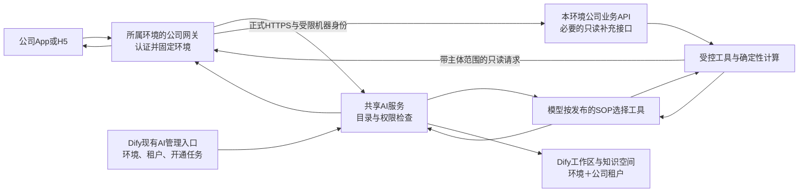

# 公司网关接入、环境管理与一键开通方案

2026-11-14。状态：用户已确认并授权实施；环境目录与管理入口首片开发中。正式网关接入与新服务器部署尚未完成。
用户已决定撤回95，拒绝客户环境专属SSH业务隧道，并要求先设计环境/租户管理页面。
本设计替代“复制95完整栈”的推广方式，不改变已上线三个业务能力的模型/SOP执行链。

## 1. 业务模型与部署责任

AI-Ops是公司软件的AI模块。客户继续从公司App/H5提问，模型按SOP调用获准工具、读取事实并回答。
新增环境不应要求客户了解Dify、模型代理、数据库端口或SSH转发；环境接入由公司部署体系完成。

| 对象 | 含义与关系 | 权威来源 |
|---|---|---|
| 业务环境 | 一套独立认证与业务数据，可跨多台服务器 | 平台受管环境目录 |
| 公司租户 | 环境中的业务主体；唯一键为环境＋公司tenant_id | 该环境的公司认证/租户目录 |
| 开通关系 | 某环境中的某租户获准使用哪些AI能力 | AI-Ops目录；不授予额外订单权限 |
| 工作区 | 租户在Dify的编辑空间，按环境＋公司租户唯一绑定 | AI-Ops绑定账本；Dify实际资源回读 |
| 应用 | 工作区下的客服应用或管家应用，有草稿、正式版本和路由 | 既有发布服务 |
| 开通任务 | 一次可恢复的配置/资源/验证流程 | 既有任务账本扩展 |

三个业务功能不要求三个工作区或三个执行器：智能客服使用客服应用；异常订单与离线分析属于同一管家应用的不同工具/SOP。
显示名称可改，环境ID与归属不能原地改成另一客户；迁环境是独立迁移，历史会话不能随地址编辑自动迁移。
服务器清单和环境目录分开：换主机不应改租户身份，一个共享AI宿主也不应成为所有业务的环境ID。

## 2. 目标链路



两种网关职责不同：公司网关是公司软件入口和业务服务入口；AI-Ops Gateway负责AI准入、会话、工具授权、发布与交付。
Dify、知识服务、Java执行节点、模型代理留在共享AI服务侧；客户不直连它们的管理端口。
共享AI的服务入口也纳入公司批准的API网关/TLS发布体系，限定业务路径与机器身份；不能直接把Dify控制台
或模型端口当公网服务入口。是否复用既有域名/路由由实际公司部署合同决定，本方案不自行开放新端口。
客户环境仅需要公司网关的AI路由/认证适配，和现有API缺失时的轻量只读模块。
对话转发路由与反向只读工具路由使用不同标识和权限，后者只到本环境业务服务，不能再次转发AI形成递归。
优先在公司既有服务内提供读接口；若发布节奏要求独立模块，也必须作为公司受管服务、经公司网关暴露。
不把MySQL、Redis、TDengine端口跨环境暴露，也不建立AI专用SSH业务网络。SSH仅用于获准运维。

集中部署不等于立即合并数据库。首轮可把现有隔离Gateway/数据根放在共享宿主内复用，租户页统一管理；
随后按独立迁移拆除单实例单环境假设。不能先让现有单环境实例读取多环境数据，再补权限隔离。
共享节点也必须核对冻结的环境、租户、run和工具授权；其容量/并发与现有独立节点清单需要适配，不能只换URL。

## 3. 公司源码已经证明什么

固定版本源码和官方资料的原件、摘要、分支对照在私有调研报告；不复制公司源码或现场配置进本仓。
所查代码不等于所有服务器正在运行的版本，部署前仍须核对运行JAR与有效配置。

| 发现 | 对方案的影响 |
|---|---|
| 公司网关使用Spring Cloud Gateway原生RouteDefinition，Nacos加载动态路由；框架支持HTTPS下游 | 正式网关路径可行，不需要SSH才能转发；实际DNS、TLS、出口、流式/轮询仍要验证 |
| 现有后台JWT过滤器存在按client-type/白名单跳过；thirdSession过滤器缺会话仍可能转发 | 新AI入口必须明确校验，不能把“经过网关”当用户已认证 |
| 内部HMAC只签时间戳/有效期；固定来源头不绑定用户、租户或环境 | 不能直接拿这些字段充当跨环境身份 |
| 个人JWT无可信环境声明；同编号用户活动记录不足以证明令牌在哪个环境签发 | 必须验证本环境的令牌级会话或独立签发方，不能仅替JWT补一个环境头 |
| 动态路由加载与监听的group可能不同；更新未提供可证明的删除/版本回读合同 | 一键配置需准确读回与撤销验证，不能只看配置中心写成功 |
| 当前AI代码仍直接读取会话Redis、权限/账务/离线MySQL | 正式网关接入还需公司侧只读接口；仅增加反代不会消除这些依赖 |

适用标准：[Spring Cloud Gateway全局过滤器](https://docs.spring.io/spring-cloud-gateway/reference/spring-cloud-gateway-server-webflux/global-filters.html)、
[下游TLS](https://docs.spring.io/spring-cloud-gateway/reference/spring-cloud-gateway-server-webflux/http-client.html)、
[RFC 7519](https://www.rfc-editor.org/rfc/rfc7519.html)、[RFC 8725 §3.8–3.12](https://www.rfc-editor.org/rfc/rfc8725.html#section-3.8)。
JWT字段可选是基础格式规则，本方案的接入协议必须要求并验证issuer、audience、有效期、主体和环境绑定。
选择JWT不意味着公司已经提供OIDC、OAuth token exchange或mTLS；这些目前没有完整可复用证据。

## 4. 认证与工具合同：先可信，再开通

1. 公司域名下固定AI入口区分客服与管家；清除客户端伪造的环境、主体和内部来源头。
   身份路径由受管路由决定，不由client-type、tenant-id、env参数或模型选择。
2. 管家验证当前环境的真实登录会话与权限；客服验证当前环境thirdSession及租户/应用归属。
   当前跨环境共享签名且缺issuer时，必须增加本环境token级登录绑定或改用独立签发验证。
   仅验JWT签名再按同user_id查询活动记录不够；这是启用前置，不允许先上线后补。
3. 公司侧认证适配签发短时、受众限定的AI调用凭据。建议每环境独立非对称密钥；私钥留公司侧，
   AI侧登记固定公钥/可信签发者。包含环境、主体、租户、入口、权限版本、iat/exp和可追踪请求标识；
   建议凭据寿命不超过120秒、时钟偏差上限30秒；每个入口请求绑定方法、规范路径与请求体摘要，
   jti在有效期内原子去重。同请求重试使用新凭据并复用业务幂等键，不重复启动模型。算法固定允许列表，
   密钥轮换按已登记kid过渡；不按令牌携带URL自动取公钥。以上是待实现的接入合同，不是现有令牌能力。
4. AI入口验证机器来源、用户范围、开通关系三者一致，冻结环境到会话/run/发布/知识检索上下文。
   未登记、停用、错受众、错签发者、过期、环境冲突均拒绝；不得尝试另一环境或回落默认环境。
5. 反向工具请求只访问目录中的公司网关。机器授权与最终用户授权分别验证；公司侧重新核对当前
   租户、本人订单或管家站点范围。不能把平台服务账号当全库查询权限。
   每次工具调用使用目标环境专用凭据，绑定run、主体、操作和参数；运行超过入口凭据寿命时由
   公司侧按当前会话、租户启停与实时业务权限重新核权后签发单次工具授权，不能只用run开始时快照续签；
   用户退出/会话失效或撤权后不续签，不延长客户端令牌。只暴露有界工具操作，不提供任意URL、SQL、表名、shell或可写动作。
6. SSE/异步轮询、图片/知识媒体、Dify预览、发布、历史回读都遵守同一环境上下文；
   停用拒绝新请求和后续取证，已发到上游的请求不能声称被撤回。后台失败记录不含完整令牌。

需要公司侧的最小接口集合：当前主体/权限与可管理租户目录、本人/授权订单及账务、站点、时序、
离线事件与相关订单事实。已有CPMS接口优先复用；缺失接口在原公司系统内按现有授权和读快照实现。
离线分析保留一致性快照、数据时区、设备当前归属、记录上限与未知值语义；计费保留真实模板和原金额字段。
不能把统一接口设计成将当前任意SQL搬到远程。权限和事实仍由系统约束，模型只决定本次需要哪些工具。

## 5. 管理页面先于推广

复用现有Dify受管“AI管理”页面与后台开通服务，不另做一套与它不一致的租户管理系统。
环境目录是控制面的唯一权威，Dify工作区是它管理的资源；Dify原生workspace列表不能代替环境目录。

| 页面 | 展示 | 操作与权限 |
|---|---|---|
| 环境列表 | 环境名称/稳定ID、接入状态、网关/适配版本、最近验证、能力缺口、租户数 | 获准平台运维可登记、验证、编辑受控引用、停用；普通租户不可见其他环境 |
| 环境详情 | 正式入口引用、认证配置引用、运行资源概况、变更版本、检查结果 | 连接验证、生成配置计划、执行已批准任务、查看回退；不显示密码/私钥/Nacos管理员凭据 |
| 租户列表 | 环境＋租户名称/编号、三能力状态、工作区、客服/管家正式版本 | 从该环境已授权目录选租户开通；停用、重试；不能凭手填ID授予公司权限 |
| 租户详情 | 工作区与知识空间、入口、发布历史、最近验收、失败原因 | 有租户编辑权限才可进入Dify编辑；环境运维权限不自动授予内容访问 |
| 开通任务 | 当前步骤、已完成步骤、可重试原因、前后版本、操作者、证据 | 幂等重试、取消未执行步骤、精确回退；失败不显示“已开通” |

页面固定显示“环境名称 / 租户名称 / 客服或管家”；工作区显示名也包含环境，防止同名误操作。
控制台会话绑定已认证环境与主体，切换环境重新核授权；跨环境列表需独立授予平台角色，不能复用Dify的全局owner身份冒充用户。
所有列表、详情、修改与资源链接均由后端授权；浏览器选择环境只是筛选请求，不是授权证据。
切换环境须有目标环境授权，不复用另一环境登录得到的权限。某环境公司的type=-1不自动成为跨环境运维员。
平台运维角色需显式授予允许的环境范围；既有公司租户编辑权限继续由该环境认证系统提供。

四个状态分别记录：资源准备、正式发布、渠道接入、真实验收。
“HTTP健康”“工作区创建成功”“模型答出文字”均不能自动推导三个功能已可用或业务准确率通过。

目录扩展最少保存：环境身份/配置版本/端点与凭据引用/启停；环境＋租户及能力授权；工作区/知识/应用绑定；
开通任务的目标版本、幂等键、步骤、错误类别、补偿状态和审计。服务端按环境＋租户＋能力＋计划指纹持久化任务，
客户端request_key只负责请求去重，不能继续依赖浏览器sessionStorage承担跨设备恢复。已有caller.platform
只表示本环境跨租户权限；集中管理另外核对显式环境范围。复用environment_registry版本校验，
self_service任务与发布服务；集中控制面是唯一写者，运行配置是可回读的版本化投影，不形成第二个可编辑目录。
并发按环境＋租户串行，过期预期版本拒绝；租户改名不重建空间，重试不重复开户、不复制别人知识库。

现有登记schema/1字段封闭，不能原地塞入新字段；实施需要schema/2迁移和受控HTTP读写接口。
旧gateway_url表示独立AI Gateway的origin；新company_gateway_url/path_prefix表示公司网关路径，两者不得混用。
先备份、校验并生成新版本投影，再由兼容制品切换；旧记录按明确环境导入，不从tenant_id猜测。
64个环境的既有上限首版保留，超过就明确拒绝；观测/任务状态进入既有账本，不全塞进目录JSON。

Dify工作区成员由受管登录/成员同步按公司权限映射，不能由任意租户手工邀请跨环境账号。
租户停用同时阻断受管登录/编辑/预览/发布，撤销其映射成员访问并核验旧会话；共享服务owner不作为用户登录身份。
原有Dify会话不会因目录停用天然失效，这项需配套实现。资源改名不改绑定ID；每次管理操作前回读绑定与成员，
开通任务恢复时对账外部资源，发现漂移显示冲突，禁止静默接管。首版不提供知识/工作区的永久删除按钮。

“已批准任务”指有权限的操作者确认具体计划摘要/版本，任务持有该授权引用，计划改变须重新确认；
不新增未要求的双人审批体系。涉及公司生产发布、数据库结构或公网暴露的变更仍按公司/服务器既有审批执行，
普通租户管理员不能获得主机发布权。

## 6. 一键开通的实际含义

分为“首次接入一个业务环境”和“在已接入环境开通租户”，两者均由同一任务页面跟踪。
第一次公司软件适配发布完成后，日常租户开通应无需SSH、改环境变量或手工创建应用。

| 阶段 | 自动化动作 | 完成条件/失败处理 |
|---|---|---|
| 发现与预检 | 校验主机/环境身份、公司版本、两个调用方向各自的HTTPS证书链/主机名验证（不要求mTLS）、认证、资源余量、数据能力、索引/时区及第7节运行时检查 | 缺项列为阻塞；不试错部署，不修公司服务，不自动加索引 |
| 计划 | 生成仅AI路由/模块的配置差异、固定制品摘要、容量预算、备份与回退 | 操作者看到影响范围；数据库结构/公网暴露等额外变更单独获批 |
| 环境接入 | 公司标准发布流程交付最小模块和路由，登记可信机器身份，读回配置 | 不整份覆盖Nacos路由；兼容旧入口且验证实际路由生效 |
| 租户准备 | 读取已授权租户，创建或复用工作区/知识空间、模型/插件/工具、Service key | 复用现役prepare/开户接口，外部成功但回执丢失先对账再重试 |
| 发布与绑定 | 冻结选定SOP/工具/模型版本，按预期revision发布，建立原App/H5渠道 | 原版本继续服务直至候选完成验证；不覆盖租户既有草稿 |
| 验收与启用 | 三功能正向、跨环境/跨租户反例、原客户端及Dify完整操作 | 每项独立结论；全部必需项通过才将指定范围标为可用 |
| 恢复 | 撤销本次AI路由和新增授权，恢复先前制品/配置版本；保留审计 | 不删除公司数据/其他路由；仅停用本任务创建且确认无共享引用的空间并保留数据，首版回退不删除工作区/知识；引用不确定时保留并告警 |

“接上服务器”不是自动获得所有部署权限。使用公司现有受管发布身份和流水线；控制台不持有通用root或Nacos管理权限。
发布流程未提供接口的环境可以先生成可审核配置包，但状态必须显示“待公司发布”，不能伪装成一键完成。
同一计划重跑不新增容器/工作区；进程中断后从账本恢复；任何变更在读回及业务检查前不标ready。

### 实现影响面与复用位置

| 既有实现 | 需要改变的职责 | 关联验证 |
|---|---|---|
| gateway.environment_registry / cli_admin | 受管目录版本、权限API、环境能力和任务引用；现有CLI与UI走同一写入口 | 并发版本、撤销、坏目录与端点安全 |
| identity.company_token_auth / third_session_auth / order_visibility | 公司认证适配与远程范围读面；退出新环境的直接Redis/业务库依赖 | 错签发方、同号主体、本人/站点与撤权 |
| consumer.consumer_mall_billing / operator.offline_tool / data.offline_source | 公司网关后的授权账务与离线事实读面 | 原字段、快照/时区/上限、空数据与上游错误 |
| dify.self_service / self_service_store / workspace映射与登录代理 | 集中目录与按环境授权、幂等准备、任务状态；继续调用原发布服务 | 开户回执丢失、环境切换、跨工作区/草稿冲突 |
| 现有Dify aiops-management网页及桥 | 环境/租户列表、详情、开通任务；隐藏未授权环境不替代后端拒绝 | 原浏览器登录、筛选/编辑/发布/恢复全过程 |
| execution清单、节点与deploy/ops资产 | 共享服务中的环境固定、窄回调、制品/配置版本和补偿 | 真节点能力回报、跨run拒绝、失败回退与容量 |

公司网关/业务读接口按公司仓库流程交付，本仓integrations仅保存经过批准的集成资产，不能代替公司正式发布。
源码、调用方、工具声明、配置模板、既有测试和运维文档按每片一起改；不先增加泛化中间层或另建调度平台。

## 7. 选址与95教训

本轮已只读筛选已登记的三个候选，资源数值、业务进程样本与时间保存在私有证据，避免公开主机拓扑。
共享AI宿主优先复用现有模型/知识服务宿主；已有公司业务环境作基线。
另一个有独立公司业务栈的候选可用于验证接入，但高swap占用、容量与主机治理问题仍需排除，暂不新增完整栈。
短时vmstat无换入换出只能说明采样窗口，没有长期容量结论。没有确认新的生产部署对象。
实施前核对库外唯一主机角色登记、项目服务身份及该主机端口池；新增曝光、角色变更独立决策，不随部署命令发生。

95试验提炼的预检必须包含：Python链接的实际SQLite版本、服务UID与私有文件权限、元库初始化完成标志、
真实TCP/认证就绪、模型参数与发布清单一致、时序/账务/知识实际能力、公司业务健康及足够资源余量。
320MiB是本次95节点的实际限制；任何环境探针均应有独立资源预算，不在受限运行容器另起JVM，不能把被测服务打崩后记为通过。
公网HTTPS失败要定位正式网络/证书/网关路径，不再用客户专属隧道掩盖接入条件缺口。

## 8. 实施顺序与验收合同

| 顺序 | 可交付结果 | 依赖 |
|---|---|---|
| 1 | 确认本设计与环境/租户页面；明确公司侧认证、只读接口和发布合同 | 用户方向确认；公司当前运行版本与发布责任可核对 |
| 2 | 目录schema迁移、受控API/权限/页面闭环：登记环境、查租户、能力缺口与任务 | 复用现有管理页/账本，不要求已有新环境上线 |
| 3 | 公司网关正式HTTPS接入与身份适配、缺失只读接口 | 公司自己的代码评审/发布流程；先隔离验证 |
| 4 | 开通任务串联资源、配置、验收和补偿，复用已合并制品 | 2和3；资源预算及窄权限发布入口 |
| 5 | 第二真实环境与现有基线联合验收，少量租户启用 | 已选目标健康/容量合格、实际TLS和业务样例 |
| 6 | 原入口切换后再退休旧AI连接方式与多余服务 | 实际流量观测、回退可用；不能在验证新链时先断旧链 |

验收按以下可观察合同执行，现阶段均为计划，不能标通过：

```gherkin
Feature: 公司环境中的AI模块开通
  Scenario: 同编号主体跨环境仍隔离
    Given 两个真实环境有同编号租户、用户和订单且已独立认证
    When 用户在原App连续提问并尝试引用另一环境的会话、订单和知识库
    Then 正常问题取本环境事实且越权请求被拒绝，不能回落其他环境
  Scenario: 外来个人JWT不能被洗成本地身份
    Given 两个环境的旧JWT签名可能相同且用户编号相同
    When 用环境A令牌调用环境B的AI入口
    Then 本环境会话验证拒绝，不签发B环境AI凭据
  Scenario: 开通过程中断可以恢复
    Given 已创建工作区但调用方未收到回执
    When 操作者在原管理页重试同一开通任务
    Then 复用原资源且只推进未完成步骤，未验渠道仍显示待验
  Scenario: 回退只恢复本次AI变更
    Given 已有正常AI版本且新计划发布后验收失败
    When 操作者在管理页执行该任务的回退
    Then 原入口恢复先前版本且非AI路由保持不变，历史版本可读，任务显示已回退
  Scenario: 发布不等于验收通过
    Given 工作区和正式版本已准备但原App尚未通过验收
    When 操作者查看租户能力状态
    Then 页面分别显示资源就绪、已发布、渠道状态和待验收，不显示全部可用
  Scenario: 环境故障与撤销有界
    Given A和B已开通且A的公司接口故障或A被停用
    When 两环境用户同时提问
    Then A明确报告不可用或拒绝后续取证且B正常，不混用事实
```

系统QA计划：在隔离双环境先执行上述反例，再以两个真实环境各至少两租户完成原页面验收。
每项记录配置/制品版本、UTC时间、入口、身份获取方式、预期与实际、关联run、清理结果；凭据不入证据正文。
Q1原App/H5客服知识与本人订单追问；Q2管家异常订单真实模板与金额核验；Q3离线时区/上限/未知数据；
Q4 Dify环境筛选、授权工作区、编辑/预览/发布/恢复；Q5伪造头、错受众/过期/重放与同号隔离；
Q6开通重试、并发冲突、断电恢复、失败撤销及非AI路由不变；Q7容量峰值及探针对公司服务无影响。
临时记录与测试资源按任务账本清理，真实订单/设备记录不修改；故障准确性另需工程师确认。

当前待查清的是公司令牌级会话方案、目标有效路由/证书与出口、受限发布入口及第二环境容量。
这些是具体实施前置，不再回到猜测JWT里的隐藏字段，也不将公司源码的设计能力宣称为线上已接通。
