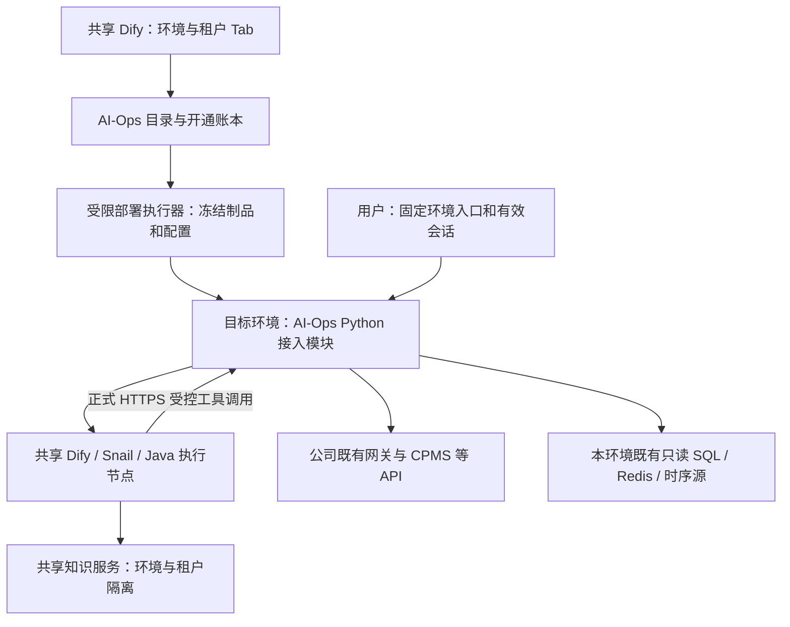

# 手工环境目录与 AI-Ops 一键开通规划

日期：2026-11-16。状态：**用户已确认并授权按 P0～P5 执行；本文件记录实施合同，不表示功能已完成**。
核查基线：`a9427e70`。用户已确定：不改公司仓库；在 Dify 增加环境与租户管理 Tab；
映射由我们维护；自动部署自己的模块；不恢复95，不建立客户专属 SSH 业务隧道。
本规划替代[11月14日方案](2026-11-14-company-gateway-onboarding.md)中要求公司改码的后续路线，
不改写已交付事实。上游依据见[Snail-AI 专项研究](../agents/snail-manual-onboarding-research.md)。

## 1. 要交付的业务效果

管理员在一个页面登记“哪个业务环境、有哪些租户、连接哪些既有服务、把我们的模块装在哪里”，
点击预检，再执行开通。系统完成安装、配置、资源准备和验证，返回可使用的入口与逐项结果。
以后新增同一环境的租户只开通租户资源，不再安装整套服务；升级环境也不重建租户知识库。

用户仍是自然语言提问 → 模型按 SOP 选择工具 → 已授权的本环境数据 → 计算与回答。
智能客服、异常订单分析、离线分析共享这套接入关系；不新增关键词路由，不让模型选择服务器或权限。
“一键”指已登记且满足条件后的自动执行，不代表能够凭一个 IP 推导账号、打通任意网络或修复公司服务。

## 2. 借鉴 Snail-AI 的具体部分

| 上游机制 | 我们采用的方式 | 不作出的推断 |
|---|---|---|
| App 管理执行节点组，Agent 绑定 App | 展示执行组、节点和所属业务环境；复用现役 SDK | App 不等于公司租户，也不自动带来订单权限 |
| 节点注册、心跳、路由与失效摘除 | 展示实际版本、在线时间和可用工具；沿用本仓能力心跳 | 注册成功不等于身份、数据与业务验收通过 |
| 模型、提示词、工具配置随执行下发 | 保留 Dify 编辑、SOP 发布与现役 Java 执行链 | 配置下发不是远程安装，也不是发布版本回退 |
| 管理界面集中查看应用与节点 | 把业务环境、租户、开通记录集中展示 | 不照搬另一个 Vue 控制台或再建平行配置入口 |
| App token 约束执行组接入 | 每个执行组独立凭据，并保持工具侧用户授权 | token 不替代 TLS、业务身份或网络可达性 |

上游没有为我们的场景提供已验证的“公司租户目录＋主机安装＋开通补偿”完整产品；这些由现有 AI-Ops 能力补齐。
上游 gRPC 存在服务端拨回客户端的方向，不能把客户端心跳当成“只出站即可接通”。
本轮学习结构与交互，不直接搬源码；上游不同来源的许可声明差异见研究记录，复制前另核适用许可。

## 3. 当前已有能力与缺口

| 已有实现 | 可复用 | 尚需完成 |
|---|---|---|
| `gateway.environment_registry` | 环境/租户目录、版本比较、审计、启停 | 草稿与生效区分、登记连接、部署目标引用、统一写入口 |
| `dify.environment_management` 和网页补丁 | 公司会话后的授权与名称/启停编辑 | 真正独立 Tab、新增环境/租户、预检与任务详情 |
| `dify.self_service`、`self_service_store` | 双端资源准备、租约、步骤及回执 | 环境级安装协调、服务端跨设备幂等、崩溃后对账 |
| `dify_ensure_workspace`、`dify_workspaces` | 环境＋租户的工作区映射、未知创建结果对账 | 接入统一开通流程，防止重试重复开户 |
| `knowledge.tenant_scope`、节点能力上报 | 知识命名空间、实际协议/工具验证 | 管理页可见，撤销和故障显示贯穿全链 |
| Python Gateway 与现有数据源 | 身份、订单授权、只读 API/SQL/Redis、会话账本 | 参数化安装配置，减少部署负担，禁止未知环境默认回落 |
| 现有 Java 节点、Snail 平台 | 模型循环、工具守卫、运行与发布合同 | 为新增环境自动准备隔离执行组及固定 Gateway 绑定 |
| 95 安装/升级资产 | 制品校验、私有目录、备份、就绪和回退思路 | 去除95硬编码，形成只管理 AI-Ops 的通用安装器 |

截至本次源码核查，现有页面是展开区域，不是独立 Tab；不能新增连接或远程安装。
41 未配环境目录时仍显示“目录尚未准备”。上线状态引用11月14日回执，本轮没有重新访问生产。
未启用的公司网关来源签名代码不是新方案的前置条件，后续在调用/配置核对后退役其专属工件。

## 4. 对象、归属与唯一真值

| 对象 | 唯一身份和关系 | 管理内容 |
|---|---|---|
| 业务环境 | 稳定 `environment_id`；可包含多台主机 | 名称、时区、既有服务连接、认证方式、配置版本、启停 |
| 部署目标 | 私有主机清单的逻辑引用；不是环境编号 | 主机可信身份、安装位置和允许动作；不另建第二份主机角色清单 |
| 公司租户 | `(environment_id, tenant_id)` | 名称、所开通能力、工作区/应用引用、状态 |
| 控制台管理员 | 经认证的主体＋明确授权范围 | 平台部署权限或租户内容权限；租户管理员不能登记任意主机 |
| Dify 工作区/应用、知识空间 | 归属环境＋租户 | 沿用已有资源与正式发布关系，不按同名猜测收养 |
| Snail 执行组/节点 | 执行隔离单元及节点凭据 | 与环境显式关联，可服务多个已授权租户；不按租户复制平台 |
| 开通任务 | `job_id`＋冻结计划摘要 | 步骤、制品、配置版本、执行者、回执、失败与恢复 |

同编号租户在不同环境可以存在；同一租户跨环境迁移是独立迁移任务，不能编辑环境字段搬家。
环境编号、资源归属建立后不可随意改；显示名称可以改。停用与删除分开，存在资源引用时只允许归档。

首版保持 `environment_registry` 为唯一目录权威；用现有 SQLite 账本记录草稿、计划与任务，不另造配置中心。
目录只由管理服务写；CLI 调同一受控入口。各环境的运行文件是指定版本的只读投影，不能各自编辑。
`consumer.business_environments` 旧清单与环境变量选择路径迁为该目录的投影；不再出现第三份独立映射。
编辑保存的是草稿，预检使用草稿；生效指针仍指向已验证版本。页面分开展示期望版本、实际应用版本和观测时间。
文件发布与远程步骤不是数据库事务：冻结版本、目标租约、CAS 和回执对账共同保证一致；不宣称跨系统原子提交。

## 5. 目标部署与运行链



**首版只支持一个部署档案：共享 AI 平台＋按业务环境隔离的 Python 接入模块。**
优先复用现有 Gateway 制品及每环境固定配置、登录代理和数据根；不是再写一套鉴权微服务。
模块靠近数据源部署，目标服务器无需装 Dify、Snail 管理平台、平台 MySQL、模型代理或 Java 执行栈。
Java 节点仍在共享服务区，先保持现有每环境固定 Gateway/凭据的绑定，不在首版改成跨环境共享节点池。
这会有共享区的节点资源成本，必须一并测量，不能只报目标机内存下降。
共享运行服务只落在已登记的服务宿主，不将开发机变成生产入口；目标主机角色、所有者和可信身份仍由私有清单统一维护。

公司既有 API 能覆盖的能力优先经原网关调用；API 缺失的离线/账务读面，复用我们模块已有的有界只读查询。
数据库/Redis 不对中心或公网新增暴露，凭据留在本环境受控位置；缺索引或授权账号时标明阻塞，安装器不擅自创建。
未来若某环境只用现成 HTTPS API、无需本地源，可将同一接入模块放到共享区；首版不因此开发第二套安装流程。

网络采用公司已有正式网关路由、已有服务网络或获准的 HTTPS 入口；连接关系逐方向预检。
共享区的 Dify/Java 需要能调用接入模块，接入模块也要能请求共享执行服务；心跳绿灯不足以证明这两条链。
**不改公司代码不等于网络一定已具备。** 若现有入口不能承载，需要单独明确网络配置责任与授权；
首版不开发反向隧道、通用代理、任意 URL 转发或新的出站任务轮询协议来掩盖这个缺口。
部署可用受管 SSH 传合并制品并调用固定安装入口，但 SSH 不承载线上对话和取数流量。

## 6. 身份与权限：映射解决路由，不创造身份

环境选择是候选配置；只有向该环境完成有效认证后，才能建立绑定环境、租户、用户的 AI 会话。
不能仅凭 `tenant_id`、URL 参数、浏览器头或模型参数确认来源，也不向所有环境广播令牌“试哪个能用”。

| 入口 | 首版处理 | 必须证明的拒绝 |
|---|---|---|
| 我们维护的 Dify/管家登录代理 | 选择已登记环境后，在服务端固定该环境完成原公司验证码/登录；再建立 AI 会话 | 验证码与登录环境不一致、撤权、换环境复用会话 |
| 公司 C端 `thirdSession` | 固定入口绑定候选环境，到该环境现有会话源实时解析，再核租户与本人订单 | 另一环境不存在/失效会话、跨租户和非本人订单 |
| 只提供旧共享签名 JWT 的 App | 单独核现有入口是否有可验证的环境会话；无证明时不纳入跨环境上线范围 | A 的令牌不能仅因 B 有同号用户就获得 B 的 AI 会话 |

旧 JWT 若没有可靠 issuer/会话归属，仅验签再调 `user/info` 不能补出签发环境。
可由我们管理的 H5 登录流程获得绑定会话；若原 App 无法使用这种流程，明确记录“旧 App 入口未支持”，
不能暗中改公司客户端，也不能把这项兼容性缺口重新变成要求公司修改 UPMS 的前提。
首次向目标环境正常登录取得的新会话，与携带一个来源未知的旧 JWT 调目标环境，是不同的认证证据。

现有独立数据根可继续承载公司登录映射；`dify_login_service.MappingStore` 目前只以用户编号为主键，
在没有改成环境复合键前不得把多个实例共用这张表。会话、QA、运行、缓存、开通幂等、发布回读均须环境隔离。
共享 Dify 账户/工作区和知识命名空间沿用已有环境维度；内容权限与平台主机管理权限始终分开。
停用在新的准入、工具调用和交付复核生效；不能撤回已发给上游的请求。运行中任务固定旧版本，不静默改查另一环境。

## 7. Dify 中的页面与操作

在我们维护的 Dify Web 顶层导航加入 **环境与租户** Tab，可直接打开、刷新、返回；保留原工作室和知识页面。
不将一切挤入当前展开按钮，也不另建 Snail 风格的平行管理台。建议结构：

```text
工作室   知识库   环境与租户
                 环境列表                         [新增环境]
                 环境名称 | 租户数 | 能力 | 配置版本 | 状态
                 └ 环境详情：连接配置 / 租户 / 运行节点 / 开通记录
                   [保存草稿] [连接与能力预检] [查看计划并开通]
                   租户：编号、名称、三项能力、工作区、正式版本
                   任务：当前步骤、失败原因、已完成项、重试/回退
```

| 表单 | 字段与行为 |
|---|---|
| 环境 | 稳定编号、显示名、时区、备注；不能把物理 IP 当业务身份 |
| 公司连接 | 已有网关/UPMS/CPMS 等所需地址、认证方式；可用统一网关路径时不要求逐服务填写 |
| 本地数据源 | 仅按所选能力显示 SQL/Redis/时序配置引用；凭据使用受控引用或写入后不回显 |
| 部署目标 | 已登记可信主机、固定安装档案、已批准版本；主机接入材料在私有清单维护 |
| 租户 | 手动输入公司租户编号、名称，选择智能客服/异常订单/离线分析；预检验证租户真实性与权限 |
| 验收 | 每项能力分别显示未配置、阻塞、可验证、已验证及证据时间，不能只显示总体绿色 |

平台管理员可以在页面配置地址；禁止的是普通业务请求/模型改变受信地址，不是禁止管理员编辑配置。
服务端按已登记网络范围验证协议、端口、解析地址和重定向，拒绝云元数据/非预期本机目标及跨目标凭据转发。
私有网络地址须属于获准环境，不能简单地一律禁止内网，也不能允许任意探测内网。
部署私钥不进入浏览器；连接秘密不落目录正文、不进入模型、日志或任务回执，仅保存引用、版本和遮罩。
替换凭据先验证新版本再切换并撤销旧版；泄露时直接撤销且重新认证，回退配置不能复活已撤销凭据。

首个控制台管理员由受管安装过程登记到我们自己的管理服务；权限不依赖待开通环境已经可登录。
日常使用现有控制台会话和平台角色，受控 CLI 保留恢复入口；不开放网页自助注册平台管理员。
普通租户管理员只管理自己的知识/SOP/应用，不看到服务器连接与部署操作。

## 8. 一键开通合同

外部只需要“保存、预检、执行计划、查看/恢复任务”四类操作；内部复用资源准备与发布逻辑，不另造通用工作流引擎。

| 步骤 | 实际执行与通过条件 |
|---|---|
| 预检 | 主机指纹/角色/所有者、允许路径与权限；CPU/内存/磁盘；正式 TLS 双向调用；公司登录与只读接口；索引及版本兼容 |
| 冻结计划 | 记录目标、制品 SHA/摘要、目录草稿版本、秘密版本、三能力、资源增改差异、回退点；过期计划不可执行 |
| 安装/配置 | 固定入口只写 AI-Ops 私有目录与自有服务；校验制品来源，分环境锁，备份，候选启动，读回版本 |
| 注册与资源准备 | 复用执行组/节点、能力回执；按环境＋租户准备 Dify 工作区/双端应用及知识命名空间 |
| 候选验证 | 身份正反例、授权数据查询、真实节点调用、三功能所需证据与原页面操作；不碰正式路由 |
| 激活 | 版本检查后切换指定资源；逐项记录实际生效版本；复用既有内容发布事务和恢复流程 |
| 回执 | 返回用户入口、每项能力结论、制品/配置版本、时间与失败项；必要项未过就不是全部完成 |

同环境已有服务时跳过安装；同租户同计划重复点击、刷新或换电脑返回同一任务。
去重依据是服务端的环境、租户/环境级目标、动作和计划摘要，不能只依赖浏览器随机键。
同一环境同时只允许一个改变部署的任务；纯名称编辑不抢运行资源，连接变更必须重新预检。
租约失效后先核实际状态再接管；远程调用超时标为“待核对”，不能当作失败直接重复创建。
现有开通账本启动时将运行任务标失败的行为，需要区分可对账任务后再接入长任务，不能直接套用。
取消只在安全步骤间停止；不能在切版本或备份中途杀进程。控制台关闭后任务仍可查看和恢复。

任务状态：`待预检 → 可执行 → 执行中 → 待验收 → 已完成`；旁路为`阻塞/失败/待核对/已取消/已回退`。
这些是任务状态；环境另有`未开通/可用/降级/停用`，节点在线状态不能自动覆盖环境验收状态。
首次开通允许只选择已具备条件的能力，但要在执行前明确范围；不能失败后悄悄缩成“客服能回答所以全部通过”。

回退安装版本与恢复配置必须成套，回退也产生新修订号；不可把 revision 倒写。
已有正式入口在候选通过前持续服务；多租户切换按租户记录，部分成功时显示部分成功，不伪造全局事务。
新工作区/知识库默认保留作对账，不失败即删；环境撤回只移除有明确所有权的 AI-Ops 资产，不动公司进程、数据或共享资源。

## 9. 代码落点与退出清单

| 改动范围 | 方向与调用方 |
|---|---|
| `gateway/environment_registry.py`、`cli_admin.py` | 唯一目录、草稿/生效/版本合同；管理 API、安装器、运行投影共用 |
| `dify/environment_management.py`、`self_service_bridge.py`、Dify Web 补丁 | 真 Tab、受权 CRUD、预检和任务；CLI 与页面不各自写配置 |
| `dify/self_service*`、工作区映射 | 拆出可复用准备步骤，保留租约/未知结果对账；不改正式发布语义 |
| `identity/`、`consumer/business_environments.py`、登录代理 | 固定环境后的认证、旧目录收敛；复查会话/账本隔离 |
| `data/`、`operator/`、`execution/` 与现役 Java 节点 | 复用受控取证、能力/运行合同；业务数据凭据保留本地 |
| `deploy/`、`ops/environments/` | 一个通用参数化安装档案及回退；现有95资产仅作历史，不复制命名 |
| 对应职责测试、配置模板、打包与文档 | 同步 CLI/管理桥/Web/服务 bundle、安装和使用入口；不新增根层工具 |

后续移除未启用公司签发路线的专属 Java 工件、配置、手册前，核现役流量/调用与恢复依赖；相关 ADR 由新决定说明替代。
不恢复95服务，不触发公司 Jenkins，不把公司登录/网关改码列为本项目待办。
重用原始业务工具，删除重复配置读取和新的默认兜底；不保留两套可以独立编辑的环境目录。

## 10. 执行顺序与完成判据

下列为逻辑任务，不是已经创建的 issue；用户批准实施后按依赖建任务，每片走原有 PR/CI/审查。

| 顺序 | 交付片 | 必须拿到的证据 | 依赖 |
|---|---|---|---|
| P0 | 两环境身份/正式网络/最小模块可行性 | 两边同编号主体不串；真实登录来源可核；两个方向的 HTTPS 工具调用；目标与共享区内存实测 | 只读筛选健康目标，不能用95；生产变更另按授权 |
| P1 | 唯一目录与权限 | 草稿不影响现役；并发拒绝；旧清单迁移；平台权限和秘密遮罩；两个真实环境登记 | P0 固定接入合同 |
| P2 | 完整 Tab 与手工配置 | 浏览器新增/编辑/停用/查看；配置预检；不可执行时明确原因；键盘与错误提示可用 | P1；未完成自动化时按钮明确不可执行 |
| P3 | 自有模块通用安装 | 冷安装、重复安装、升级失败恢复；制品/配置读回；公司服务和业务数据未被改变 | P0、P1 |
| P4 | 一键开通与恢复 | 页面执行后资源齐备；换电脑重试无重复；掉线对账；并发拒绝；节点能力错误不能激活 | P2、P3 |
| P5 | 第二环境正式验收与旧线收尾 | 两环境各至少两租户三功能；原入口与追问；权限反例；受控升级/回退；同步手册与账本 | P4；真实账号与可解释业务样例 |

P0 优先验证风险，不先铺大量 UI；P2 提前交付可见页面，P3/P4 补齐自动化，避免只有脚本没有管理入口。
每片只新增能够拦住具体错误的检查，复用现有 Gateway 验证技能与客户端 `adbx`；新协议或故障恢复有最小行为检查。
隔离双环境用故意相同的用户/租户/订单编号测串用，真实环境不为测试修改业务记录。
不存在真实同号样本时将“真实正向”与“隔离同号反例”分开记，不能合称真实双环境全覆盖。

| 必验反例/故障 | 正确结果 |
|---|---|
| A环境会话访问B、跨租户订单/知识/运行、伪造环境头 | 拒绝；不得回落其他环境；拒绝不泄露对象是否存在 |
| 非平台管理员编辑连接、任意URL/重定向/未登记主机 | 服务端拒绝；不进行带凭据探测或部署 |
| 保存草稿、过期版本提交、执行中改连接 | 现役不变；冲突明确；任务仍按冻结版本执行 |
| 注册成功但取数失败、工具版本过期、某项API缺失 | 显示对应能力阻塞，禁止标全部开通 |
| 安装成功回执丢失、服务重启、重复点击、两个管理员同时操作 | 对账后接续，只有一个实际资源和一个有效部署变更 |
| 环境断网/停用/凭据撤销、恢复后旧会话继续提问 | 故障只影响该环境；权限重新核对，不静默换来源 |
| SOP发布、预览、恢复和原客服/管家追问 | 使用所选环境与租户版本；费用计算仍用事实规则 |

业务验收由产品/测试/工程师确认真实样例；模型调用、HTTP 200、节点在线或测试通过都不能单独替代它。
容量验收记录空闲/三功能并发/升级重叠下的 RSS、峰值、延迟和共享区节点成本；没有数据前不承诺内存数值。

## 11. 标准、边界与待验证条件

- [RFC 8725 §3.8–3.12](https://www.rfc-editor.org/rfc/rfc8725.html#section-3.8)：JWT 签发者/受众与互斥验证规则。
  映射到本方案：旧公司 JWT 不等同绑定环境的 AI 会话；身份类型不能混用，元数据字段不可信。
- [RFC 9110 §9.2.2、§13.1.1](https://www.rfc-editor.org/rfc/rfc9110.html#section-9.2.2)：HTTP 幂等与条件更新。
  现有 JSON revision/CAS 合同继续使用；若实施引入 ETag/If-Match，应按条件请求语义实现，不能只重命名字段。
  POST 创建资源不是天然幂等，必须有服务端任务唯一性与未知结果对账。
- [SQLite 事务文档](https://www.sqlite.org/lang_transaction.html)：单写事务及忙锁行为。
  账本事务保持短小，外部安装/HTTP 不持有写事务；首版单管理写入服务，不把 SQLite 文件多主复制当高可用。

仍需 P0 证据的项目：新目标健康与容量、正式网络和证书、可用登录方式、API/本地源的实际授权与只读范围。
这些决定能开通哪些入口和能力，不会通过添加映射自动消失。没有这些证据前，本方案不声称双环境已可用。
规划已获用户确认；实施从 P0 开始，按上述依赖推进。功能交付与实际运行结论另记验收回执，不能由本文推定完成。
