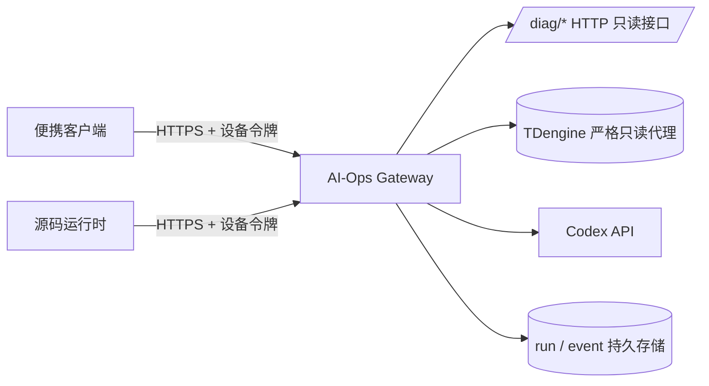

# AI-Ops Gateway 架构与部署

## 目标

现有客户端聊天入口的本人订单状态查询可由 `AIOPS_GATEWAY_CONSUMER_ORDER_CHAT_ENABLED`
显式启用，默认关闭；必须同时具备个人状态地址与逻辑执行环境。
身份、部署/回退、证据留存与验收边界见[手册](agents/consumer-order-chat/README.md)。

便携包只负责客户端交互和进度显示。固定服务器上的 Gateway 才负责 `/diag/*` HTTP 查询、TDengine 直连代理、SSH 隧道、Codex provider、运行状态和事件存储。



客户端永远不接触数据库密码、SSH 私钥或 provider API key。订单、费用、设备和 Redis 队列证据经 `/diag/*` HTTP 读取，TDengine 仍走严格只读代理；Phase 3a 后服务器私有 `production.env` 不再保存 MySQL / Redis 直连凭据。

## 行业依据

- [NIST SP 800-207 Zero Trust Architecture](https://csrc.nist.gov/pubs/sp/800/207/final)：不能因为设备位于某个网络就隐式信任；用户和设备必须在访问资源前分别认证和授权。
- [RFC 8628 OAuth 2.0 Device Authorization Grant](https://www.rfc-editor.org/rfc/rfc8628)：适合无浏览器或输入受限的设备，通过另一台设备完成一次性授权。
- [RFC 8705 OAuth mTLS](https://www.rfc-editor.org/rfc/rfc8705)：生产环境可使用证书绑定令牌，避免被复制的 bearer token 被重放。
- [OWASP Secrets Management Cheat Sheet](https://cheatsheetseries.owasp.org/cheatsheets/Secrets_Management_Cheat_Sheet.html)：集中管理、最小权限、自动轮换和秘密使用审计。
- [HashiCorp Vault Database Secrets Engine](https://developer.hashicorp.com/vault/docs/secrets/databases)：优先为数据库访问签发短期动态凭据，而不是在客户端分发长期密码。
- [Freedesktop Secret Service](https://specifications.freedesktop.org/secret-service-spec/latest/)：客户端令牌应进入操作系统凭据库，而不是明文配置或漫游文件。
- [Temporal Durable Execution](https://docs.temporal.io/temporal)：跨机器和故障恢复需要持久事件历史；本项目 MVP 先用 SQLite/WAL 事件表，接口预留 PostgreSQL/Temporal 演进空间。

## 当前实现

### 服务端

`aiops-gateway` 提供：

- `GET /health`：非敏感健康检查。
- `POST /v1/enroll`：兑换一次性高熵注册码，注册码只能使用一次。
- `POST /v1/runs`：创建只读诊断 run，真实执行发生在 Gateway 所在服务器。
- `GET /v1/runs`、`GET /v1/runs/{run_id}`：按 workspace 隔离的 run 查询。
- `GET /v1/runs/{run_id}/events`：按 sequence 增量同步事件。
- `GET /v1/runs/{run_id}/events/stream`：SSE 实时同步事件。
- `GET /v1/runs/{run_id}/evidence`：按 run 返回脱敏证据元数据（工具、状态、请求骨架、行数、错误），不含业务正文。
- `GET /v1/orders/{order_no}/access`：标准 Bearer token 的订单授权探针；只返回
  `order_no`、可访问标记和范围指纹，不返回订单正文。该端点是后续标准健康报告与
  单问诊断 API 的认证 tracer bullet。
- `GET /v1/orders/{order_no}/charging-status`：该订单在业务系统里记录的**充电状态快照**
  （[ADR-0033](adr/0033-consumer-charging-status.md)）。**默认关闭**：未配置
  `AIOPS_GATEWAY_CHARGING_STATUS_BASE_URL` 时按 404 处理（路由不存在）；配置了业务地址
  就要求同时给出合法的逻辑环境名（`AIOPS_GATEWAY_EXECUTION_ENVIRONMENT`），否则**启动失败**；
  只配环境名而业务地址为空时路由仍然关闭。只接受
  **consumer 的非代查本人范围**；顺序固定为「解析身份 → 复用订单可见性判定 →
  才调业务接口」，因此**越权与不存在同为 404**、授权源不可用是 503。响应只有
  7 个键（`order_no`/`status_code`/`status_role`/`observed_at`/`source`/`environment`/
  `gateway_version`）—— 上游响应里还带车牌、用户标识、设备信息等与本面无关的字段，
  裁剪在这一层做。
  入口头按 `OPERATOR`/` consumer ` 规范化后要求**恰好是 `consumer`**；**缺失也拒绝**
  （这个头当前由前端自报，缺省成本人等于让一个漏发的头静默换成本人范围；
  反代若补这个头，接口也不依赖那一跳）。
  状态码不在这里重新定义（交 `order_status.py`），未知码是 `unknown`，**不解释成充电结束**。
  `observed_at` 是**我们读取的时刻**，不是设备上报时刻。

- `POST /v1/orders/{order_no}/charging-status/delegated`：把一次**已授权**的读取交给可信执行节点
  （[委托执行契约](m2-close-01-wiring.md)）。判据与直读入口完全相同；差别只在「谁来读」。
  **默认关闭**：未配置 `AIOPS_GATEWAY_AGENT_RUN_CONFIG_FILE` 时 404。请求体是**空的严格模型**
  —— 环境、appId、agentId、sid 都不接受（多一个字段就是 422），绑定来自服务端配置。
  回执含 `actual_node_id` / `node_build` / `gateway_version`，`agent_version` 为 null 且标注
  `not_wired`（版本追溯仍是缺口，不冒充已通过）。
- `POST /v1/internal/charging-status/claims/{run_id}`：**仅节点**可调。节点凭据走
  `Authorization`，身份由凭据派生（自报的 node/host 头不参与判定）；请求体同样是空的严格模型。
  顺序是硬的：认节点 → 核对记录/环境/节点 → **再执行一次订单授权** → 才读业务或返回已有结果。
  同一记录最多启动一次业务读取；成功后重试返回同一份快照。

### App 聊天交给客户执行节点（APP-RUNTIME-01）

`POST /v1/assistant/questions` 的口径不变：本人订单状态问题在命中**服务端绑定**时交给客户
执行节点，POST 立即返回 `202 + qa_id`，App 用**原 GET** 轮询，答案来自**同一条 run** 的
succeeded 快照并沿用原 blocks 形状。未命中绑定走原确定性直读，行为与接线前逐字一致。

```env
AIOPS_GATEWAY_CHAT_EXECUTION_BINDINGS_FILE=
```

## 正式指针：运营发布的版本如何接管路由（M3-01）

```env
AIOPS_GATEWAY_CHAT_ROUTE_BINDINGS_FILE=   # `chat_route_bindings` 表所在的 SQLite 文件
AIOPS_GATEWAY_CHAT_DIFY_KEY_DIR=          # `<dir>/<app_id>.key`，每个 Dify app 一把
```

配了第一项之后，**发布与撤回才真的改变 App 跑哪一版**：

* 运营在 Dify 控制台点「发布到 AI-Ops」→ `POST /v1/dify/publish` → 冻结一个新版本，
  **同时**把（环境，租户，入口，场景）的正式指针推到这一版；
* 点撤回 → `POST /v1/dify/retract` → 指针改成 `retracted`（**不删行**），在飞运行被收敛，
  历史与在飞正文不再交付。**不自动恢复旧版** —— 恢复是另一次显式发布；
* 保存草稿**不动指针**：Dify 的保存只写它自己的 draft，路由表一个字都不写。

**同一个 key 不许同时被文件登记与这张表声明** ⇒ 启动失败。迁移到管理指针的做法是
先把文件登记里那几条删掉（或把表里的行撤回），再让发布接管；不存在"谁优先"的规则。

每个 app 的 Service API 凭据由运维预置成 `<key_dir>/<app_id>.key`（0600）：发布只推路径，
**全程不读密钥**，所以凭据不会出现在这张表里。撤回与发布共用同一把发布门
（`AIOPS_GATEWAY_DIFY_PUBLISH_API_KEY`），不新造第二套权限。

指向一张 0600 的登记表（`schema=aiops-chat-execution/1`）。**绑定是按租户登记的**：

```json
{
  "schema": "aiops-chat-execution/1",
  "bindings": [
    {
      "environment": "41",
      "tenant_id": "<租户>",
      "entry": "consumer",
      "scenario": "consumer_own_order_status",
      "config_file": "<0600 的执行配置，与委派入口同格式>",
      "manifest_file": "<0600 的执行清单>"
    }
  ]
}
```

判据与失败形态：

- **没有这个租户的登记 ⇒ 原直读，一次派发都不发生。**「配了一个全局文件」不是绑定 ——
  那等于任何能通过本人授权的租户都派到同一个节点，而执行位置隔离正是这条路线要的东西。
- 每条登记的 `config_file` / `manifest_file` 必须在**启动时**可读、权限合规，且
  config 的 `environment` 与登记一致，否则**启动失败**（不降级）。`manifest_file` **必需**：
  没有清单的 run 走旧协议（领取即 succeeded），会把「只读了业务、整轮模型循环没跑完」记成成功。
- 命中绑定后**失败就是失败**：节点失败、超时、配置漂移、撤销、到期、订单转归他人、
  授权源不可用 —— 一律落 QA `failed`，**不回落直读、不回落旧模型、不换别的节点**。
- 交付前过一道共用判定（委派入口 / 后台 worker / GET 三处同一份），并且在**读配置之后重读记录**：
  配置读取期间发生的撤销或到期同样拒绝正文。
- 节点凭据**轮换**是合法的：同一个 `node_id` 可以同时存在「旧 token 停用 + 新 token 生效」
  两条登记，有效性按「存在一条 active、同环境、同实际节点的登记」判断，不按条目顺序。
- **停用只拒绝正文**：拿掉登记后 `completed` 的结果返回 404 `CHARGING_STATUS_DISABLED`，
  但 `queued/running/failed/cancelled/expired` 仍按原协议可读 —— 否则用户看到「取消失败」
  而库里其实已经取消。

**从旧变量迁移**：早期草案是 `AIOPS_GATEWAY_CHAT_EXECUTION_CONFIG_FILE` 与
`..._MANIFEST_FILE` 两个全局键。它们**不是**按租户绑定（未登记租户也会被派到同一个节点），
已移除。迁移做法：把原来那一对 config/manifest 作为**某一条登记**的 `config_file` /
`manifest_file`，并为每个要启用的租户各写一条；然后删掉这两个旧键、只留
`AIOPS_GATEWAY_CHAT_EXECUTION_BINDINGS_FILE`。两个旧键现在没有任何读取路径，
留着不会生效（也就不会有人以为它还在起作用）。

与 `AIOPS_GATEWAY_AGENT_RUN_CONFIG_FILE` 的关系：**不复用**。委派入口与聊天入口是两条独立的
启用路径，共用一个键会让「只开委派」顺带把聊天也接到节点。

### 标准资源 API 认证

标准资源接口与既有 `aops_*` 设备接口并存，二者不能互换。标准接口只接受
`Authorization: Bearer <access_token>`，通过可配置的 caller-context resolver 建立
不可变 `ScopeContext`，再复用现有 `QueryScope` 与 `ScopedSources` 做订单范围校验。
请求中的裸 `user_id`、`tenant_id`、设备令牌或内部 HMAC 都不能扩大授权范围。

第一版提供 OAuth 2.0 token introspection 适配器：验证 `active`、`sub`、租户、
AI-Ops audience、过期时间、required scope 和业务数据范围。资源接口只依赖 resolver
协议，未来可在引入经过批准的 JOSE 依赖后增加 JWT 验签实现，不手写不完整的 JWT
签名校验。

```env
AIOPS_GATEWAY_INTROSPECTION_URL=https://auth.example.com/oauth2/introspect
AIOPS_GATEWAY_INTROSPECTION_CLIENT_ID=aiops
AIOPS_GATEWAY_INTROSPECTION_CLIENT_SECRET=REDACTED
AIOPS_GATEWAY_STANDARD_API_AUDIENCE=aiops-api
AIOPS_GATEWAY_INTROSPECTION_TIMEOUT_SECONDS=5
```

未配置 introspection 时，既有设备接口照常工作，标准资源接口以稳定 503 错误
`ACCESS_TOKEN_VALIDATION_UNAVAILABLE` fail closed。远程 introspection endpoint 必须使用
HTTPS；client secret 不得进入便携包、日志或 API 响应。

### 解析器的选择顺序（2026-09-29 补充）

同一个入口上并存**两条信任模式**，先由**入站来源密钥**分派，未命中才在既有链内按配置
**互斥**选择：

```
来源密钥（X-AIOps-Source-Key，由可信那一跳注入）
  ├─ 带且验过 ⇒ 公司 check_token 路径（管家端 OAuth2 令牌，ADR-0009）
  └─ 其它     ⇒ 既有链：会话服务令牌 → introspection → UPMS 兜底
```

**分派依据是密钥而不是令牌形态**：按形态分派要靠试错，顺序错了就是静默降级；密钥是调用方
**自报不了**的判据。**未配置密钥 ⇒ 新链路整体不启用**（fail closed，不是放行）。门排在
**会话那一级之前**是必须的：41 现网 `AIOPS_GATEWAY_THIRD_SESSION_SERVICE_TOKEN` 有值且那一级
直接 `return`，门槛若在它之后，带公司令牌、不带 `third-session` 的请求会在第一级就被 401。

既有链内每一级的配置键不齐备就不构造该路径；只设了其中一部分是启动失败，不是静默禁用
（避免部署看起来正常、实际一直 401）。

```env
AIOPS_GATEWAY_COMPANY_CHECK_TOKEN_URL=
AIOPS_GATEWAY_COMPANY_TOKEN_CLIENT_ID=
AIOPS_GATEWAY_COMPANY_TOKEN_CLIENT_SECRET=REDACTED
AIOPS_GATEWAY_COMPANY_SOURCE_KEY=
```

公司那条路径**默认不启用**：四个键缺省为空 ⇒ 选择结果与新增它之前逐字一致（清空即回滚）。
来源密钥短于 16 字符、或只配密钥不配校验入口，都是**启动失败**（前者等于没有这道门，
后者是装了门却没有可路由的目标）。请求头是 `X-AIOps-Source-Key`，必须由那一跳**覆盖式注入**
（不是追加一个客户端也能伪造的头）。
它的校验落在公司自己的 `/oauth/check_token` 上 —— 不自己验签、不复制密钥、不读令牌存储；
身份与店铺集合直接取自令牌，站点集合经与运营商账号**同一份**规则解析。注意公司这条端点的
**成功体没有 `code`/`data` 信封**（身份字段在顶层），而**失败体有信封且走 HTTP 200**，
所以「HTTP 200 就代表令牌有效」在这里不成立。

服务端 SQLite 只保存注册码哈希、设备令牌哈希、run 元数据、脱敏结果和事件元数据，不保存原始 API key。证据正文仍保留在服务器私有 run workspace，不通过 Gateway 事件接口暴露。

当前 MVP 的注册码由服务器管理员本地签发：

```bash
# 工作区级注册（推荐）：不传 --tenant-id，注册后的设备可诊断任意订单，
# 由 order_snapshot 按订单号自动发现租户。适合可信内部运维团队。
uv run aiops-gateway issue-enrollment --workspace ops
uv run aiops-gateway serve
```

`--tenant-id` 是可选的：不传即工作区级（设备不绑定租户，任意订单可查）；仅当需要把某台设备限制到单一租户时才传（例如多外部运营商必须互不可见的场景）。诊断时运维只需提交订单号，无需查找或输入租户——`order_snapshot` 会按 `order_no` 发现订单及其租户。

Gateway 进程通过 `AIOPS_GATEWAY_SERVER_CONFIG_FILE` 加载服务器私有 `production.env`。该文件只应存在于固定服务器，不应复制到便携包；Phase 3a 后其中只保留 `/diag/*` HTTP 内部令牌、TDengine 直连代理、provider key 和 Gateway 配置。

用户级 systemd 服务必须显式固定应用配置和数据根目录，不能依赖用户管理器继承的通用 `XDG_CONFIG_HOME/XDG_DATA_HOME`。否则 key slot 可能错误解析到 `$XDG_CONFIG_HOME/keys`：

```env
AIOPS_CONFIG_HOME=/home/claude/.config/aiops-diagnostics
AIOPS_DATA_HOME=/home/claude/.local/share/aiops-diagnostics
AIOPS_GATEWAY_SERVER_CONFIG_FILE=/home/claude/.config/aiops-diagnostics/production.env
AIOPS_CODEX_KEY_SLOT=psydo-primary
```

### Model provider

Gateway 在服务端运行 Codex session，因此 provider 选择是服务端行为：切换默认 provider
后，已注册的客户端立即生效，无需更新客户端。在 `production.env` 中配置多 provider
注册表，默认 provider 用于每次 `remote diagnose`：

```env
AIOPS_PROVIDERS=glm-ark,gpt-psydo
AIOPS_DEFAULT_PROVIDER=glm-ark
AIOPS_PROVIDER_GLM_ARK_BASE_URL=https://ark.cn-beijing.volces.com/api/coding/v3/
AIOPS_PROVIDER_GLM_ARK_MODEL=glm-5-2-260617
AIOPS_PROVIDER_GLM_ARK_KEY_SLOT=glm-ark
AIOPS_PROVIDER_GPT_PSYDO_BASE_URL=https://api.psydo.top/
AIOPS_PROVIDER_GPT_PSYDO_KEY_SLOT=psydo-primary
```

`AIOPS_GATEWAY_ALLOWED_KEY_SLOTS` 必须包含每个 provider 的 key slot。客户端可用
`remote diagnose --provider gpt-psydo` 按运行切换 fallback provider；不传则用默认。
`agent-doctor --provider <name>` 可单独验证某个 provider 的 key 与 runtime。

### C 端 thirdSession 调用

小程序继续调用 Java 业务后端，不需要获取 `cloud-auth JWT`。Java 验证 `thirdSession` 后调用
AI-Ops，携带 `Authorization: Bearer <service-token>` 和 `third-session: <thirdSession>`（全小写，勿用 `X-Third-Session`）。
Gateway 使用只读 Redis 读取 `app:3rd_session:<thirdSession>`；Java 序列化外壳内嵌的 JSON
只被提取解析，不执行 Java 对象反序列化。截图 token `76ea8a54-12d7-4889-823e-edded054a7218`
在测试业务 Redis 中不存在，判定为过期或其他环境 token，不能用于真实验收。

### 多环境与共享 KB 部署

环境切换只移动 Gateway、入口反代和本环境诊断数据源；RAGFlow/KB 属于重资产，保持在
移动云 36 单实例。41 不复制 RAGFlow 或 `kb-service`，而是通过 `aiops-36-kb-tunnel.service`
以 `aiops41` 身份访问 36 的回环 `127.0.0.1:9380`，本机只暴露 `127.0.0.1:29380`。
隧道 SSH key 在 36 使用 `command=/bin/false`、`permitopen=127.0.0.1:9380`，不开放 shell
或其他端口；41 Gateway 只配置 `AIOPS_GATEWAY_KB_SERVICE_BASE_URL=http://127.0.0.1:29380`。
这保持单一知识库资产、租户映射和模型配置，同时让 41 的会话/订单/诊断数据源独立。

### App 聊天交给 Dify：固定版本与运行中取消

Dify 聊天绑定中的 `workflow_id` 通过版本专用 Service API
`POST /v1/workflows/{workflow_id}/run` 执行。另发新版不会改变已有绑定；保存草稿也不影响它。
开始事件即把真实 `workflow_run_id`、`task_id` 关联到 QA，原 App 仍使用原 POST/GET。
开始与完成事件的身份必须一致，缺失身份不能用配置值补齐。

取消先落本地终态并撤销取数凭据，再用同 task/user 请求 Dify stop；ID 迟到也补停。
停止失败不撤回本地取消，不保证外部模型即时停费。断流/超时不会重发启动请求。
[隔离验收与边界](agents/consumer-order-chat/dify-chat-real-chain-evidence.md)。

### Dify 知识检索适配路由（#581 / PRD #577）

Dify 控制台里给智能体挂「外接知识库」时，端点填 `https://<host>/v1/dify`、API Key 填
`AIOPS_GATEWAY_DIFY_KNOWLEDGE_API_KEY`。Dify 自己会拼成 `POST /v1/dify/retrieval`，
请求体是它 External Knowledge API 的固定形状（`retrieval_setting{top_k,score_threshold}`、
`query`、`knowledge_id`、`metadata_condition`），响应读 `records`。**形状以 Dify 源码为准，
不凭印象**（依据见 PRD #577）。

**这一跳是适配，不是代理**：请求体里既没有租户也没有知识库列表，二者由
`AIOPS_GATEWAY_DIFY_KNOWLEDGE_BINDINGS` 按 `knowledge_id` 决定。Dify 因此拿不到数据面，
也扩不了检索范围。

## 运营自助发布：`POST /v1/operator/publish`（#577 / ADR-0018 追加）

运营改完 Dify 之后**自己**触发的那一步。与 `POST /v1/dify/publish` 是**同一个实现**，
区别只在谁被允许调：

| 路由 | 谁在调 | 凭据 |
|---|---|---|
| `/v1/dify/publish` | 机器（运维脚本） | 一把独立的共享密钥 |
| **`/v1/operator/publish`** | **人（运营在页面上点）** | 运营自己的 `thirdSession` |

**三个条件全部满足才放行**：会话有效 → `X-Business-Entry: operator` → 该
`(租户, operator)` 绑了 agent 且请求点的 `app_id` 就是它绑的那一个。

请求体**只有 `app_id`**（`extra="forbid"`）：租户、agent 名、类型、契约、知识库
全部来自运行时注册表，调用方改不了。所以最坏情况是「重新冻结一个**已声明**绑定的
当前内容」，而重复发布未变内容是 no-op。

**据实**：该租户 operator 入口下**任何**登录用户都能发 —— 按人到角色的授权要等
UPMS 的 `ROLE_AGENT_PUBLISHER`（尚未建）。

## 开场白与预设问题：Dify 存中文母版，其余语言用制品（#577 / ADR-0020）

`GET /v1/assistant/starters` 的 `opening` 与 `suggested_questions` 有两个来源，载荷会
**明说**用的是哪一个：

| 来源标记 | 何时 | 内容 |
|---|---|---|
| `dify` | 语言是 `zh` **且**该 agent 的**已发布快照**里有运营写的值 | 运营在 Dify 里写的那一份 |
| `artifact` | 其余一切：非 zh、没绑定 agent、该版没写、读取出错 | `agent_content.AGENT_STARTERS` 里手写的文案 |

**为什么只有 zh**：Dify 一个字段只有一个值，所以"运营改开场白"在结构上只可能改到中文
那一份；其余语言必须是**写下来的文案**（运行时没有翻译机制）。

**为什么要有来源标记**：没有它，「哪几门语言还停在制品上」不可观测 —— 运营会以为全语言
都改了。标记让这件事**可观测**，但它**不能**消除"非中文滞后"这个代价，那是决定的直接后果。

**未自动化的部分**：`quick_commands` 不参与（Dify 无对应字段）；`opening_statement` /
`suggested_questions` 的**草稿**不算数，只认已发布快照。

## 工具白名单：Dify 声明，执行器强制（#577 / ADR-0019）

`AgentConfig.allowed_tools` 决定这个 agent 能跑哪几个工具。**强制点在执行器**
（`DiagnosticToolExecutor.execute`），不在提示词：白名单外的工具记一条 `blocked` 证据、
**不取数**，而且这条判定**先于 journal 缓存** —— 否则早先运行缓存下的成功结果会绕过它。

三个方向都要知道：

- **默认 = 全部七个工具**（`agent_contracts.ALL_TOOL_NAMES`）。它让这个字段对存量
  **零影响**：没有快照会因为多了这一维而被全量重发。
- **Dify 拥有这个字段，清单不得写**（`agent_manifest.DIFY_OWNED_FIELDS`）。绑定了 Dify
  的 agent 在 `[[agents]]` 里写 `allowed_tools` ⇒ 装载期**拒**；`reconcile` 也会**保留**
  库中现值，不会把运营改过的白名单改回默认。
- **怎么改（两条路，#772 E / ADR-0019 §修订）**：
  - **推荐**：在 Dify 里把工具挂在 **`aiops` 提供方**下（运营粘贴
    `ops/dify-tools/aiops-tools.openapi.json` 注册一次）。该提供方下的七个工具
    `operationId` **直接**对应我们的七个 `ToolName`，勾选即生效。匹配按提供方的
    **UUID**做，而那个 UUID 每次拉取**当场从控制台解析**、不落任何配置 —— 所以重建
    Dify 实例或重建提供方都不会让已发布的映射失效。
  - **其他提供方**：登记进 `AIOPS_GATEWAY_DIFY_TOOL_BINDINGS`，格式
    `provider_id/tool_name:our_tool`（多行/分号分隔）。Dify 1.17.1 的工具条目是
    `{provider_id, provider_type, tool_name, tool_parameters}` —— 注意它是**自定义
    API 提供方**时 `provider_id` 是**行 UUID**，且**没有提供方名字这个字段**。
- **`enabled=false` 与「删除」同义**：不进白名单。**全被关掉 / 一个都没勾** ⇒ 沿用默认
  （全部七个），与「不声明工具」逐字同向。
- **翻不出的身份会被拒**：拉回侧报出那个条目并要求登记，**绝不按字面搬运** ——
  两个命名空间里名字相等不代表语义相同（它那边的 `order_snapshot` 与我们的不是同一个东西）。

失败语义（与 Dify 侧 `raise ValueError(response.text)` 的读法对齐）：

| 情况 | 响应 |
|---|---|
| 命中 / 空命中 | 200 `{"records": [...]}`（空命中就是空列表，**不是错误**） |
| `metadata_condition` 非空 | 400 `DIFY_FILTER_UNSUPPORTED`（不支持就明说，不是静默忽略） |
| 体不合法 / `knowledge_id` 缺失 | 400 `DIFY_INVALID_REQUEST` |
| 未登记 `knowledge_id`；路由未配置 | 404（无存在性泄露） |
| 缺凭据 / 凭据错 | 401 / 403 |
| kb-service 不可用 / 媒体面未配 | 502 `DIFY_KNOWLEDGE_UNAVAILABLE`（retryable）—— **绝不**用 200 空 `records` 表示故障 |

**记录里的媒体 URL 是绝对的，且不挂在智能体名下**（ADR-0077）。两点都是实测踩出来的：

- `metadata.media[].url` 在配了 `AIOPS_GATEWAY_PUBLIC_BASE_URL` 之后是
  `https://<host>/v1/media/<id>.<sig>`。相对路径在这里不成立：这串字符是交给 Dify 的，
  它会用**自己的**主机解析（36 的 nginx 把 `/v1` 转给 `api:5001`），每张图 404。
  APP 与网关同源，所以 APP 那条路一直不需要它 —— 留空即保持相对路径。
- 这些 URL 用 `agent_version="dify:<knowledge_id>"` 签发，因此 `/v1/media` 的
  liveness 检查**不做**智能体版本核对（没有版本可核对）。有效性由签发它的登记行决定：
  代理不可达 → 检索 502、行删了 → 检索 404，而已经签出去的 URL 在 TTL（默认 600s）内
  仍可取。智能体签发的 URL 仍按原规则检查版本与知识库绑定。

两个键全空 ⇒ 路由整体 404；只配一个是**启动失败**（半配置不静默禁用，与本仓其余开关同一条）。
本路由对 Dify 所发 `top_k` 的封顶值取自 `AIOPS_GATEWAY_KB_SEARCH_MAX_RESULTS`（1..20，**与客户问答/宣传卡片路径共用同一个口径**，默认 10）—— Dify 自己也会发 `top_k`，我们封顶而不采信。
Dify 侧 `ssrf_proxy` 默认会拦私有网段地址，须显式处置（PRD #577 已记为「必须记录的一次
显式选择」）。

### 固定问答调用
业务后端可使用服务 Bearer、`third-session` 和可信的 `X-Business-Entry` 调用
`/v1/faq/recommendations`、`/v1/faq/catalog` 与 `/v1/faq/answer`。平台由 AI-Ops
根据 C/B 身份关联和 UPMS 角色判定，前端不传 `platform` 或裸身份字段。完整输入输出见
[固定问答标准接口](faq-api.md)。

### 客户端

新电脑只需一次注册：

```bash
aiops remote enroll --url https://aiops.example.com --code-file /secure/gateway-enrollment.code
aiops remote doctor
aiops remote runs
aiops remote diagnose "订单 123 金额异常" --json
aiops remote evidence RUN_ID
```

`order_snapshot` 按 `order_no` 发现订单并从订单行学习 tenant，再校验是否在设备授权租户内；不匹配时返回明确的租户范围错误而非空结果。诊断结果与证据默认用中文输出；`remote evidence RUN_ID` 列出每条证据的工具、状态、命中行数和错误，用于追溯结论来源（证据正文仍只在服务端）。

注册码只能兑换一次。若文件名或路径不正确，客户端会在本地文件检查阶段返回 `File ... does not exist`，此时注册码尚未被兑换；检查实际文件名后重试。也可以省略 `--code-file`，让客户端隐藏提示输入注册码。注册成功后删除本地注册码文件，不要再次运行 `remote enroll`。

注册后，客户端只保存 Gateway URL、设备 ID、workspace ID 等 profile，以及设备令牌。令牌优先存入操作系统凭据库（Linux Secret Service），通过 `keyring` 访问；没有系统凭据库时才回退到当前用户私有文件，并保留 `0600` 校验。

同一 workspace 的多台设备查询同一套 run/event 数据，因此换设备后仍能用 `remote runs`、`remote show` 和 `remote events` 查看进度。

`remote doctor` 只调用公开的 `/health` liveness 接口，不证明设备令牌仍有效；要验证注册后的身份，请执行 `remote runs`。诊断出现 `interrupted` 或 `failed` 时，`remote show RUN_ID` 会显示脱敏的 `error_type` 和 `error_message`，`remote events RUN_ID --after 0` 可追溯排队、worker 启动、provider 调用和中断原因。

## 安全边界

- ZIP 不包含数据库凭据、SSH 私钥、provider key 或 Gateway bearer token。
- 客户端不能提交任意 provider URL、任意数据库查询、任意 fixture 路径或业务动作。
- 设备注册 code 和设备 token 只在传输/兑换时出现，服务端只存 SHA-256 哈希。
- 租户绑定在注册码上；设备请求其他租户时被拒绝。
- 标准资源接口验证 access token 的 audience、有效期和 required scope，并按不可变
  调用者范围重新查询订单；知道订单号或资源 ID 不能单独获得访问权。
- 服务端 key slot 通过 `AIOPS_GATEWAY_ALLOWED_KEY_SLOTS` 白名单限制，恢复和执行仍比较固定 provider endpoint。
- Gateway 只同步状态和证据 ID 等元数据，不同步 evidence payload、密码或内部绝对路径。
- run 元数据中的用户反馈会在服务端持久化前脱敏；客户端 `show` 只得到诊断合同结果，不得到服务器证据正文。

## 生产硬化要求

当前代码是可运行的单节点 Gateway MVP，不应直接暴露到公网。正式部署前必须完成：

1. 在 Nginx/Traefik 或云负载均衡后启用 TLS，Gateway 只监听 loopback 或内网地址。
2. 把一次性注册码替换为企业 OIDC Device Flow；高安全环境增加 mTLS 或证书绑定 token。
3. 用 Vault/KMS 管理服务端数据库和 provider key，数据库账号改为短期动态凭据；不把长期密码放在客户端环境变量。
4. 将 SQLite/WAL 替换为 PostgreSQL，并为事件表、workspace、device、revocation 和审计日志建立备份与保留策略。
5. 增加反暴力、速率限制、设备撤销、密钥轮换、审计导出和管理员审批。
6. 需要跨节点 durable worker 时再引入 Temporal；第一版不把 Temporal 作为便携包运行时依赖。

这些硬化完成前，Gateway 仅适合内网、测试和受控工程师验收，不宣称已经完成生产多租户认证。


### M3 委派响应的本人充电快照

`POST /v1/orders/{order_no}/charging-status/delegated` 在已确认成功的回执旁返回
`charging_status`：`order_no/status_code/status_role/observed_at/source`，来自同 run
已持久化快照；`result_sha256` 仍按该快照计算，不再次读取 CPMS。
返回前重新检查本人订单授权和现行执行绑定、记录状态/有效期、配置身份；
订单已不可见为 404，授权源失败为 503，其余无有效结果时不返回业务正文。
成功及业务错误均 no-store。App 应显示本次观察时间，未知状态不猜测，超时后不自动重发。
该变更不新增轮询或幂等键，不启用生产开关，真实用户与 App 验收另行执行。

### 管理试用结果与撤回代次

管理 Workflow 试用的成功结果仍需当前订单授权、源路由代次、执行TTL及同轮快照校验。
取数凭据在试用终态撤销，不作为结果回读凭据；已撤权/撤回/变版的结果不再交付。
撤回冻结当前路由revision，只停止该代次及之前的任务；之后发布或恢复的新任务不受旧撤回影响。

### 节点 SOP 发布

`AIOPS_GATEWAY_CHAT_NODE_TARGETS_FILE` 将已登记编辑应用映射到节点配置与受控模板。
正式版本与撤回复用管理路由，原App接口不变；Java节点启用按run加载清单后，发布才改变实际SOP。
详见[节点发布手册](agents/m3-node-publication.md)与ADR-0128；默认关闭。

## WF01完整发布内容

C端Chatflow的目标、审核内容、只读能力和媒体按同一Agent版本冻结，原运营发布/试用/撤回/恢复
入口控制consumer_service路线。配置与执行步骤见[WF01发布](agents/consumer-wf01/README.md)。
修改草稿不影响已发布内容；实时数据仍逐次授权，不随内容快照冻结。功能默认关闭。
