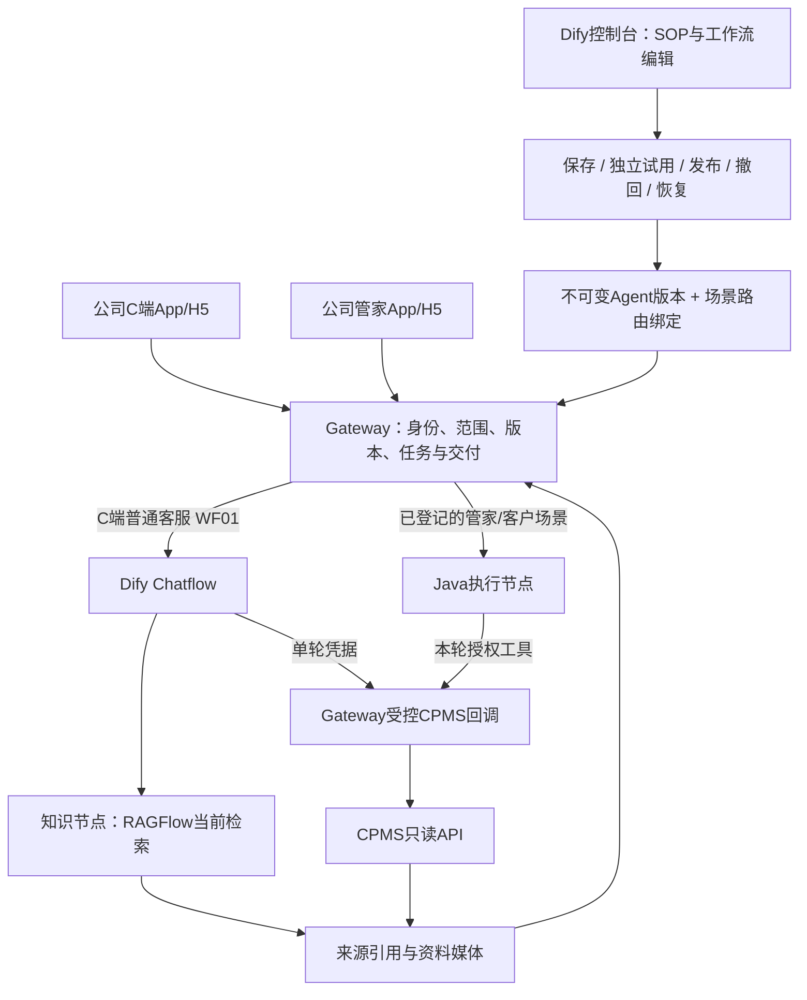

# 系统架构

更新：2026-10-28。本页描述现有代码与已验证执行路径；正式启用范围以[当前状态](agents/current-delivery-state.md)为准。
阶段规划见[系统策略](system-strategy-audit.md)，测试范围见[测试交接](testing-handoff.md)。

## 用户入口与执行职责

图中的管家页面箭头表示已实现的接口接线；公司源码已合并，正式页面部署和真人验收仍待证。
Java节点当前业务取证经Gateway受限转发，不代表已证明客户内网节点可直连任意业务系统。
固定FAQ、宣传案例、健康报告仍是各自既有产品面，不能把它们都称为WF01或Java节点。

## C端WF01

1. 原POST解析公司登录态与consumer本人范围，语义模型只选能力及订单指代；不能生成授权或业务事实。
2. 知识问题执行节点所选库的当前检索；状态/账务由独立HTTP步骤携单轮data_grant取数。
3. 授权绑定主体、环境、租户、QA、工作流及订单，读前读后、完成与回读都检查当前权限/取消/有效期。
4. 知识模型组织有来源的正文；实时状态/金额按本轮CPMS快照确定性渲染，不猜币种或银行到账。
5. App语言进入分类、Dify输入与固定文案；正文语言守卫可阻止中文泄漏，不能替代母语质量验收。

工作流和库选择随发布版本固定，库内资料新增/更新/删除在索引完成后影响新问题。
不再依赖KB编号、approved字段、content.json或媒体ID映射；旧模式仅用于显式恢复兼容。
每轮检索快照用于引用和一致性，不是额外的内容审核层。详见[WF01](agents/consumer-wf01/README.md)。

## 管家节点与发布绑定

管家携个人公司Bearer与operator入口，按当前站点或合法主账号范围授权。
`cpms_order_detail`、`cpms_charging_samples`为两个正式CPMS工具；只接受固定参数和有界响应，
不允许模型提交SQL、换租户或使用共享租户凭据扩大范围。监测首批最多50条，不等于完整时间线。

发布权威复用agents.published_version及不可变agent_versions；chat_route_bindings绑定版本与实际路线。
保存草稿不影响App；试用独立运行；发布切正式版本；撤回保留路由行并停止后续交付，恢复读历史快照。
Dify工具选择须发布后进入节点清单；全关不恢复默认工具。实际执行与完成均核对清单和节点身份。
详见[管家手册](agents/operator-cpms/README.md)、[节点发布](agents/m3-node-publication.md)。

## Python 旧执行器退役

本分支按用户决定删除 Thin Harness 与诊断/设备 CLI，C端检测进入 C端工作流状态分支，
管家及其试用使用 Java 节点，Dify 草稿按应用绑定执行。没有绑定时拒绝，不启动 Python 回退。
共享授权、发布、知识与存储保留；不等同于生产已经部署。见[退役说明](runtime-retirement.md)。

## 基于后端的业务规则

初始规则来自用户提供的后端快照：

- 订单状态：`CommonConstant` 和 `ChOrderInfo` 定义状态 2 为不可控异常、3 为异常已处理、5 为设备已上报但异常结束。
- 交易匹配：OCPP 使用 `transaction_id`；AYK、YKC 和其他非 OCPP 协议使用订单号，符合后端事件查询路径。
- 计费侧：`FourPriceComputeComponent` 对 OCPP 和 AYK 使用服务端计费，其他协议使用桩端计费。
- operator 订单：`launch_type=operator` 绕过标准停止充电计费流程，直接用 `tx_data.totalFee` 检查订单总额，不套用费率模板和标准结算检查。
- 桩端计费：平台电费根据分时电量和费率模板计算；服务费为 `max(tx_data.totalFee - electricity_fee, 0)`。
- 订单总额：`ChOrderInfo.collectFee()` 汇总电费、服务费、启动费、停车费、电损电费和电损服务费。
- YKC 异常结束：64-73 视为正常结束，其他设备上报码通常标记为状态 5。
- 交易完整性：可解析的 `tx_data` 视为已收到证据，即使独立接收标志不一致；充电订单结束前不强制要求交易结束数据。
- 两轮车订单：当前版本标记为不支持并降低置信度，不套用四轮车计费和枪时序规则。
- 置信度：证据源失败、跳过或金额快照缺失都会降低置信度，不能用残缺证据链报告高确定性。

## 部署与信息边界

Gateway、Dify、RAGFlow、节点是不同制品与生命周期，部署成功不能证明场景已启用。
现有服务宿主通过合并制品交付；访问、端口和凭据位置见受控运维记录及[环境手册](agents/env-41-runbook.md)。
不在本页复制主机地址或秘密。现役健康/聚合与授权源仍需最小权限账号及有界数据读取。

开发机只运行隔离验证；生产变更、流量切换和旧服务退役各自保留授权、制品身份、验收及恢复路径。
AFK是独立开发治理面，不是用户业务引擎，见[AFK](afk-workflow.md)。

本页Mermaid是当前职责图；`docs/architecture/ai-ops-architecture.*`保留为早期诊断内核图快照，
不再用来判断当前C端/Dify/节点的交付程度。

旧[architecture.md](architecture.md)和根SOP作为历史资料保留，不再进入模型工作区或 Python 包。
本页面向工程/测试的系统全景，不替换模型运行时业务参考。
