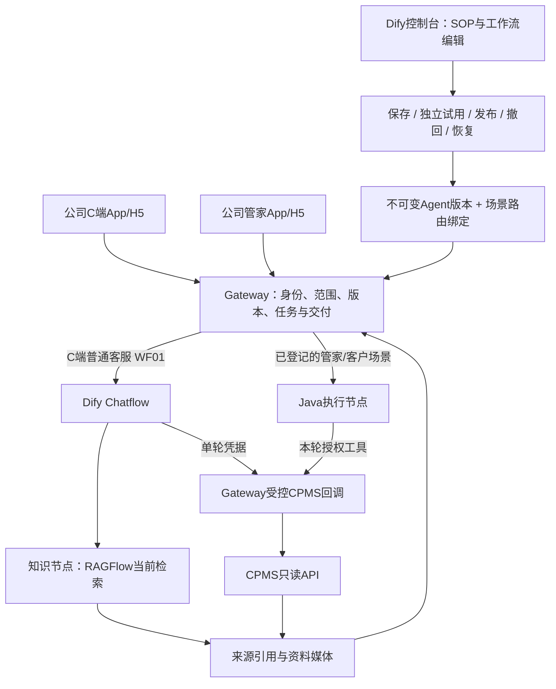

# 系统架构

更新：2026-11-04。本页描述现有代码与已验证执行路径；正式启用范围以[当前状态](agents/current-delivery-state.md)为准。
阶段规划见[系统策略](system-strategy-audit.md)，测试范围见[测试交接](testing-handoff.md)。

## 用户入口与执行职责

管家原H5与Dify预览已有真实链路验收；首页新增入口后来撤回，原聊天页仍可访问。
正式启用和剩余业务范围按交付索引核对，不能由图中的箭头推断全场景已验。
Java节点当前业务取证经Gateway受限转发，不代表已证明客户内网节点可直连任意业务系统。
固定FAQ、宣传案例、健康报告仍是各自既有产品面，不能把它们都称为WF01或Java节点。

## C端客服 Agent 与受控数据

新合同callback_version 6：原App自然输入 → Gateway身份/会话 → Dify官方Agent工具循环 → 自然答复。
模型可以组合本人订单、状态、账务与知识；Gateway不预先选择互斥能力，不再要求最终JSON和事实占位符。
工具只能访问已发布范围，不能提交身份、地址或SQL；知识库在节点配置中固定，授权由Gateway注入，
不进入模型工具schema。并发预算、取消、撤权和来源记录由Gateway执行。

完整问答历史保留在已有会话表。历史业务对象及知识授权在复用与回读时重新核验；
旧快照用于解释历史，当前状态必须重新查询。运行/取数凭据仍为180秒，结束即撤销；
这与会话寿命独立。最终正文保存为同轮不可变答复，来源链接/媒体保留确定性来源校验；
不能把语义准确性当作由数字词表或句式校验已证明。

Dify编辑仍是业务提示词与知识库选择的入口，保存/试用/发布/恢复沿原生命周期。
旧callback1–5保留原分支/表达规则供恢复。该改造的生产迁移、H5和安卓范围须分别看
[当前交付](agents/current-delivery-state.md)与[验收计划](agents/consumer-wf01/agent-conversation-qa.md)。

## 管家统一模型循环与发布绑定

管家个人公司Bearer在Gateway解析，权限来自当前主体与站点范围；模型仅提议业务对象，
不能提交租户、凭据、SQL或任意地址。原H5与Dify预览走同一operator-agent/1合同。

1. Gateway冻结应用已发布SOP、工具和模型，加载同会话已完成问题及实际回答；旧对象先重新授权。
2. Java执行节点从Gateway取受控消息，逐轮核验输入、系统、工具与模型。最多12次模型调用，
   持续错误停止；C端仍沿用自己的状态/知识流程。
3. 模型理解问题后选择订单或站点工具，订单读取前才绑定对象；同run只允许一笔已授权订单。
   订单详情、监测、历史模板、账务保留原始取证权限与字段投影，监测最多第一页50条。
4. 金额核验和过程统计作为工具把确定性结果交回模型，模型可据此继续取证。最终直接输出
   自然语言，不再强制JSON正文、字段路径占位符或整块后台字段。
5. Gateway核对答复与证据一致性，重新检查权限/取消后冻结最终回答。语义复核不是
   对任意推理正确性的保证；不将局部算术一致写成计量、优惠资格或银行到账已证明。

站点查询及未来费用估算使用同一模型循环，工具可见性按已发布选择；不因一句话没有订单号
自动更换协议或补开工具。当前原始交易、通讯报文及队列证据仍有缺口，SOP必须明确部分排查。

Dify编辑区是业务SOP的可编辑来源，repo提供只读种子与规则依据；保存不切正式、预览独立，
发布以不可变agent_versions及chat_route_bindings切换。节点/JAR/声明/Gateway/应用须成套迁移，
新协议不兼容旧工具参数；旧正式版本仅配原制品用于恢复，不静默升级其权限。
详情见[管家手册](agents/operator-cpms/README.md)、[改造验收](acceptance/operator-agent-loop-qa-plan.md)。
本节描述候选实现；是否已经完成生产迁移仍以当前交付索引和本次验收记录为准。

## Python 旧执行器退役

Thin Harness 与诊断/设备 CLI 已退役并完成部署验收，C端检测进入 C端工作流状态分支，
管家及其试用使用 Java 节点，Dify 草稿按应用绑定执行。没有绑定时拒绝，不启动 Python 回退。
共享授权、发布、知识与存储保留。见[退役说明](runtime-retirement.md)及其真实验收记录。

## 后端业务规则参考（不等于现役工具覆盖）

以下来自早期后端快照，用于理解业务；旧执行器已退役。现役CPMS工具没有完整计费规则、
协议报文与故障源，不能按这份参考直接生成诊断结论或承诺能读取下列所有字段：

- 订单状态：`CommonConstant` 和 `ChOrderInfo` 定义状态 2 为不可控异常、3 为异常已处理、5 为设备已上报但异常结束。
- 交易匹配：OCPP 使用 `transaction_id`；AYK、YKC 和其他非 OCPP 协议使用订单号，符合后端事件查询路径。
- 计费侧：`FourPriceComputeComponent` 对 OCPP 和 AYK 使用服务端计费，其他协议使用桩端计费。
- operator 订单：`launch_type=operator` 绕过标准停止充电计费流程，直接用 `tx_data.totalFee` 检查订单总额，不套用费率模板和标准结算检查。
- 桩端计费：平台电费根据分时电量和费率模板计算；服务费为 `max(tx_data.totalFee - electricity_fee, 0)`。
- 订单总额：`ChOrderInfo.collectFee()` 汇总电费、服务费、启动费、停车费、电损电费和电损服务费。
- YKC 异常结束：64-73 视为正常结束，其他设备上报码通常标记为状态 5。
- 交易完整性：可解析的 `tx_data` 视为已收到证据，即使独立接收标志不一致；充电订单结束前不强制要求交易结束数据。
- 两轮车订单：当前版本标记为不支持并降低置信度，不套用四轮车计费和枪时序规则。
- 置信度：证据源失败、跳过或金额快照缺失都会降低置信度，不能用残缺证据链报告高确定性。

## 部署与信息边界

Gateway、Dify、RAGFlow、节点是不同制品与生命周期，部署成功不能证明场景已启用。
现有服务宿主通过合并制品交付；访问、端口和凭据位置见受控运维记录及[环境手册](agents/env-41-runbook.md)。
不在本页复制主机地址或秘密。现役健康/聚合与授权源仍需最小权限账号及有界数据读取。

开发机只运行隔离验证；生产变更、流量切换和旧服务退役各自保留授权、制品身份、验收及恢复路径。
AFK是独立开发治理面，不是用户业务引擎，见[AFK](afk-workflow.md)。

本页Mermaid是当前职责图；`docs/architecture/ai-ops-architecture.*`保留为早期诊断内核图快照，
不再用来判断当前C端/Dify/节点的交付程度。

旧[architecture.md](architecture.md)和根SOP作为历史资料保留，不再进入模型工作区或 Python 包。
本页面向工程/测试的系统全景，不替换模型运行时业务参考。
