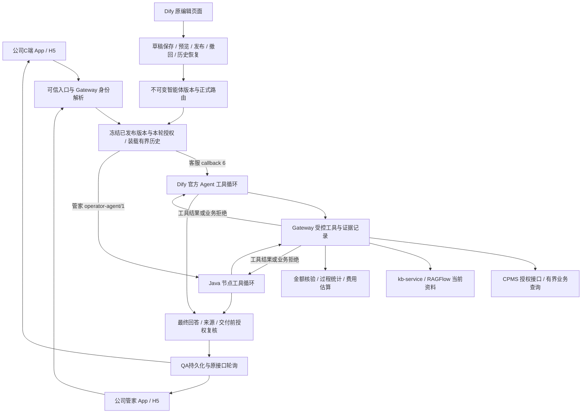

# 系统架构

核对日期：2026-11-05；代码基线 `c2316e4a`。本页描述现役职责与合同，不声明每个租户都已启用全部工具。
运行制品和真实验收见[交付状态](agents/current-delivery-state.md)，待办见[阶段台账](reviews/2026-11-05-architecture-stage-closeout.md)。

## 业务主线

用户提出问题，模型结合业务SOP与会话历史决定需要哪些证据，调用受控工具，再根据结果回答或澄清。
模型负责理解、选择和表达；系统负责身份、范围、计算、预算、取消与结果交付。退款、停充、改单、
重放和重启不在业务工具范围。管理人员发布工作流属于配置生命周期，不是模型获得了业务写权限。

两条执行链各有一个工具循环主控；Dify在管家链中是编辑和试用入口，业务模型循环在Java节点。
Gateway不因模型失败自动换引擎，也不恢复旧Python执行器。固定FAQ、健康报告和运维聚合是独立产品面，
不经过这两条聊天循环的每一个步骤。实现入口见[README模块索引](../README.md#三系统模块与依赖关系)。

## 客服链：一个问题可组合多种证据

1. 原 `POST /v1/assistant/questions` 解析消费者登录态，核本人范围、正式绑定及可选订单。
   `callback_version=6`直接进入Agent，不先运行旧意图分类器或关键词分流。
2. Gateway把已完成问题、实际答案和已授权对象组织成有界上下文；每次调用Dify都显式传入它，
   不依赖Dify隐式历史保存授权。当前读取最近6个已完成回合，并设单条和总字符上限；不是无限历史。
3. 官方Agent通过受控客服插件选择 `knowledge`、`orders`、`status`、`billing`、`support`。
   模型只提业务参数；库选择由发布图固定，身份、grant与可信地址不由模型生成。
   本人最近订单按业务记录时间排序；状态和账务重新取数；support只返回联系指引，不代表已经接通人工。
4. Gateway在取数前后、完成和回读时检查本轮状态、绑定、对象与知识权限。180秒运行/取数寿命与历史寿命分离；
   本轮最多8次工具调用，失败及并发尝试计入预算，结束撤销凭据。旧答案只能解释历史，不能冒充当前事实。
5. 仅取官方Agent最后成功且无工具调用轮次的正文；SSE运行、任务与消息身份也须一致。
   工具过程不混进正文，来源/媒体来自实际工具记录，脱敏只保留已授权取证的订单标识。

原 `GET /v1/assistant/questions/{qa_id}` 返回冻结结果；同页后续POST携带Gateway的 `conversation_id`。
换发布版或历史依赖撤权时可要求新会话。旧APK缺此字段不能靠服务端猜测补齐；H5和APK分别验收。
正式App强制消费者本人；原Dify运营预览使用公司身份，只允许明确选中的已授权订单，禁止管理员列单/换单。

实现：`consumer_agent.py`、`consumer_chat_service.py`、`dify_chatflow.py`、`dify_run_store.py`。
决定见[ADR 0232](adr/0232-consumer-agent-conversation.md)，操作与兼容见[客服手册](agents/consumer-wf01/README.md)。
旧callback1–5仍用于显式恢复，其分类器、模板和短期上下文规则不是新版客服的主路径。

## 管家链：SOP决定取证步骤，工具承担计算

Gateway解析公司个人Bearer与当前站点范围，冻结已发布SOP、模型、工具及有界历史，交给Java节点。
节点核对清单、工具声明与模型，每轮最多12次模型调用；没有订单号也可咨询或查站点。
模型提议单号后，Gateway先校验来源、存在与归属，再绑定本轮唯一订单；跨回合可明确切换。

| 工具类别 | 现役声明 | 数据与限制 |
|---|---|---|
| 订单与监测 | `cpms_order_detail`、`cpms_charging_samples` | CPMS详情和第一页最多50条样本；缺样本不等于设备无故障 |
| 历史费用 | `cpms_order_tariff`、`cpms_order_billing` | 订单历史模板、账务与优惠记录；不能用当前站点价替代历史价 |
| 确定性分析 | `cpms_order_amount_check`、`cpms_order_process_stats` | 只计算本轮已取得证据，模型不能提交金额作为核验事实 |
| 站点与计划 | `cpms_site_search`、`cpms_station_plan` | 当前可见站点；指定站点、日期、时区、电量、功率、同日时间窗内单次连续充电估算 |
| 时序遥测 | `cpms_charging_timeline` | 需独立tsdata接口配置；声明存在不等于每个环境可用 |

唯一声明为 `operator/operator_tools.json`，实际可用集合还受应用发布选择和节点能力约束。
四项金额核验提供公式、记录值、计算值、差额和限制；局部算术相符不能推出优惠资格、原始计量、
支付到账或整单无多收。未来方案不承诺实时空闲、预约成功、任意跨日或充电功率恒定的实际结果。

可纠正的业务拒绝回喂模型；协议、撤权与发布改变仍终止运行并保留原始原因。
失败/迟到上报经协议身份闸收存，执行和成功交付继续经过完整授权闸；收存证据不等于允许对用户交付。
最终自然正文附本轮来源，事实复核包含受限模型检查及站名抽取后的程序归属核对；币种仅观察，不单独拒绝，不能保证任意语义正确。
已取得证据后模型回答未通过或生成失败时，程序交付本轮授权记录并明确诊断未完成，
不再盲重派；无证据或取消/撤权仍拒绝。运行日志单独标识仅交付证据，见
[证据交付合同](agents/operator-cpms/evidence-delivery.md)。
已修复的JSON/字段占位符协议不再约束新回答。

实现：`operator_agent.py`、`operator_cpms.py`、`operator_answer_review.py`及Java `ReportingChatSessionRuntime`。
见[管家手册](agents/operator-cpms/README.md)、[原入口证据](validation/2026-11-05-operator-agent-live.md)、
[第二租户恢复](validation/2026-11-05-secondary-operator-route-recovery.md)、[拒绝上报补验](validation/2026-11-05-split-callback-gate-f4a-replay-41.md)。

## 共享身份、数据与持久化

| 概念 | 权威与边界 |
|---|---|
| 身份与入口 | C端经可信代理转发登录态，Gateway读取会话身份；管家用公司个人Bearer。入口由可信接入链约束，前端自报租户/用户不能授权 |
| 能力与数据范围 | `identity.capability`记录asserted/derived/unasserted来源；只有asserted按scope集合判定，另两档仍需角色和数据范围。`required_scope`不是新授予权限 |
| 订单归属 | `identity.data_scope_rule`、`order_visibility`、`query_scope`共享范围规则；本人、站点与租户是不同约束，模型提出对象不等于对象可见 |
| 环境与租户 | `deployment_environment`统一部署身份；业务环境目录指定可信依赖，租户隔离叠加在环境之内，不能由模型改目标 |
| 知识工作区 | 公司租户/环境映射Dify与RAGFlow空间。选库随发布冻结，库内正文在解析索引后实时生效；知识文本是数据，不是越权指令 |
| 会话与问答 | `conversations`/`conversation_turns`保存归属与回合，`assistant_questions`保存QA状态/最终结果；同会话串行与历史再授权由Gateway执行 |
| 运行与授权 | `agent_runs`记录节点运行，`chat_dify_runs`记录Dify运行，短期grant绑定本轮权限；内部运行ID、QA ID、会话ID与上游Dify ID不能混用 |
| 发布与审计 | `agent_versions`保存版本，`chat_route_bindings`选择正式路线，`publish_audit_ledger`记录发布尝试；`standard_diagnoses`保留承载试用等内部记录，不意味着旧HTTP端点仍开放 |

以上应用账本集中于Gateway的SQLite存储；连接事务由 `gateway.gateway_db` 的具名profile统一。
1.7.0的28张表结构由 `gateway.gateway_schema` 单点声明，构造只读版本，启动完整检查。
旧库在一个写事务内补齐结构、复核后写版本；切WAL的BUSY单独有界等待，业务事务不重试。
独立登录映射 `mappings.db` 不合库；历史scope_json默认值差异保留，未知结构拒绝。
决策与运行方法见[ADR0244](adr/0244-gateway-schema-authority.md)和[升级手册](agents/gateway-schema-runbook.md)。
Dify、RAGFlow和业务CPMS各有自己的持久化与生命周期，不是一个数据库事务。身份/健康/聚合仍有
受控数据库读取，不能把“模型只用受限工具”误写成“所有后端数据访问都只走CPMS HTTP”。

## 聊天以外的现役功能

| 功能 | 执行与数据 | 与智能问答的关系 |
|---|---|---|
| 固定FAQ、推荐与案例 | 已发布内容按问题标识读取，不调用模型、不读订单 | 固定入口，不用来掩盖自由提问失败 |
| 快捷动作与横幅 | 按租户/入口发布；提示动作提交问题，跳转动作只导航 | 展示配置不授予数据权限，也不决定模型完整取证计划 |
| 充电健康报告 | `health-report-jobs`异步计算指标/曲线；有界业务数据、规则版本与缺失原因 | 独立于故障诊断；#602客户端报告页仍开放 |
| 运维分析 | 站点集合和时间窗内只读聚合，程序计算统计，模型生成受约束说明 | 跨订单统计，不是给一笔订单套异常率；支付结果不等于支付失败原因 |
| 知识管理 | 公司登录、工作区准入、上传/解析/同步/检索及来源媒体授权 | 资料管理与用户查询分开授权，解析成功不等于回答正确 |

这些接口复用身份、范围与作业存储，不能因聊天通过就视为都完成原页面验收。
旧通用试用仍保留固定调试租户兼容分支；现役受管客服/管家预览走已验证公司身份，
不能把兼容调试身份当作生产用户的授权来源。

## 管理、部署与运行边界

Dify草稿是可编辑内容；保存不切正式，试用冻结独立候选，发布才更新不可变版本和场景路由。
恢复是把选定历史版本重新绑定并递增revision，不倒写旧revision；恢复正式版与还原草稿是两步。
开通还需环境登记、工作区、知识连接、模型/插件、Service key及节点能力，任务成功与用户问答通过分别判定。

| 制品/入口 | 交付责任 |
|---|---|
| Gateway | 合并main的源码/依赖制品经标准CD；启动预检、节点版本闸、健康与逐文件SHA核验 |
| Java节点、声明、回调 | 按协议成套构建与交付；只改Gateway不能证明节点/JAR已更新 |
| Dify、桥、登录代理、插件、网页 | 各自版本化资产与管理接口；Gateway CD不会自动发布应用或重建全部Dify服务 |
| RAGFlow与kb-service | 资料、索引、工作区和服务独立维护；检索可达不证明资料适用 |
| 公司H5、APK/IPA | 公司源码与打包流程独立；H5上线不等于手机安装包已更新 |
| CI/AFK/镜像同步 | 开发治理面；必需CI、审查处理、合并、部署、业务验收各有结果，GitLab镜像不作为运行来源 |

方法见[运维导航](../ops/README.md)及[交付手册](agents/actions-delivery.md)；具体主机地址、凭据与证据原件留在受控记录。
本阶段未证明客户内网独立节点拓扑、全租户/全语言、长期稳定性或真实故障根因准确率。

## 历史与残余设计

Python Thin Harness、Codex子进程、旧七工具、共享服务主体provider和 `/v1/standard/diagnoses` 已退役，
不作故障回退；历史数据及显式恢复合同保留。旧 `architecture.md`、早期架构图片是历史快照。
根SOP提供业务参考，现役模型输入以已发布SOP和工具合同为准，不能把旧后端规则清单当成已取证事实。

当前仍有两套执行适配、旧callback兼容分支、事实复核和跨系统发布步骤。这些增加维护成本，
但不是重新加入自然语言关键词路由的理由；后续是否合并引擎，应由重复成本与用户证据驱动，不能只为图更整齐。
